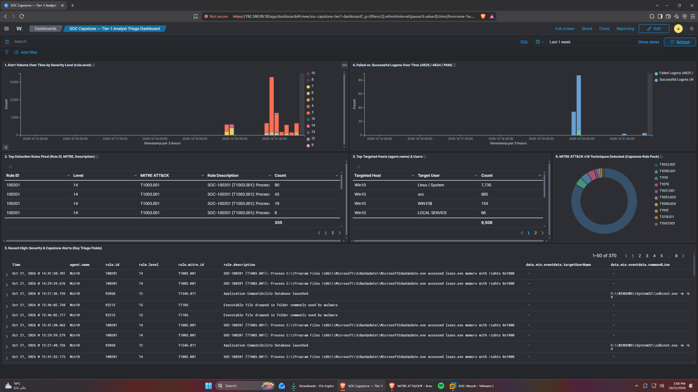

# Sub-task 1.4 — Custom SOC Tier-1 Analyst Dashboard (6 pts)

## 1. Live Dashboard Access

- **Direct Dashboard URL**: `https://192.168.99.10/app/dashboards#/view/soc-capstone-tier1-dashboard`
- **Credentials**: `admin` / `SecretPassword`
- **Exported Saved Objects Bundle**: [`soc_capstone_tier1_dashboard.ndjson`](../../detections/dashboard/soc_capstone_tier1_dashboard.ndjson) (the dashboard, its 6 panels, and the `SOC Capstone - Custom rule alerts` saved search)
- **Default time range**: last 7 days (stored with the dashboard). For screenshots of the original 2026-10-19 test run use an absolute range of 2026-10-19 17:30 – 19:30 UTC.



---

## 2. Dashboard Panels Specification (6 Panels)

| Panel # | Panel Title | Visualization Type | Index / Filter Query (KQL) | Tier-1 Analyst Purpose |
| :--- | :--- | :--- | :--- | :--- |
| **1** | `1. Alert Volume Over Time by Severity Level (rule.level)` | Stacked Bar Histogram | `wazuh-alerts-*` (`timestamp` x `rule.level`) | Detects alert spikes and separates Level 12–14 critical incidents (`100200`, `100201`, `100207`) from baseline Level 3–5 telemetry. |
| **2** | `2. Top Detection Rules Fired (Rule ID, MITRE, Description)` | Data Table | `rule.groups:soc_capstone` (top 25 `rule.id`) | Ranks the custom rules by volume alongside `rule.id`, `rule.level`, `rule.mitre.id`, and `rule.description` to spot noisy rules vs. high-priority detections. Scoped to the custom group because with `or rule.level >= 8` the built-in Sysmon rules filled the table and pushed 4 custom rules out; rows without a MITRE id show as `no MITRE id` instead of disappearing. |
| **3** | `3. Top Targeted Hosts (agent.name) & Users` | Data Table | `wazuh-alerts-*` (`agent.name` x `data.win.eventdata.targetUserName`) | Identifies which endpoints (`Win10`, `ubuntu-01`) and Windows accounts (e.g. `soc`) are under active attack. Linux alerts have no `targetUserName`, so they group under the empty user bucket - use `data.audit.auid` / `data.dstuser` in Discover for those. |
| **4** | `4. Failed vs. Successful Logons Over Time (4625 / 4624 / PAM)` | Stacked Bar Histogram | Filter 1: `rule.groups:authentication_failed or data.win.system.eventID:4625`<br/>Filter 2: `rule.groups:authentication_success or data.win.system.eventID:4624` | Visually correlates brute-force bursts (`100007`) against subsequent logon successes (`100200` / `100204`). |
| **5** | `5. Recent High-Severity & Capstone Alerts (Key Triage Fields)` | Saved Search Stream | `rule.groups:soc_capstone or rule.level >= 8` | Provides immediate one-screen triage context: `timestamp`, `agent.name`, `rule.id`, `rule.level`, `rule.mitre.id`, `rule.description`, `data.win.eventdata.targetUserName`, and `data.win.eventdata.commandLine`. |
| **6** | `6. MITRE ATT&CK v19 Techniques Detected (Capstone Rule Pack)` | Donut Chart | `rule.groups:soc_capstone` (`rule.mitre.id`) | Maps active alerts directly to MITRE ATT&CK v19 techniques (`T1059.001`, `T1110`, `T1003.001`, `T1105`, `T1053.003`, `T1098.004`, `T1021.001`, `T1218.011`, `T1547.001`, `T1070.001`). Wazuh 4.14.9's built-in ATT&CK data predates v19, so rule 100207 (v19 `T1685.005`) is shown under its v18 id `T1070.001`, and 100205 shows the tactic as Defense Evasion rather than Stealth. Alerts indexed before the 2026-10-22 rule update have no MITRE id for 100207. |

---

## 3. Re-Importing the Dashboard and the Alerting Monitor

From the repo root (Git Bash on the analyst PC):

```bash
lab/wazuh/apply_alerting.sh
```

It creates or updates the Alerting monitor and imports `soc_capstone_tier1_dashboard.ndjson` with `overwrite=true`. The bundle doesn't carry its own `wazuh-alerts-*` index pattern (importing a bare one would replace the Wazuh-managed pattern and its 810 fields). On a freshly rebuilt stack, open the Wazuh dashboard once first so the Wazuh app creates the pattern, then run the script.

---

## 4. Where Alerts Show Up

Wazuh 4.14 has no menu item called "Alerts". Alerts live in three places:

| Where | Path in the UI | What it shows |
| :--- | :--- | :--- |
| **Wazuh alert list** | Threat intelligence → Threat Hunting → **Events** | Every Wazuh alert (`wazuh-alerts-*`). Set the time range to cover the test and filter with `rule.groups:soc_capstone` for the custom rules. |
| **Alerting (OpenSearch)** | Explore → **Alerting** → Alerts tab | Alerts raised by the monitor `SOC Capstone - custom rule alerts` ([`../alerting/soc_capstone_custom_rules_monitor.json`](../alerting/soc_capstone_custom_rules_monitor.json)). It runs every minute over the last 5 minutes, one alert per rule × host, with severity 1 for level ≥ 12 (100200, 100201, 100207), 2 for level 10–11 (100005, 100007, 100013, 100202) and 3 for level 8–9 (100203, 100204, 100205, 100206). An alert stays Active while that rule keeps firing on that host and moves to Completed 5 minutes after the last hit; acknowledge it in the UI once triaged. No notification channel is configured (the lab has no mail server); the Alerts tab is the queue. |
| **Saved search** | Discover → Open → **SOC Capstone - Custom rule alerts** | All custom-rule alerts newest first with the triage columns (host, rule, level, MITRE, image/sourceImage, command line, target user, audit command). |
