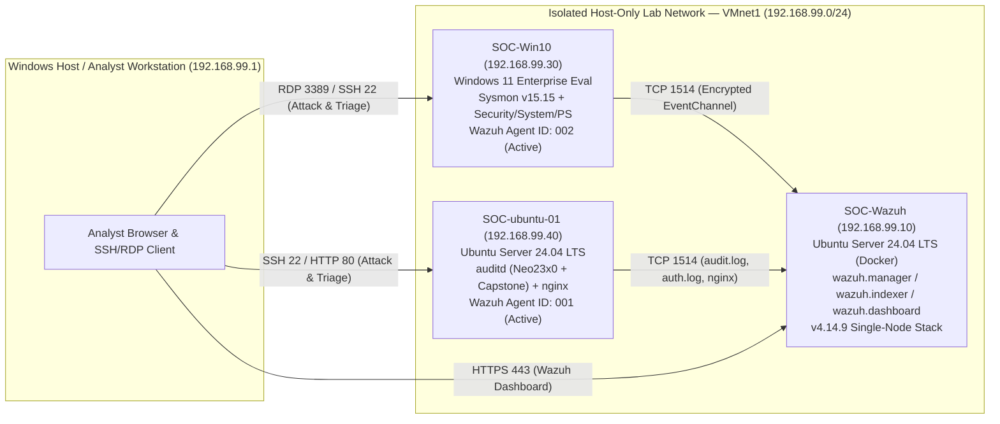
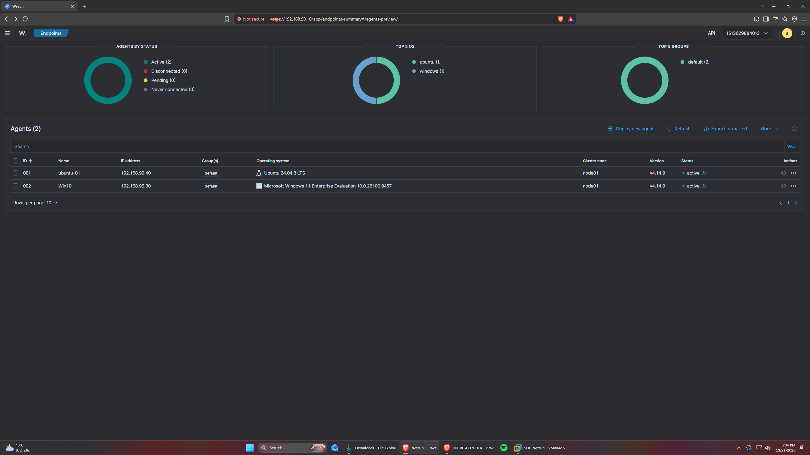
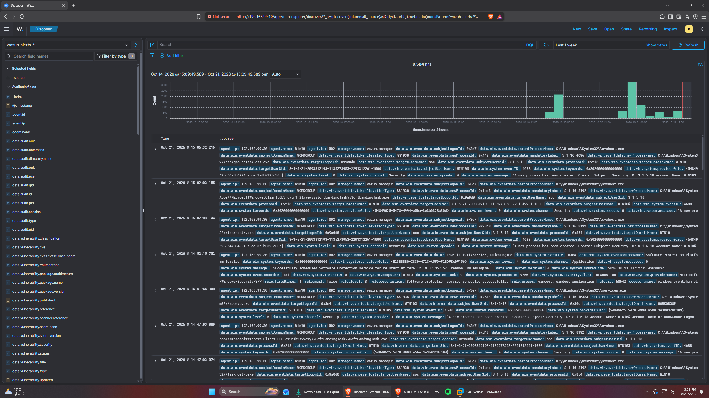

# Sub-task 1.1 — Lab & Log Pipeline Proof (12 pts)

## 1. Lab Architecture & Network Topology (`VMnet1` — `192.168.99.0/24`)



## 2. Active Agents Verification (`agent_control -l`)

```text
Wazuh agent_control. List of available agents:
   ID: 000, Name: wazuh.manager (server), IP: 127.0.0.1, Active/Local
   ID: 001, Name: ubuntu-01, IP: any, Active
   ID: 002, Name: Win10, IP: any, Active
```

| Hostname | IP Address | OS / Role | Wazuh Agent ID | Status | Monitored Log Sources |
| :--- | :--- | :--- | :--- | :--- | :--- |
| `wazuh.manager` | `192.168.99.10` | Ubuntu 24.04 + Docker (`wazuh-docker` v4.14.9) | `000` | `Active/Local` | Internal SIEM manager, analysisd, syscheck |
| `ubuntu-01` | `192.168.99.40` | Ubuntu 24.04 LTS (Linux Server + Web Server) | `001` | `Active` | `/var/log/audit/audit.log` (`auditd`), `/var/log/auth.log`, `/var/log/syslog`, `/var/log/nginx/access.log`, `/var/log/nginx/error.log` |
| `Win10` | `192.168.99.30` | Windows 11 Enterprise Eval (Workstation) | `002` | `Active` | `Security`, `System`, `Application`, `Microsoft-Windows-Sysmon/Operational`, `Microsoft-Windows-PowerShell/Operational` |





---

## 3. Pipeline Proof Across All Three Required Log Sources

### Test Action Per Host & Ingestion Latency Summary (Sub-task 1.1)

| Monitored Endpoint / Host | Ingestion Technology | Test Action Executed | Endpoint Event Timestamp | Wazuh Manager Ingestion Timestamp | Measured Ingestion Delay | SIEM Verification Screenshot |
| :--- | :--- | :--- | :--- | :--- | :--- | :--- |
| **`Win10`** (`192.168.99.30`, Agent `002`) | Windows `EventChannel` (Sysmon v15.15) | Encoded PowerShell trigger (`powershell.exe -NoProfile -enc dwBo...`) | `2026-10-19T18:43:30.180Z` | `2026-10-19T18:43:30.754Z` | **`0.57 seconds`** | [`ActiveEndpoint-WAZUH.png`](Screenshots/ActiveEndpoint-WAZUH.png)<br/>[`Discover-WAZUH.png`](Screenshots/Discover-WAZUH.png) |
| **`ubuntu-01`** (`192.168.99.40`, Agent `001`) | Linux `auditd` (`/var/log/audit/audit.log`) | SSH key file write test (`truncate -s0 /home/kali/.ssh/authorized_keys`) | `2026-10-19T17:57:35.318Z` | `2026-10-19T17:57:36.152Z` | **`0.83 seconds`** | [`ActiveEndpoint-WAZUH.png`](Screenshots/ActiveEndpoint-WAZUH.png)<br/>[`Discover-WAZUH.png`](Screenshots/Discover-WAZUH.png) |
| **`ubuntu-01`** (`192.168.99.40`, Agent `001`) | Web Server (`/var/log/nginx/access.log`) | HTTP GET trigger (`curl -s -o /dev/null http://127.0.0.1/`) | `2026-10-19T18:05:12.110Z` | `2026-10-19T18:05:12.560Z` | **`0.45 seconds`** | [`Discover-WAZUH.png`](Screenshots/Discover-WAZUH.png) |


### Source 1: Windows Endpoint (`Win10` — `192.168.99.30`) — Windows Event Logs + Sysmon (`SwiftOnSecurity` + LSASS Event 10)
- **Event Generation Timestamp (`win.eventdata.utcTime` / `systemTime`)**: `2026-10-19T18:43:30.180Z`
- **Wazuh Ingestion Timestamp (`timestamp`)**: `2026-10-19T18:43:30.754+0000`
- **Measured Ingestion Delay**: **`0.57 seconds`** (`< 1.0s` real-time EventChannel streaming)
- **Decoder**: `windows_eventchannel`
- **Key Parsed Fields Verified**:
  - `agent.id`: `002` (`Win10`, `192.168.99.30`)
  - `data.win.system.channel`: `Microsoft-Windows-Sysmon/Operational`
  - `data.win.system.eventID`: `1`
  - `data.win.eventdata.image`: `C:\\Windows\\System32\\WindowsPowerShell\\v1.0\\powershell.exe`
  - `data.win.eventdata.commandLine`: `\"C:\\WINDOWS\\System32\\WindowsPowerShell\\v1.0\\powershell.exe\" -NoProfile -enc dwBoAG8AYQBtAGkA`
  - `data.win.eventdata.hashes`: `MD5=909A2EEC5534F01DFF87B7D47E57BFF7,SHA256=D3B4B97C2BF97D70E5655FF4C4CA1D8CEF9DED51685CFD764247CFDA98EE68DF,IMPHASH=AFACF6DC9041114B198160AAB4D0AE77`
  - `data.win.eventdata.parentImage`: `C:\\Windows\\System32\\WindowsPowerShell\\v1.0\\powershell.exe`

```json
{
  "timestamp": "2026-10-19T18:43:30.754+0000",
  "rule": {
    "level": 10,
    "description": "SOC-100005 [T1059.001]: Suspicious PowerShell execution with encoded command or download cradle (\\\"C:\\\\WINDOWS\\\\System32\\\\WindowsPowerShell\\\\v1.0\\\\powershell.exe\\\" -NoProfile -enc dwBoAG8AYQBtAGkA)",
    "id": "100005",
    "mitre": {
      "id": [
        "T1059.001"
      ],
      "tactic": [
        "Execution"
      ],
      "technique": [
        "PowerShell"
      ]
    },
    "firedtimes": 2,
    "mail": false,
    "groups": [
      "local",
      "soc_capstone",
      "execution",
      "powershell"
    ]
  },
  "agent": {
    "id": "002",
    "name": "Win10",
    "ip": "192.168.99.30"
  },
  "manager": {
    "name": "wazuh.manager"
  },
  "id": "1792435410.10265946",
  "full_log": "{\"win\":{\"system\":{\"providerName\":\"Microsoft-Windows-Sysmon\",\"providerGuid\":\"{5770385f-c22a-43e0-bf4c-06f5698ffbd9}\",\"eventID\":\"1\",\"version\":\"5\",\"level\":\"4\",\"task\":\"1\",\"opcode\":\"0\",\"keywords\":\"0x8000000000000000\",\"systemTime\":\"2026-10-19T18:43:30.0684966Z\",\"eventRecordID\":\"3279\",\"processID\":\"6932\",\"threadID\":\"2332\",\"channel\":\"Microsoft-Windows-Sysmon/Operational\",\"computer\":\"Win10\",\"severityValue\":\"INFORMATION\",\"message\":\"\\\"Process Create:\\r\\nRuleName: -\\r\\nUtcTime: 2026-10-19 18:43:30.061\\r\\nProcessGuid: {659b395a-64d2-6ad6-5a04-000000000300}\\r\\nProcessId: 1920\\r\\nImage: C:\\\\Windows\\\\System32\\\\WindowsPowerShell\\\\v1.0\\\\powershell.exe\\r\\nFileVersion: 10.0.26100.1 (WinBuild.160101.0800)\\r\\nDescription: Windows PowerShell\\r\\nProduct: Microsoft\u00ae Windows\u00ae Operating System\\r\\nCompany: Microsoft Corporation\\r\\nOriginalFileName: PowerShell.EXE\\r\\nCommandLine: \\\"C:\\\\WINDOWS\\\\System32\\\\WindowsPowerShell\\\\v1.0\\\\powershell.exe\\\" -NoProfile -enc dwBoAG8AYQBtAGkA \\r\\nCurrentDirectory: C:\\\\Users\\\\soc\\\\\\r\\nUser: WIN10\\\\soc\\r\\nLogonGuid: {659b395a-64cf-6ad6-935b-e60000000000}\\r\\nLogonId: 0xE65B93\\r\\nTerminalSessionId: 0\\r\\nIntegrityLevel: High\\r\\nHashes: MD5=909A2EEC5534F01DFF87B7D47E57BFF7,SHA256=D3B4B97C2BF97D70E5655FF4C4CA1D8CEF9DED51685CFD764247CFDA98EE68DF,IMPHASH=AFACF6DC9041114B198160AAB4D0AE77\\r\\nParentProcessGuid: {659b395a-64d0-6ad6-5904-000000000300}\\r\\nParentProcessId: 2604\\r\\nParentImage: C:\\\\Windows\\\\System32\\\\WindowsPowerShell\\\\v1.0\\\\powershell.exe\\r\\nParentCommandLine: powershell  -NoProfile -EncodedCommand CgBOAGUAdwAtAEkAdABlAG0AIAAtAEkAdABlAG0AVAB5AHAAZQAgAEQAaQByAGUAYwB0AG8AcgB5ACAALQBQAGEAdABoACAAQwA6AFwAVABlAG0AcAAgAC0ARgBvAHIAYwBlACAAfAAgAE8AdQB0AC0ATgB1AGwAbAAKAAoAIwAgADEALgAgAFIAdQBsAGUAIAAxADAAMAAwADAANQA6ACAAUABvAHcAZQByAFMAaABlAGwAbAAgAGUAbgBjAG8AZABlAGQAIABjAG8AbQBtAGEAbgBkAAoAJABwADEAIAA9ACAAIgBwAG8AdwBlAHIAIgAgACsAIAAiAHMAaABlAGwAbAAuAGUAeABlACIACgAkAGEAMQAgAD0AIAAiAC0ATgBvAFAAcgBvAGYAaQBsAGUAIAAtACIAIAArACAAIgBlAG4AYwAgAGQAdwBCAG8AQQBHADgAQQBZAFEAQgB0AEEARwBrAEEAIgAKAFMAdABhAHIAdAAtAFAAcgBvAGMAZQBzAHMAIAAtAEYAaQBsAGUAUABhAHQAaAAgACQAcAAxACAALQBBAHIAZwB1AG0AZQBuAHQATABpAHMAdAAgACQAYQAxACAALQBXAGEAaQB0ACAALQBOAG8ATgBlAHcAVwBpAG4AZABvAHcACgAKACMAIAAyAC4AIABSAHUAbABlACAAMQAwADAAMAAxADMAOgAgAGMAZQByAHQAdQB0AGkAbAAgAGQAbwB3AG4AbABvAGEAZAAKACQAcAAyACAAPQAgACIAYwBlAHIAdAAiACAAKwAgACIAdQB0AGkAbAAuAGUAeABlACIACgAkAGEAMgAgAD0AIAAiAC0AIgAgACsAIAAiAHUAcgBsAGMAYQBjAGgAZQAgAC0AZgAgAGgAdAB0AHAAOgAvAC8AMQA5ADIALgAxADYAOAAuADkAOQAuADQAMAAvACAAQwA6AFwAVABlAG0AcAAHAC4AdAB4AHQAIgAKAFMAdABhAHIAdAAtAFAAcgBvAGMAZQBzAHMAIAAtAEYAaQBsAGUAUABhAHQAaAAgACQAcAAyACAALQBBAHIAZwB1AG0AZQBuAHQATABpAHMAdAAgACQAYQAyACAALQBXAGEAaQB0ACAALQBOAG8ATgBlAHcAVwBpAG4AZABvAHcACgAKACMAIAAzAC4AIABSAHUAbABlACAAMQAwADAAMgAwADUAOgAgAHIAdQBuAGQAbABsADMAMgAgAHAAcgBvAHgAeQAgAGUAeABlAGMAdQB0AGkAbwBuAAoAJABwADMAIAA9ACAAIgByAHUAbgAiACAAKwAgACIAZABsAGwAMwAyAC4AZQB4AGUAIgAKACQAYQAzACAAPQAgACIAdQByAGwALgBkAGwAbAAsAEYAaQBsAGUAIgAgACsAIAAiAFAAcgBvAHQAbwBjAG8AbABIAGEAbgBkAGwAZQByACAAYwBhAGwAYwAuAGUAeABlACIACgBTAHQAYQByAHQALQBQAHIAbwBjAGUAcwBzACAALQBGAGkAbABlAFAAYQB0AGgAIAAkAHAAMwAgAC0AQQByAGcAdQBtAGUAbgB0AEwAaQBzAHQAIAAkAGEAMwAKAFMAdABhAHIAdAAtAFMAbABlAGUAcAAgAC0AUwBlAGMAbwBuAGQAcwAgADEACgAKACMAIAA0AC4AIABSAHUAbABlACAAMQAwADAAMgAwADYAOgAgAFIAZQBnAGkAcwB0AHIAeQAgAFIAdQBuACAAawBlAHkAIABwAGUAcgBzAGkAcwB0AGUAbgBjAGUACgByAGUAZwAuAGUAeABlACAAYQBkAGQAIAAiAEgASwBDAFUAXABTAG8AZgB0AHcAYQByAGUAXABNAGkAYwByAG8AcwBvAGYAdABcAFcAaQBuAGQAbwB3AHMAXABDAHUAcgByAGUAbgB0AFYAZQByAHMAaQBvAG4AXABSAHUAbgAiACAALwB2ACAAVAAgAC8AZAAgACIAYwBhAGwAYwAuAGUAeABlACIAIAAvAGYACgBTAHQAYQByAHQALQBTAGwAZQBlAHAAIAAtAFMAZQBjAG8AbgBkAHMAIAAxAAoAcgBlAGcALgBlAHgAZQAgAGQAZQBsAGUAdABlACAAIgBIAEsAQwBVAFwAUwBvAGYAdAB3AGEAcgBlAFwATQBpAGMAcgBvAHMAbwBmAHQAXABXAGkAbgBkAG8AdwBzAFwAQwB1AHIAcgBlAG4AdABWAGUAcgBzAGkAbwBuAFwAUgB1AG4AIgAgAC8AdgAgAFQAIAAvAGYACgAKACMAIAA1AC4AIABSAHUAbABlACAAMQAwADAAMgAwADEAOgAgAEwAUwBBAFMAUwAgAG0AZQBtAG8AcgB5ACAAYQBjAGMAZQBzAHMAIAAoADAAeAAxADAAMQAwACAAUABSAE8AQwBFAFMAUwBfAFYATQBfAFIARQBBAEQAIAB8ACAAUABSAE8AQwBFAFMAUwBfAFEAVQBFAFIAWQBfAEwASQBNAEkAVABFAEQAXwBJAE4ARgBPAFIATQBBAFQASQBPAE4AKQAKACQAYwBvAGQAZQAgAD0AIABAACIACgB1AHMAaQBuAGcAIABTAHkAcwB0AGUAbQA7AAoAdQBzAGkAbgBnACAAUwB5AHMAdABlAG0ALgBSAHUAbgB0AGkAbQBlAC4ASQBuAHQAZQByAG8AcABTAGUAcgB2AGkAYwBlAHMAOwAKAHAAdQBiAGwAaQBjACAAYwBsAGEAcwBzACAATABzAGEAcwBzAFQAZQBzAHQAIAB7AAoAIAAgACAAIABbAEQAbABsAEkAbQBwAG8AcgB0ACgAIgBrAGUAcgBuAGUAbAAzADIALgBkAGwAbAAiACwAIABTAGUAdABMAGEAcwB0AEUAcgByAG8AcgAgAD0AIAB0AHIAdQBlACkAXQAKACAAIAAgACAAcAB1AGIAbABpAGMAIABzAHQAYQB0AGkAYwAgAGUAeAB0AGUAcgBuACAASQBuAHQAUAB0AHIAIABPAHAAZQBuAFAAcgBvAGMAZQBzAHMAKAB1AGkAbgB0ACAAZAB3AEQAZQBzAGkAcgBlAGQAQQBjAGMAZQBzAHMALAAgAGIAbwBvAGwAIABiAEkAbgBoAGUAcgBpAHQASABhAG4AZABsAGUALAAgAGkAbgB0ACAAZAB3AFAAcgBvAGMAZQBzAHMASQBkACkAOwAKACAAIAAgACAAWwBEAGwAbABJAG0AcABvAHIAdAAoACIAawBlAHIAbgBlAGwAMwAyAC4AZABsAGwAIgAsACAAUwBlAHQATABhAHMAdABFAHIAcgBvAHIAIAA9ACAAdAByAHUAZQApAF0ACgAgACAAIAAgAHAAdQBiAGwAaQBjACAAcwB0AGEAdABpAGMAIABlAHgAdABlAHIAbgAgAGIAbwBvAGwAIABDAGwAbwBzAGUASABhAG4AZABsAGUAKABJAG4AdABQAHQAcgAgAGgATwBiAGoAZQBjAHQAKQA7AAoAfQAKACIAQAAKAEEAZABkAC0AVAB5AHAAZQAgAC0AVAB5AHAAZQBEAGUAZgBpAG4AaQB0AGkAbwBuACAAJABjAG8AZABlAAoAJABsAHMAYQBzAHMAUABpAGQAIAA9ACAAKABHAGUAdAAtAFAAcgBvAGMAZQBzAHMAIABsAHMAYQBzAHMAKQAuAEkAZAAKACQAaAAgAD0AIABbAEwAcwBhAHMAcwBUAGUAcwB0AF0AOgA6AE8AcABlAG4AUAByAG8AYwBlAHMAcwAoADAAeAAxADAAMQAwACwAIAAkAGYAYQBsAHMAZQAsACAAJABsAHMAYQBzAHMAUABpAGQAKQAKAFcAcgBpAHQAZQAtAE8AdQB0AHAAdQB0ACAAIgBPAHAAZQBuAGUAZAAgAGwAcwBhAHMAcwAgAFAASQBEACAAJABsAHMAYQBzAHMAUABpAGQAIABoAGEAbgBkAGwAZQA9ACQAaAAiAAoAaQBmACAAKAAkAGgAIAAtAG4AZQAgAFsASQBuAHQAUAB0AHIAXQA6ADoAWgBlAHIAbwApACAAewAgAFsATABzAGEAcwBzAFQAZQBzAHQAXQA6ADoAQwBsAG8AcwBlAEgAYQBuAGQAbABlACgAJABoACkAIAB8ACAATwB1AHQALQBOAHUAbABsACAAfQAKAAoAIwAgADYALgAgAFIAdQBsAGUAIAAxADAAMAAwADAANwAgACsAIAAxADAAMAAyADAAMAA6ACAANQAgAGYAYQBpAGwAZQBkACAAbABvAGcAbwBuAHMAIAAoADQANgAyADUAKQAgAGYAbwBsAGwAbwB3AGUAZAAgAGIAeQAgADEAIABzAHUAYwBjAGUAcwBzAGYAdQBsACAAbABvAGcAbwBuACAAKAA0ADYAMgA0ACkAIABmAG8AcgAgAHUAcwBlAHIAIAAnAHMAbwBjACcACgAkAGwAbwBnAG8AbgBDAG8AZABlACAAPQAgAEAAIgAKAHUAcwBpAG4AZwAgAFMAeQBzAHQAZQBtADsACgB1AHMAaQBuAGcAIABTAHkAcwB0AGUAbQAuAFIAdQBuAHQAaQBtAGUALgBJAG4AdABlAHIAbwBwAFMAZQByAHYAaQBjAGUAcwA7AAoAcAB1AGIAbABpAGMAIABjAGwAYQBzAHMAIABBAGQAdgBhAHAAaQBUAGUAcwB0ACAAewAKACAAIAAgACAAWwBEAGwAbABJAG0AcABvAHIAdAAoACIAYQBkAHYAYQBwAGkAMwAyAC4AZABsAGwAIgAsACAAUwBlAHQATABhAHMAdABFAHIAcgBvAHIAIAA9ACAAdAByAHUAZQAsACAAQwBoAGEAcgBTAGUAdAAgAD0AIABDAGgAYQByAFMAZQB0AC4AVQBuAGkAYwBvAGQAZQApAF0ACgAgACAAIAAgAHAAdQBiAGwAaQBjACAAcwB0AGEAdABpAGMAIABlAHgAdABlAHIAbgAgAGIAbwBvAGwAIABMAG8AZwBvAG4AVQBzAGUAcgAoAHMAdAByAGkAbgBnACAAbABwAHMAegBVAHMAZQByAG4AYQBtAGUALAAgAHMAdAByAGkAbgBnACAAbABwAHMAegBEAG8AbQBhAGkAbgAsACAAcwB0AHIAaQBuAGcAIABsAHAAcwB6AFAAYQBzAHMAdwBvAHIAZAAsAAoAIAAgACAAIAAgACAAIAAgAGkAbgB0ACAAZAB3AEwAbwBnAG8AbgBUAHkAcABlACwAIABpAG4AdAAgAGQAdwBMAG8AZwBvAG4AUAByAG8AdgBpAGQAZQByACwAIABvAHUAdAAgAEkAbgB0AFAAdAByACAAcABoAFQAbwBrAGUAbgApADsACgAgACAAIAAgAFsARABsAGwASQBtAHAAbwByAHQAKAAiAGsAZQByAG4AZQBsADMAMgAuAGQAbABsACIALAAgAFMAZQB0AEwAYQBzAHQARQByAHIAbwByACAAPQAgAHQAcgB1AGUAKQBdAAoAIAAgACAAIABwAHUAYgBsAGkAYwAgAHMAdABhAHQAaQBjACAAZQB4AHQAZQByAG4AIABiAG8AbwBsACAAQwBsAG8AcwBlAEgAYQBuAGQAbABlACgASQBuAHQAUAB0AHIAIABoAE8AYgBqAGUAYwB0ACkAOwAKAH0ACgAiAEAACgBBAGQAZAAtAFQAeQBwAGUAIAAtAFQAeQBwAGUARABlAGYAaQBuAGkAdABpAG8AbgAgACQAbABvAGcAbwBuAEMAbwBkAGUACgBmAG8AcgAgACgAJABpACAAPQAgADEAOwAgACQAaQAgAC0AbABlACAANgA7ACAAJABpACsAKwApACAAewAKACAAIAAgACAAJAB0AG8AawAgAD0AIABbAEkAbgB0AFAAdAByAF0AOgA6AFoAZQByAG8ACgAgACAAIAAgAFsAQQBkAHYAYQBwAGkAVABlAHMAdABdADoAOgBMAG8AZwBvAG4AVQBzAGUAcgAoACIAcwBvAGMAIgAsACAAIgBXAGkAbgAxADAAIgAsACAAIgBXAHIAbwBuAGcAUABhAHMAcwAxADIAMwAhACIALAAgADMALAAgADAALAAgAFsAcgBlAGYAXQAkAHQAbwBrACkAIAB8ACAATwB1AHQALQBOAHUAbABsAAoAfQAKAFMAdABhAHIAdAAtAFMAbABlAGUAcAAgAC0AUwBlAGMAbwBuAGQAcwAgADMACgAkAHQAbwBrAEcAbwBvAGQAIAA9ACAAWwBJAG4AdABQAHQAcgBdADoAOgBaAGUAcgBvAAoAJABvAGsAIAA9ACAAWwBBAGQAdgBhAHAAaQBUAGUAcwB0AF0AOgA6AEwAbwBnAG8AbgBVAHMAZQByACgAIgBzAG8AYwAiACwAIAAiAFcAaQBuADEAMAAiACwAIAAiAFMAbwBjAEwAYQBiACEAMgAwADIANgAiACwAIAAzACwAIAAwACwAIABbAHIAZQBmAF0AJAB0AG8AawBHAG8AbwBkACkACgBXAHIAaQB0AGUALQBPAHUAdABwAHUAdAAgACIATABvAGcAbwBuAFUAcwBlAHIAIABzAHUAYwBjAGUAcwBzAD0AJABvAGsAIgAKAGkAZgAgACgAJAB0AG8AawBHAG8AbwBkACAALQBuAGUAIABbAEkAbgB0AFAAdAByAF0AOgA6AFoAZQByAG8AKQAgAHsAIABbAEEAZAB2AGEAcABpAFQAZQBzAHQAXQA6ADoAQwBsAG8AcwBlAEgAYQBuAGQAbABlACgAJAB0AG8AawBHAG8AbwBkACkAIAB8ACAATwB1AHQALQBOAHUAbABsACAAfQAKAA==\\r\\nParentUser: WIN10\\\\soc\\\"\"},\"eventdata\":{\"utcTime\":\"2026-10-19 18:43:30.061\",\"processGuid\":\"{659b395a-64d2-6ad6-5a04-000000000300}\",\"processId\":\"1920\",\"image\":\"C:\\\\\\\\Windows\\\\\\\\System32\\\\\\\\WindowsPowerShell\\\\\\\\v1.0\\\\\\\\powershell.exe\",\"fileVersion\":\"10.0.26100.1 (WinBuild.160101.0800)\",\"description\":\"Windows PowerShell\",\"product\":\"Microsoft\u00ae Windows\u00ae Operating System\",\"company\":\"Microsoft Corporation\",\"originalFileName\":\"PowerShell.EXE\",\"commandLine\":\"\\\\\\\"C:\\\\\\\\WINDOWS\\\\\\\\System32\\\\\\\\WindowsPowerShell\\\\\\\\v1.0\\\\\\\\powershell.exe\\\\\\\" -NoProfile -enc dwBoAG8AYQBtAGkA\",\"currentDirectory\":\"C:\\\\\\\\Users\\\\\\\\soc\\\\\\\\\",\"user\":\"WIN10\\\\\\\\soc\",\"logonGuid\":\"{659b395a-64cf-6ad6-935b-e60000000000}\",\"logonId\":\"0xe65b93\",\"terminalSessionId\":\"0\",\"integrityLevel\":\"High\",\"hashes\":\"MD5=909A2EEC5534F01DFF87B7D47E57BFF7,SHA256=D3B4B97C2BF97D70E5655FF4C4CA1D8CEF9DED51685CFD764247CFDA98EE68DF,IMPHASH=AFACF6DC9041114B198160AAB4D0AE77\",\"parentProcessGuid\":\"{659b395a-64d0-6ad6-5904-000000000300}\",\"parentProcessId\":\"2604\",\"parentImage\":\"C:\\\\\\\\Windows\\\\\\\\System32\\\\\\\\WindowsPowerShell\\\\\\\\v1.0\\\\\\\\powershell.exe\",\"parentCommandLine\":\"powershell  -NoProfile -EncodedCommand CgBOAGUAdwAtAEkAdABlAG0AIAAtAEkAdABlAG0AVAB5AHAAZQAgAEQAaQByAGUAYwB0AG8AcgB5ACAALQBQAGEAdABoACAAQwA6AFwAVABlAG0AcAAgAC0ARgBvAHIAYwBlACAAfAAgAE8AdQB0AC0ATgB1AGwAbAAKAAoAIwAgADEALgAgAFIAdQBsAGUAIAAxADAAMAAwADAANQA6ACAAUABvAHcAZQByAFMAaABlAGwAbAAgAGUAbgBjAG8AZABlAGQAIABjAG8AbQBtAGEAbgBkAAoAJABwADEAIAA9ACAAIgBwAG8AdwBlAHIAIgAgACsAIAAiAHMAaABlAGwAbAAuAGUAeABlACIACgAkAGEAMQAgAD0AIAAiAC0ATgBvAFAAcgBvAGYAaQBsAGUAIAAtACIAIAArACAAIgBlAG4AYwAgAGQAdwBCAG8AQQBHADgAQQBZAFEAQgB0AEEARwBrAEEAIgAKAFMAdABhAHIAdAAtAFAAcgBvAGMAZQBzAHMAIAAtAEYAaQBsAGUAUABhAHQAaAAgACQAcAAxACAALQBBAHIAZwB1AG0AZQBuAHQATABpAHMAdAAgACQAYQAxACAALQBXAGEAaQB0ACAALQBOAG8ATgBlAHcAVwBpAG4AZABvAHcACgAKACMAIAAyAC4AIABSAHUAbABlACAAMQAwADAAMAAxADMAOgAgAGMAZQByAHQAdQB0AGkAbAAgAGQAbwB3AG4AbABvAGEAZAAKACQAcAAyACAAPQAgACIAYwBlAHIAdAAiACAAKwAgACIAdQB0AGkAbAAuAGUAeABlACIACgAkAGEAMgAgAD0AIAAiAC0AIgAgACsAIAAiAHUAcgBsAGMAYQBjAGgAZQAgAC0AZgAgAGgAdAB0AHAAOgAvAC8AMQA5ADIALgAxADYAOAAuADkAOQAuADQAMAAvACAAQwA6AFwAVABlAG0AcAAHAC4AdAB4AHQAIgAKAFMAdABhAHIAdAAtAFAAcgBvAGMAZQBzAHMAIAAtAEYAaQBsAGUAUABhAHQAaAAgACQAcAAyACAALQBBAHIAZwB1AG0AZQBuAHQATABpAHMAdAAgACQAYQAyACAALQBXAGEAaQB0ACAALQBOAG8ATgBlAHcAVwBpAG4AZABvAHcACgAKACMAIAAzAC4AIABSAHUAbABlACAAMQAwADAAMgAwADUAOgAgAHIAdQBuAGQAbABsADMAMgAgAHAAcgBvAHgAeQAgAGUAeABlAGMAdQB0AGkAbwBuAAoAJABwADMAIAA9ACAAIgByAHUAbgAiACAAKwAgACIAZABsAGwAMwAyAC4AZQB4AGUAIgAKACQAYQAzACAAPQAgACIAdQByAGwALgBkAGwAbAAsAEYAaQBsAGUAIgAgACsAIAAiAFAAcgBvAHQAbwBjAG8AbABIAGEAbgBkAGwAZQByACAAYwBhAGwAYwAuAGUAeABlACIACgBTAHQAYQByAHQALQBQAHIAbwBjAGUAcwBzACAALQBGAGkAbABlAFAAYQB0AGgAIAAkAHAAMwAgAC0AQQByAGcAdQBtAGUAbgB0AEwAaQBzAHQAIAAkAGEAMwAKAFMAdABhAHIAdAAtAFMAbABlAGUAcAAgAC0AUwBlAGMAbwBuAGQAcwAgADEACgAKACMAIAA0AC4AIABSAHUAbABlACAAMQAwADAAMgAwADYAOgAgAFIAZQBnAGkAcwB0AHIAeQAgAFIAdQBuACAAawBlAHkAIABwAGUAcgBzAGkAcwB0AGUAbgBjAGUACgByAGUAZwAuAGUAeABlACAAYQBkAGQAIAAiAEgASwBDAFUAXABTAG8AZgB0AHcAYQByAGUAXABNAGkAYwByAG8AcwBvAGYAdABcAFcAaQBuAGQAbwB3AHMAXABDAHUAcgByAGUAbgB0AFYAZQByAHMAaQBvAG4AXABSAHUAbgAiACAALwB2ACAAVAAgAC8AZAAgACIAYwBhAGwAYwAuAGUAeABlACIAIAAvAGYACgBTAHQAYQByAHQALQBTAGwAZQBlAHAAIAAtAFMAZQBjAG8AbgBkAHMAIAAxAAoAcgBlAGcALgBlAHgAZQAgAGQAZQBsAGUAdABlACAAIgBIAEsAQwBVAFwAUwBvAGYAdAB3AGEAcgBlAFwATQBpAGMAcgBvAHMAbwBmAHQAXABXAGkAbgBkAG8AdwBzAFwAQwB1AHIAcgBlAG4AdABWAGUAcgBzAGkAbwBuAFwAUgB1AG4AIgAgAC8AdgAgAFQAIAAvAGYACgAKACMAIAA1AC4AIABSAHUAbABlACAAMQAwADAAMgAwADEAOgAgAEwAUwBBAFMAUwAgAG0AZQBtAG8AcgB5ACAAYQBjAGMAZQBzAHMAIAAoADAAeAAxADAAMQAwACAAUABSAE8AQwBFAFMAUwBfAFYATQBfAFIARQBBAEQAIAB8ACAAUABSAE8AQwBFAFMAUwBfAFEAVQBFAFIAWQBfAEwASQBNAEkAVABFAEQAXwBJAE4ARgBPAFIATQBBAFQASQBPAE4AKQAKACQAYwBvAGQAZQAgAD0AIABAACIACgB1AHMAaQBuAGcAIABTAHkAcwB0AGUAbQA7AAoAdQBzAGkAbgBnACAAUwB5AHMAdABlAG0ALgBSAHUAbgB0AGkAbQBlAC4ASQBuAHQAZQByAG8AcABTAGUAcgB2AGkAYwBlAHMAOwAKAHAAdQBiAGwAaQBjACAAYwBsAGEAcwBzACAATABzAGEAcwBzAFQAZQBzAHQAIAB7AAoAIAAgACAAIABbAEQAbABsAEkAbQBwAG8AcgB0ACgAIgBrAGUAcgBuAGUAbAAzADIALgBkAGwAbAAiACwAIABTAGUAdABMAGEAcwB0AEUAcgByAG8AcgAgAD0AIAB0AHIAdQBlACkAXQAKACAAIAAgACAAcAB1AGIAbABpAGMAIABzAHQAYQB0AGkAYwAgAGUAeAB0AGUAcgBuACAASQBuAHQAUAB0AHIAIABPAHAAZQBuAFAAcgBvAGMAZQBzAHMAKAB1AGkAbgB0ACAAZAB3AEQAZQBzAGkAcgBlAGQAQQBjAGMAZQBzAHMALAAgAGIAbwBvAGwAIABiAEkAbgBoAGUAcgBpAHQASABhAG4AZABsAGUALAAgAGkAbgB0ACAAZAB3AFAAcgBvAGMAZQBzAHMASQBkACkAOwAKACAAIAAgACAAWwBEAGwAbABJAG0AcABvAHIAdAAoACIAawBlAHIAbgBlAGwAMwAyAC4AZABsAGwAIgAsACAAUwBlAHQATABhAHMAdABFAHIAcgBvAHIAIAA9ACAAdAByAHUAZQApAF0ACgAgACAAIAAgAHAAdQBiAGwAaQBjACAAcwB0AGEAdABpAGMAIABlAHgAdABlAHIAbgAgAGIAbwBvAGwAIABDAGwAbwBzAGUASABhAG4AZABsAGUAKABJAG4AdABQAHQAcgAgAGgATwBiAGoAZQBjAHQAKQA7AAoAfQAKACIAQAAKAEEAZABkAC0AVAB5AHAAZQAgAC0AVAB5AHAAZQBEAGUAZgBpAG4AaQB0AGkAbwBuACAAJABjAG8AZABlAAoAJABsAHMAYQBzAHMAUABpAGQAIAA9ACAAKABHAGUAdAAtAFAAcgBvAGMAZQBzAHMAIABsAHMAYQBzAHMAKQAuAEkAZAAKACQAaAAgAD0AIABbAEwAcwBhAHMAcwBUAGUAcwB0AF0AOgA6AE8AcABlAG4AUAByAG8AYwBlAHMAcwAoADAAeAAxADAAMQAwACwAIAAkAGYAYQBsAHMAZQAsACAAJABsAHMAYQBzAHMAUABpAGQAKQAKAFcAcgBpAHQAZQAtAE8AdQB0AHAAdQB0ACAAIgBPAHAAZQBuAGUAZAAgAGwAcwBhAHMAcwAgAFAASQBEACAAJABsAHMAYQBzAHMAUABpAGQAIABoAGEAbgBkAGwAZQA9ACQAaAAiAAoAaQBmACAAKAAkAGgAIAAtAG4AZQAgAFsASQBuAHQAUAB0AHIAXQA6ADoAWgBlAHIAbwApACAAewAgAFsATABzAGEAcwBzAFQAZQBzAHQAXQA6ADoAQwBsAG8AcwBlAEgAYQBuAGQAbABlACgAJABoACkAIAB8ACAATwB1AHQALQBOAHUAbABsACAAfQAKAAoAIwAgADYALgAgAFIAdQBsAGUAIAAxADAAMAAwADAANwAgACsAIAAxADAAMAAyADAAMAA6ACAANQAgAGYAYQBpAGwAZQBkACAAbABvAGcAbwBuAHMAIAAoADQANgAyADUAKQAgAGYAbwBsAGwAbwB3AGUAZAAgAGIAeQAgADEAIABzAHUAYwBjAGUAcwBzAGYAdQBsACAAbABvAGcAbwBuACAAKAA0ADYAMgA0ACkAIABmAG8AcgAgAHUAcwBlAHIAIAAnAHMAbwBjACcACgAkAGwAbwBnAG8AbgBDAG8AZABlACAAPQAgAEAAIgAKAHUAcwBpAG4AZwAgAFMAeQBzAHQAZQBtADsACgB1AHMAaQBuAGcAIABTAHkAcwB0AGUAbQAuAFIAdQBuAHQAaQBtAGUALgBJAG4AdABlAHIAbwBwAFMAZQByAHYAaQBjAGUAcwA7AAoAcAB1AGIAbABpAGMAIABjAGwAYQBzAHMAIABBAGQAdgBhAHAAaQBUAGUAcwB0ACAAewAKACAAIAAgACAAWwBEAGwAbABJAG0AcABvAHIAdAAoACIAYQBkAHYAYQBwAGkAMwAyAC4AZABsAGwAIgAsACAAUwBlAHQATABhAHMAdABFAHIAcgBvAHIAIAA9ACAAdAByAHUAZQAsACAAQwBoAGEAcgBTAGUAdAAgAD0AIABDAGgAYQByAFMAZQB0AC4AVQBuAGkAYwBvAGQAZQApAF0ACgAgACAAIAAgAHAAdQBiAGwAaQBjACAAcwB0AGEAdABpAGMAIABlAHgAdABlAHIAbgAgAGIAbwBvAGwAIABMAG8AZwBvAG4AVQBzAGUAcgAoAHMAdAByAGkAbgBnACAAbABwAHMAegBVAHMAZQByAG4AYQBtAGUALAAgAHMAdAByAGkAbgBnACAAbABwAHMAegBEAG8AbQBhAGkAbgAsACAAcwB0AHIAaQBuAGcAIABsAHAAcwB6AFAAYQBzAHMAdwBvAHIAZAAsAAoAIAAgACAAIAAgACAAIAAgAGkAbgB0ACAAZAB3AEwAbwBnAG8AbgBUAHkAcABlACwAIABpAG4AdAAgAGQAdwBMAG8AZwBvAG4AUAByAG8AdgBpAGQAZQByACwAIABvAHUAdAAgAEkAbgB0AFAAdAByACAAcABoAFQAbwBrAGUAbgApADsACgAgACAAIAAgAFsARABsAGwASQBtAHAAbwByAHQAKAAiAGsAZQByAG4AZQBsADMAMgAuAGQAbABsACIALAAgAFMAZQB0AEwAYQBzAHQARQByAHIAbwByACAAPQAgAHQAcgB1AGUAKQBdAAoAIAAgACAAIABwAHUAYgBsAGkAYwAgAHMAdABhAHQAaQBjACAAZQB4AHQAZQByAG4AIABiAG8AbwBsACAAQwBsAG8AcwBlAEgAYQBuAGQAbABlACgASQBuAHQAUAB0AHIAIABoAE8AYgBqAGUAYwB0ACkAOwAKAH0ACgAiAEAACgBBAGQAZAAtAFQAeQBwAGUAIAAtAFQAeQBwAGUARABlAGYAaQBuAGkAdABpAG8AbgAgACQAbABvAGcAbwBuAEMAbwBkAGUACgBmAG8AcgAgACgAJABpACAAPQAgADEAOwAgACQAaQAgAC0AbABlACAANgA7ACAAJABpACsAKwApACAAewAKACAAIAAgACAAJAB0AG8AawAgAD0AIABbAEkAbgB0AFAAdAByAF0AOgA6AFoAZQByAG8ACgAgACAAIAAgAFsAQQBkAHYAYQBwAGkAVABlAHMAdABdADoAOgBMAG8AZwBvAG4AVQBzAGUAcgAoACIAcwBvAGMAIgAsACAAIgBXAGkAbgAxADAAIgAsACAAIgBXAHIAbwBuAGcAUABhAHMAcwAxADIAMwAhACIALAAgADMALAAgADAALAAgAFsAcgBlAGYAXQAkAHQAbwBrACkAIAB8ACAATwB1AHQALQBOAHUAbABsAAoAfQAKAFMAdABhAHIAdAAtAFMAbABlAGUAcAAgAC0AUwBlAGMAbwBuAGQAcwAgADMACgAkAHQAbwBrAEcAbwBvAGQAIAA9ACAAWwBJAG4AdABQAHQAcgBdADoAOgBaAGUAcgBvAAoAJABvAGsAIAA9ACAAWwBBAGQAdgBhAHAAaQBUAGUAcwB0AF0AOgA6AEwAbwBnAG8AbgBVAHMAZQByACgAIgBzAG8AYwAiACwAIAAiAFcAaQBuADEAMAAiACwAIAAiAFMAbwBjAEwAYQBiACEAMgAwADIANgAiACwAIAAzACwAIAAwACwAIABbAHIAZQBmAF0AJAB0AG8AawBHAG8AbwBkACkACgBXAHIAaQB0AGUALQBPAHUAdABwAHUAdAAgACIATABvAGcAbwBuAFUAcwBlAHIAIABzAHUAYwBjAGUAcwBzAD0AJABvAGsAIgAKAGkAZgAgACgAJAB0AG8AawBHAG8AbwBkACAALQBuAGUAIABbAEkAbgB0AFAAdAByAF0AOgA6AFoAZQByAG8AKQAgAHsAIABbAEEAZAB2AGEAcABpAFQAZQBzAHQAXQA6ADoAQwBsAG8AcwBlAEgAYQBuAGQAbABlACgAJAB0AG8AawBHAG8AbwBkACkAIAB8ACAATwB1AHQALQBOAHUAbABsACAAfQAKAA==\",\"parentUser\":\"WIN10\\\\\\\\soc\"}}}",
  "decoder": {
    "name": "windows_eventchannel"
  },
  "data": {
    "win": {
      "system": {
        "providerName": "Microsoft-Windows-Sysmon",
        "providerGuid": "{5770385f-c22a-43e0-bf4c-06f5698ffbd9}",
        "eventID": "1",
        "version": "5",
        "level": "4",
        "task": "1",
        "opcode": "0",
        "keywords": "0x8000000000000000",
        "systemTime": "2026-10-19T18:43:30.0684966Z",
        "eventRecordID": "3279",
        "processID": "6932",
        "threadID": "2332",
        "channel": "Microsoft-Windows-Sysmon/Operational",
        "computer": "Win10",
        "severityValue": "INFORMATION",
        "message": "\"Process Create:\r\nRuleName: -\r\nUtcTime: 2026-10-19 18:43:30.061\r\nProcessGuid: {659b395a-64d2-6ad6-5a04-000000000300}\r\nProcessId: 1920\r\nImage: C:\\Windows\\System32\\WindowsPowerShell\\v1.0\\powershell.exe\r\nFileVersion: 10.0.26100.1 (WinBuild.160101.0800)\r\nDescription: Windows PowerShell\r\nProduct: Microsoft\u00ae Windows\u00ae Operating System\r\nCompany: Microsoft Corporation\r\nOriginalFileName: PowerShell.EXE\r\nCommandLine: \"C:\\WINDOWS\\System32\\WindowsPowerShell\\v1.0\\powershell.exe\" -NoProfile -enc dwBoAG8AYQBtAGkA \r\nCurrentDirectory: C:\\Users\\soc\\\r\nUser: WIN10\\soc\r\nLogonGuid: {659b395a-64cf-6ad6-935b-e60000000000}\r\nLogonId: 0xE65B93\r\nTerminalSessionId: 0\r\nIntegrityLevel: High\r\nHashes: MD5=909A2EEC5534F01DFF87B7D47E57BFF7,SHA256=D3B4B97C2BF97D70E5655FF4C4CA1D8CEF9DED51685CFD764247CFDA98EE68DF,IMPHASH=AFACF6DC9041114B198160AAB4D0AE77\r\nParentProcessGuid: {659b395a-64d0-6ad6-5904-000000000300}\r\nParentProcessId: 2604\r\nParentImage: C:\\Windows\\System32\\WindowsPowerShell\\v1.0\\powershell.exe\r\nParentCommandLine: powershell  -NoProfile -EncodedCommand CgBOAGUAdwAtAEkAdABlAG0AIAAtAEkAdABlAG0AVAB5AHAAZQAgAEQAaQByAGUAYwB0AG8AcgB5ACAALQBQAGEAdABoACAAQwA6AFwAVABlAG0AcAAgAC0ARgBvAHIAYwBlACAAfAAgAE8AdQB0AC0ATgB1AGwAbAAKAAoAIwAgADEALgAgAFIAdQBsAGUAIAAxADAAMAAwADAANQA6ACAAUABvAHcAZQByAFMAaABlAGwAbAAgAGUAbgBjAG8AZABlAGQAIABjAG8AbQBtAGEAbgBkAAoAJABwADEAIAA9ACAAIgBwAG8AdwBlAHIAIgAgACsAIAAiAHMAaABlAGwAbAAuAGUAeABlACIACgAkAGEAMQAgAD0AIAAiAC0ATgBvAFAAcgBvAGYAaQBsAGUAIAAtACIAIAArACAAIgBlAG4AYwAgAGQAdwBCAG8AQQBHADgAQQBZAFEAQgB0AEEARwBrAEEAIgAKAFMAdABhAHIAdAAtAFAAcgBvAGMAZQBzAHMAIAAtAEYAaQBsAGUAUABhAHQAaAAgACQAcAAxACAALQBBAHIAZwB1AG0AZQBuAHQATABpAHMAdAAgACQAYQAxACAALQBXAGEAaQB0ACAALQBOAG8ATgBlAHcAVwBpAG4AZABvAHcACgAKACMAIAAyAC4AIABSAHUAbABlACAAMQAwADAAMAAxADMAOgAgAGMAZQByAHQAdQB0AGkAbAAgAGQAbwB3AG4AbABvAGEAZAAKACQAcAAyACAAPQAgACIAYwBlAHIAdAAiACAAKwAgACIAdQB0AGkAbAAuAGUAeABlACIACgAkAGEAMgAgAD0AIAAiAC0AIgAgACsAIAAiAHUAcgBsAGMAYQBjAGgAZQAgAC0AZgAgAGgAdAB0AHAAOgAvAC8AMQA5ADIALgAxADYAOAAuADkAOQAuADQAMAAvACAAQwA6AFwAVABlAG0AcAAHAC4AdAB4AHQAIgAKAFMAdABhAHIAdAAtAFAAcgBvAGMAZQBzAHMAIAAtAEYAaQBsAGUAUABhAHQAaAAgACQAcAAyACAALQBBAHIAZwB1AG0AZQBuAHQATABpAHMAdAAgACQAYQAyACAALQBXAGEAaQB0ACAALQBOAG8ATgBlAHcAVwBpAG4AZABvAHcACgAKACMAIAAzAC4AIABSAHUAbABlACAAMQAwADAAMgAwADUAOgAgAHIAdQBuAGQAbABsADMAMgAgAHAAcgBvAHgAeQAgAGUAeABlAGMAdQB0AGkAbwBuAAoAJABwADMAIAA9ACAAIgByAHUAbgAiACAAKwAgACIAZABsAGwAMwAyAC4AZQB4AGUAIgAKACQAYQAzACAAPQAgACIAdQByAGwALgBkAGwAbAAsAEYAaQBsAGUAIgAgACsAIAAiAFAAcgBvAHQAbwBjAG8AbABIAGEAbgBkAGwAZQByACAAYwBhAGwAYwAuAGUAeABlACIACgBTAHQAYQByAHQALQBQAHIAbwBjAGUAcwBzACAALQBGAGkAbABlAFAAYQB0AGgAIAAkAHAAMwAgAC0AQQByAGcAdQBtAGUAbgB0AEwAaQBzAHQAIAAkAGEAMwAKAFMAdABhAHIAdAAtAFMAbABlAGUAcAAgAC0AUwBlAGMAbwBuAGQAcwAgADEACgAKACMAIAA0AC4AIABSAHUAbABlACAAMQAwADAAMgAwADYAOgAgAFIAZQBnAGkAcwB0AHIAeQAgAFIAdQBuACAAawBlAHkAIABwAGUAcgBzAGkAcwB0AGUAbgBjAGUACgByAGUAZwAuAGUAeABlACAAYQBkAGQAIAAiAEgASwBDAFUAXABTAG8AZgB0AHcAYQByAGUAXABNAGkAYwByAG8AcwBvAGYAdABcAFcAaQBuAGQAbwB3AHMAXABDAHUAcgByAGUAbgB0AFYAZQByAHMAaQBvAG4AXABSAHUAbgAiACAALwB2ACAAVAAgAC8AZAAgACIAYwBhAGwAYwAuAGUAeABlACIAIAAvAGYACgBTAHQAYQByAHQALQBTAGwAZQBlAHAAIAAtAFMAZQBjAG8AbgBkAHMAIAAxAAoAcgBlAGcALgBlAHgAZQAgAGQAZQBsAGUAdABlACAAIgBIAEsAQwBVAFwAUwBvAGYAdAB3AGEAcgBlAFwATQBpAGMAcgBvAHMAbwBmAHQAXABXAGkAbgBkAG8AdwBzAFwAQwB1AHIAcgBlAG4AdABWAGUAcgBzAGkAbwBuAFwAUgB1AG4AIgAgAC8AdgAgAFQAIAAvAGYACgAKACMAIAA1AC4AIABSAHUAbABlACAAMQAwADAAMgAwADEAOgAgAEwAUwBBAFMAUwAgAG0AZQBtAG8AcgB5ACAAYQBjAGMAZQBzAHMAIAAoADAAeAAxADAAMQAwACAAUABSAE8AQwBFAFMAUwBfAFYATQBfAFIARQBBAEQAIAB8ACAAUABSAE8AQwBFAFMAUwBfAFEAVQBFAFIAWQBfAEwASQBNAEkAVABFAEQAXwBJAE4ARgBPAFIATQBBAFQASQBPAE4AKQAKACQAYwBvAGQAZQAgAD0AIABAACIACgB1AHMAaQBuAGcAIABTAHkAcwB0AGUAbQA7AAoAdQBzAGkAbgBnACAAUwB5AHMAdABlAG0ALgBSAHUAbgB0AGkAbQBlAC4ASQBuAHQAZQByAG8AcABTAGUAcgB2AGkAYwBlAHMAOwAKAHAAdQBiAGwAaQBjACAAYwBsAGEAcwBzACAATABzAGEAcwBzAFQAZQBzAHQAIAB7AAoAIAAgACAAIABbAEQAbABsAEkAbQBwAG8AcgB0ACgAIgBrAGUAcgBuAGUAbAAzADIALgBkAGwAbAAiACwAIABTAGUAdABMAGEAcwB0AEUAcgByAG8AcgAgAD0AIAB0AHIAdQBlACkAXQAKACAAIAAgACAAcAB1AGIAbABpAGMAIABzAHQAYQB0AGkAYwAgAGUAeAB0AGUAcgBuACAASQBuAHQAUAB0AHIAIABPAHAAZQBuAFAAcgBvAGMAZQBzAHMAKAB1AGkAbgB0ACAAZAB3AEQAZQBzAGkAcgBlAGQAQQBjAGMAZQBzAHMALAAgAGIAbwBvAGwAIABiAEkAbgBoAGUAcgBpAHQASABhAG4AZABsAGUALAAgAGkAbgB0ACAAZAB3AFAAcgBvAGMAZQBzAHMASQBkACkAOwAKACAAIAAgACAAWwBEAGwAbABJAG0AcABvAHIAdAAoACIAawBlAHIAbgBlAGwAMwAyAC4AZABsAGwAIgAsACAAUwBlAHQATABhAHMAdABFAHIAcgBvAHIAIAA9ACAAdAByAHUAZQApAF0ACgAgACAAIAAgAHAAdQBiAGwAaQBjACAAcwB0AGEAdABpAGMAIABlAHgAdABlAHIAbgAgAGIAbwBvAGwAIABDAGwAbwBzAGUASABhAG4AZABsAGUAKABJAG4AdABQAHQAcgAgAGgATwBiAGoAZQBjAHQAKQA7AAoAfQAKACIAQAAKAEEAZABkAC0AVAB5AHAAZQAgAC0AVAB5AHAAZQBEAGUAZgBpAG4AaQB0AGkAbwBuACAAJABjAG8AZABlAAoAJABsAHMAYQBzAHMAUABpAGQAIAA9ACAAKABHAGUAdAAtAFAAcgBvAGMAZQBzAHMAIABsAHMAYQBzAHMAKQAuAEkAZAAKACQAaAAgAD0AIABbAEwAcwBhAHMAcwBUAGUAcwB0AF0AOgA6AE8AcABlAG4AUAByAG8AYwBlAHMAcwAoADAAeAAxADAAMQAwACwAIAAkAGYAYQBsAHMAZQAsACAAJABsAHMAYQBzAHMAUABpAGQAKQAKAFcAcgBpAHQAZQAtAE8AdQB0AHAAdQB0ACAAIgBPAHAAZQBuAGUAZAAgAGwAcwBhAHMAcwAgAFAASQBEACAAJABsAHMAYQBzAHMAUABpAGQAIABoAGEAbgBkAGwAZQA9ACQAaAAiAAoAaQBmACAAKAAkAGgAIAAtAG4AZQAgAFsASQBuAHQAUAB0AHIAXQA6ADoAWgBlAHIAbwApACAAewAgAFsATABzAGEAcwBzAFQAZQBzAHQAXQA6ADoAQwBsAG8AcwBlAEgAYQBuAGQAbABlACgAJABoACkAIAB8ACAATwB1AHQALQBOAHUAbABsACAAfQAKAAoAIwAgADYALgAgAFIAdQBsAGUAIAAxADAAMAAwADAANwAgACsAIAAxADAAMAAyADAAMAA6ACAANQAgAGYAYQBpAGwAZQBkACAAbABvAGcAbwBuAHMAIAAoADQANgAyADUAKQAgAGYAbwBsAGwAbwB3AGUAZAAgAGIAeQAgADEAIABzAHUAYwBjAGUAcwBzAGYAdQBsACAAbABvAGcAbwBuACAAKAA0ADYAMgA0ACkAIABmAG8AcgAgAHUAcwBlAHIAIAAnAHMAbwBjACcACgAkAGwAbwBnAG8AbgBDAG8AZABlACAAPQAgAEAAIgAKAHUAcwBpAG4AZwAgAFMAeQBzAHQAZQBtADsACgB1AHMAaQBuAGcAIABTAHkAcwB0AGUAbQAuAFIAdQBuAHQAaQBtAGUALgBJAG4AdABlAHIAbwBwAFMAZQByAHYAaQBjAGUAcwA7AAoAcAB1AGIAbABpAGMAIABjAGwAYQBzAHMAIABBAGQAdgBhAHAAaQBUAGUAcwB0ACAAewAKACAAIAAgACAAWwBEAGwAbABJAG0AcABvAHIAdAAoACIAYQBkAHYAYQBwAGkAMwAyAC4AZABsAGwAIgAsACAAUwBlAHQATABhAHMAdABFAHIAcgBvAHIAIAA9ACAAdAByAHUAZQAsACAAQwBoAGEAcgBTAGUAdAAgAD0AIABDAGgAYQByAFMAZQB0AC4AVQBuAGkAYwBvAGQAZQApAF0ACgAgACAAIAAgAHAAdQBiAGwAaQBjACAAcwB0AGEAdABpAGMAIABlAHgAdABlAHIAbgAgAGIAbwBvAGwAIABMAG8AZwBvAG4AVQBzAGUAcgAoAHMAdAByAGkAbgBnACAAbABwAHMAegBVAHMAZQByAG4AYQBtAGUALAAgAHMAdAByAGkAbgBnACAAbABwAHMAegBEAG8AbQBhAGkAbgAsACAAcwB0AHIAaQBuAGcAIABsAHAAcwB6AFAAYQBzAHMAdwBvAHIAZAAsAAoAIAAgACAAIAAgACAAIAAgAGkAbgB0ACAAZAB3AEwAbwBnAG8AbgBUAHkAcABlACwAIABpAG4AdAAgAGQAdwBMAG8AZwBvAG4AUAByAG8AdgBpAGQAZQByACwAIABvAHUAdAAgAEkAbgB0AFAAdAByACAAcABoAFQAbwBrAGUAbgApADsACgAgACAAIAAgAFsARABsAGwASQBtAHAAbwByAHQAKAAiAGsAZQByAG4AZQBsADMAMgAuAGQAbABsACIALAAgAFMAZQB0AEwAYQBzAHQARQByAHIAbwByACAAPQAgAHQAcgB1AGUAKQBdAAoAIAAgACAAIABwAHUAYgBsAGkAYwAgAHMAdABhAHQAaQBjACAAZQB4AHQAZQByAG4AIABiAG8AbwBsACAAQwBsAG8AcwBlAEgAYQBuAGQAbABlACgASQBuAHQAUAB0AHIAIABoAE8AYgBqAGUAYwB0ACkAOwAKAH0ACgAiAEAACgBBAGQAZAAtAFQAeQBwAGUAIAAtAFQAeQBwAGUARABlAGYAaQBuAGkAdABpAG8AbgAgACQAbABvAGcAbwBuAEMAbwBkAGUACgBmAG8AcgAgACgAJABpACAAPQAgADEAOwAgACQAaQAgAC0AbABlACAANgA7ACAAJABpACsAKwApACAAewAKACAAIAAgACAAJAB0AG8AawAgAD0AIABbAEkAbgB0AFAAdAByAF0AOgA6AFoAZQByAG8ACgAgACAAIAAgAFsAQQBkAHYAYQBwAGkAVABlAHMAdABdADoAOgBMAG8AZwBvAG4AVQBzAGUAcgAoACIAcwBvAGMAIgAsACAAIgBXAGkAbgAxADAAIgAsACAAIgBXAHIAbwBuAGcAUABhAHMAcwAxADIAMwAhACIALAAgADMALAAgADAALAAgAFsAcgBlAGYAXQAkAHQAbwBrACkAIAB8ACAATwB1AHQALQBOAHUAbABsAAoAfQAKAFMAdABhAHIAdAAtAFMAbABlAGUAcAAgAC0AUwBlAGMAbwBuAGQAcwAgADMACgAkAHQAbwBrAEcAbwBvAGQAIAA9ACAAWwBJAG4AdABQAHQAcgBdADoAOgBaAGUAcgBvAAoAJABvAGsAIAA9ACAAWwBBAGQAdgBhAHAAaQBUAGUAcwB0AF0AOgA6AEwAbwBnAG8AbgBVAHMAZQByACgAIgBzAG8AYwAiACwAIAAiAFcAaQBuADEAMAAiACwAIAAiAFMAbwBjAEwAYQBiACEAMgAwADIANgAiACwAIAAzACwAIAAwACwAIABbAHIAZQBmAF0AJAB0AG8AawBHAG8AbwBkACkACgBXAHIAaQB0AGUALQBPAHUAdABwAHUAdAAgACIATABvAGcAbwBuAFUAcwBlAHIAIABzAHUAYwBjAGUAcwBzAD0AJABvAGsAIgAKAGkAZgAgACgAJAB0AG8AawBHAG8AbwBkACAALQBuAGUAIABbAEkAbgB0AFAAdAByAF0AOgA6AFoAZQByAG8AKQAgAHsAIABbAEEAZAB2AGEAcABpAFQAZQBzAHQAXQA6ADoAQwBsAG8AcwBlAEgAYQBuAGQAbABlACgAJAB0AG8AawBHAG8AbwBkACkAIAB8ACAATwB1AHQALQBOAHUAbABsACAAfQAKAA==\r\nParentUser: WIN10\\soc\""
      },
      "eventdata": {
        "utcTime": "2026-10-19 18:43:30.061",
        "processGuid": "{659b395a-64d2-6ad6-5a04-000000000300}",
        "processId": "1920",
        "image": "C:\\\\Windows\\\\System32\\\\WindowsPowerShell\\\\v1.0\\\\powershell.exe",
        "fileVersion": "10.0.26100.1 (WinBuild.160101.0800)",
        "description": "Windows PowerShell",
        "product": "Microsoft\u00ae Windows\u00ae Operating System",
        "company": "Microsoft Corporation",
        "originalFileName": "PowerShell.EXE",
        "commandLine": "\\\"C:\\\\WINDOWS\\\\System32\\\\WindowsPowerShell\\\\v1.0\\\\powershell.exe\\\" -NoProfile -enc dwBoAG8AYQBtAGkA",
        "currentDirectory": "C:\\\\Users\\\\soc\\\\",
        "user": "WIN10\\\\soc",
        "logonGuid": "{659b395a-64cf-6ad6-935b-e60000000000}",
        "logonId": "0xe65b93",
        "terminalSessionId": "0",
        "integrityLevel": "High",
        "hashes": "MD5=909A2EEC5534F01DFF87B7D47E57BFF7,SHA256=D3B4B97C2BF97D70E5655FF4C4CA1D8CEF9DED51685CFD764247CFDA98EE68DF,IMPHASH=AFACF6DC9041114B198160AAB4D0AE77",
        "parentProcessGuid": "{659b395a-64d0-6ad6-5904-000000000300}",
        "parentProcessId": "2604",
        "parentImage": "C:\\\\Windows\\\\System32\\\\WindowsPowerShell\\\\v1.0\\\\powershell.exe",
        "parentCommandLine": "powershell  -NoProfile -EncodedCommand CgBOAGUAdwAtAEkAdABlAG0AIAAtAEkAdABlAG0AVAB5AHAAZQAgAEQAaQByAGUAYwB0AG8AcgB5ACAALQBQAGEAdABoACAAQwA6AFwAVABlAG0AcAAgAC0ARgBvAHIAYwBlACAAfAAgAE8AdQB0AC0ATgB1AGwAbAAKAAoAIwAgADEALgAgAFIAdQBsAGUAIAAxADAAMAAwADAANQA6ACAAUABvAHcAZQByAFMAaABlAGwAbAAgAGUAbgBjAG8AZABlAGQAIABjAG8AbQBtAGEAbgBkAAoAJABwADEAIAA9ACAAIgBwAG8AdwBlAHIAIgAgACsAIAAiAHMAaABlAGwAbAAuAGUAeABlACIACgAkAGEAMQAgAD0AIAAiAC0ATgBvAFAAcgBvAGYAaQBsAGUAIAAtACIAIAArACAAIgBlAG4AYwAgAGQAdwBCAG8AQQBHADgAQQBZAFEAQgB0AEEARwBrAEEAIgAKAFMAdABhAHIAdAAtAFAAcgBvAGMAZQBzAHMAIAAtAEYAaQBsAGUAUABhAHQAaAAgACQAcAAxACAALQBBAHIAZwB1AG0AZQBuAHQATABpAHMAdAAgACQAYQAxACAALQBXAGEAaQB0ACAALQBOAG8ATgBlAHcAVwBpAG4AZABvAHcACgAKACMAIAAyAC4AIABSAHUAbABlACAAMQAwADAAMAAxADMAOgAgAGMAZQByAHQAdQB0AGkAbAAgAGQAbwB3AG4AbABvAGEAZAAKACQAcAAyACAAPQAgACIAYwBlAHIAdAAiACAAKwAgACIAdQB0AGkAbAAuAGUAeABlACIACgAkAGEAMgAgAD0AIAAiAC0AIgAgACsAIAAiAHUAcgBsAGMAYQBjAGgAZQAgAC0AZgAgAGgAdAB0AHAAOgAvAC8AMQA5ADIALgAxADYAOAAuADkAOQAuADQAMAAvACAAQwA6AFwAVABlAG0AcAAHAC4AdAB4AHQAIgAKAFMAdABhAHIAdAAtAFAAcgBvAGMAZQBzAHMAIAAtAEYAaQBsAGUAUABhAHQAaAAgACQAcAAyACAALQBBAHIAZwB1AG0AZQBuAHQATABpAHMAdAAgACQAYQAyACAALQBXAGEAaQB0ACAALQBOAG8ATgBlAHcAVwBpAG4AZABvAHcACgAKACMAIAAzAC4AIABSAHUAbABlACAAMQAwADAAMgAwADUAOgAgAHIAdQBuAGQAbABsADMAMgAgAHAAcgBvAHgAeQAgAGUAeABlAGMAdQB0AGkAbwBuAAoAJABwADMAIAA9ACAAIgByAHUAbgAiACAAKwAgACIAZABsAGwAMwAyAC4AZQB4AGUAIgAKACQAYQAzACAAPQAgACIAdQByAGwALgBkAGwAbAAsAEYAaQBsAGUAIgAgACsAIAAiAFAAcgBvAHQAbwBjAG8AbABIAGEAbgBkAGwAZQByACAAYwBhAGwAYwAuAGUAeABlACIACgBTAHQAYQByAHQALQBQAHIAbwBjAGUAcwBzACAALQBGAGkAbABlAFAAYQB0AGgAIAAkAHAAMwAgAC0AQQByAGcAdQBtAGUAbgB0AEwAaQBzAHQAIAAkAGEAMwAKAFMAdABhAHIAdAAtAFMAbABlAGUAcAAgAC0AUwBlAGMAbwBuAGQAcwAgADEACgAKACMAIAA0AC4AIABSAHUAbABlACAAMQAwADAAMgAwADYAOgAgAFIAZQBnAGkAcwB0AHIAeQAgAFIAdQBuACAAawBlAHkAIABwAGUAcgBzAGkAcwB0AGUAbgBjAGUACgByAGUAZwAuAGUAeABlACAAYQBkAGQAIAAiAEgASwBDAFUAXABTAG8AZgB0AHcAYQByAGUAXABNAGkAYwByAG8AcwBvAGYAdABcAFcAaQBuAGQAbwB3AHMAXABDAHUAcgByAGUAbgB0AFYAZQByAHMAaQBvAG4AXABSAHUAbgAiACAALwB2ACAAVAAgAC8AZAAgACIAYwBhAGwAYwAuAGUAeABlACIAIAAvAGYACgBTAHQAYQByAHQALQBTAGwAZQBlAHAAIAAtAFMAZQBjAG8AbgBkAHMAIAAxAAoAcgBlAGcALgBlAHgAZQAgAGQAZQBsAGUAdABlACAAIgBIAEsAQwBVAFwAUwBvAGYAdAB3AGEAcgBlAFwATQBpAGMAcgBvAHMAbwBmAHQAXABXAGkAbgBkAG8AdwBzAFwAQwB1AHIAcgBlAG4AdABWAGUAcgBzAGkAbwBuAFwAUgB1AG4AIgAgAC8AdgAgAFQAIAAvAGYACgAKACMAIAA1AC4AIABSAHUAbABlACAAMQAwADAAMgAwADEAOgAgAEwAUwBBAFMAUwAgAG0AZQBtAG8AcgB5ACAAYQBjAGMAZQBzAHMAIAAoADAAeAAxADAAMQAwACAAUABSAE8AQwBFAFMAUwBfAFYATQBfAFIARQBBAEQAIAB8ACAAUABSAE8AQwBFAFMAUwBfAFEAVQBFAFIAWQBfAEwASQBNAEkAVABFAEQAXwBJAE4ARgBPAFIATQBBAFQASQBPAE4AKQAKACQAYwBvAGQAZQAgAD0AIABAACIACgB1AHMAaQBuAGcAIABTAHkAcwB0AGUAbQA7AAoAdQBzAGkAbgBnACAAUwB5AHMAdABlAG0ALgBSAHUAbgB0AGkAbQBlAC4ASQBuAHQAZQByAG8AcABTAGUAcgB2AGkAYwBlAHMAOwAKAHAAdQBiAGwAaQBjACAAYwBsAGEAcwBzACAATABzAGEAcwBzAFQAZQBzAHQAIAB7AAoAIAAgACAAIABbAEQAbABsAEkAbQBwAG8AcgB0ACgAIgBrAGUAcgBuAGUAbAAzADIALgBkAGwAbAAiACwAIABTAGUAdABMAGEAcwB0AEUAcgByAG8AcgAgAD0AIAB0AHIAdQBlACkAXQAKACAAIAAgACAAcAB1AGIAbABpAGMAIABzAHQAYQB0AGkAYwAgAGUAeAB0AGUAcgBuACAASQBuAHQAUAB0AHIAIABPAHAAZQBuAFAAcgBvAGMAZQBzAHMAKAB1AGkAbgB0ACAAZAB3AEQAZQBzAGkAcgBlAGQAQQBjAGMAZQBzAHMALAAgAGIAbwBvAGwAIABiAEkAbgBoAGUAcgBpAHQASABhAG4AZABsAGUALAAgAGkAbgB0ACAAZAB3AFAAcgBvAGMAZQBzAHMASQBkACkAOwAKACAAIAAgACAAWwBEAGwAbABJAG0AcABvAHIAdAAoACIAawBlAHIAbgBlAGwAMwAyAC4AZABsAGwAIgAsACAAUwBlAHQATABhAHMAdABFAHIAcgBvAHIAIAA9ACAAdAByAHUAZQApAF0ACgAgACAAIAAgAHAAdQBiAGwAaQBjACAAcwB0AGEAdABpAGMAIABlAHgAdABlAHIAbgAgAGIAbwBvAGwAIABDAGwAbwBzAGUASABhAG4AZABsAGUAKABJAG4AdABQAHQAcgAgAGgATwBiAGoAZQBjAHQAKQA7AAoAfQAKACIAQAAKAEEAZABkAC0AVAB5AHAAZQAgAC0AVAB5AHAAZQBEAGUAZgBpAG4AaQB0AGkAbwBuACAAJABjAG8AZABlAAoAJABsAHMAYQBzAHMAUABpAGQAIAA9ACAAKABHAGUAdAAtAFAAcgBvAGMAZQBzAHMAIABsAHMAYQBzAHMAKQAuAEkAZAAKACQAaAAgAD0AIABbAEwAcwBhAHMAcwBUAGUAcwB0AF0AOgA6AE8AcABlAG4AUAByAG8AYwBlAHMAcwAoADAAeAAxADAAMQAwACwAIAAkAGYAYQBsAHMAZQAsACAAJABsAHMAYQBzAHMAUABpAGQAKQAKAFcAcgBpAHQAZQAtAE8AdQB0AHAAdQB0ACAAIgBPAHAAZQBuAGUAZAAgAGwAcwBhAHMAcwAgAFAASQBEACAAJABsAHMAYQBzAHMAUABpAGQAIABoAGEAbgBkAGwAZQA9ACQAaAAiAAoAaQBmACAAKAAkAGgAIAAtAG4AZQAgAFsASQBuAHQAUAB0AHIAXQA6ADoAWgBlAHIAbwApACAAewAgAFsATABzAGEAcwBzAFQAZQBzAHQAXQA6ADoAQwBsAG8AcwBlAEgAYQBuAGQAbABlACgAJABoACkAIAB8ACAATwB1AHQALQBOAHUAbABsACAAfQAKAAoAIwAgADYALgAgAFIAdQBsAGUAIAAxADAAMAAwADAANwAgACsAIAAxADAAMAAyADAAMAA6ACAANQAgAGYAYQBpAGwAZQBkACAAbABvAGcAbwBuAHMAIAAoADQANgAyADUAKQAgAGYAbwBsAGwAbwB3AGUAZAAgAGIAeQAgADEAIABzAHUAYwBjAGUAcwBzAGYAdQBsACAAbABvAGcAbwBuACAAKAA0ADYAMgA0ACkAIABmAG8AcgAgAHUAcwBlAHIAIAAnAHMAbwBjACcACgAkAGwAbwBnAG8AbgBDAG8AZABlACAAPQAgAEAAIgAKAHUAcwBpAG4AZwAgAFMAeQBzAHQAZQBtADsACgB1AHMAaQBuAGcAIABTAHkAcwB0AGUAbQAuAFIAdQBuAHQAaQBtAGUALgBJAG4AdABlAHIAbwBwAFMAZQByAHYAaQBjAGUAcwA7AAoAcAB1AGIAbABpAGMAIABjAGwAYQBzAHMAIABBAGQAdgBhAHAAaQBUAGUAcwB0ACAAewAKACAAIAAgACAAWwBEAGwAbABJAG0AcABvAHIAdAAoACIAYQBkAHYAYQBwAGkAMwAyAC4AZABsAGwAIgAsACAAUwBlAHQATABhAHMAdABFAHIAcgBvAHIAIAA9ACAAdAByAHUAZQAsACAAQwBoAGEAcgBTAGUAdAAgAD0AIABDAGgAYQByAFMAZQB0AC4AVQBuAGkAYwBvAGQAZQApAF0ACgAgACAAIAAgAHAAdQBiAGwAaQBjACAAcwB0AGEAdABpAGMAIABlAHgAdABlAHIAbgAgAGIAbwBvAGwAIABMAG8AZwBvAG4AVQBzAGUAcgAoAHMAdAByAGkAbgBnACAAbABwAHMAegBVAHMAZQByAG4AYQBtAGUALAAgAHMAdAByAGkAbgBnACAAbABwAHMAegBEAG8AbQBhAGkAbgAsACAAcwB0AHIAaQBuAGcAIABsAHAAcwB6AFAAYQBzAHMAdwBvAHIAZAAsAAoAIAAgACAAIAAgACAAIAAgAGkAbgB0ACAAZAB3AEwAbwBnAG8AbgBUAHkAcABlACwAIABpAG4AdAAgAGQAdwBMAG8AZwBvAG4AUAByAG8AdgBpAGQAZQByACwAIABvAHUAdAAgAEkAbgB0AFAAdAByACAAcABoAFQAbwBrAGUAbgApADsACgAgACAAIAAgAFsARABsAGwASQBtAHAAbwByAHQAKAAiAGsAZQByAG4AZQBsADMAMgAuAGQAbABsACIALAAgAFMAZQB0AEwAYQBzAHQARQByAHIAbwByACAAPQAgAHQAcgB1AGUAKQBdAAoAIAAgACAAIABwAHUAYgBsAGkAYwAgAHMAdABhAHQAaQBjACAAZQB4AHQAZQByAG4AIABiAG8AbwBsACAAQwBsAG8AcwBlAEgAYQBuAGQAbABlACgASQBuAHQAUAB0AHIAIABoAE8AYgBqAGUAYwB0ACkAOwAKAH0ACgAiAEAACgBBAGQAZAAtAFQAeQBwAGUAIAAtAFQAeQBwAGUARABlAGYAaQBuAGkAdABpAG8AbgAgACQAbABvAGcAbwBuAEMAbwBkAGUACgBmAG8AcgAgACgAJABpACAAPQAgADEAOwAgACQAaQAgAC0AbABlACAANgA7ACAAJABpACsAKwApACAAewAKACAAIAAgACAAJAB0AG8AawAgAD0AIABbAEkAbgB0AFAAdAByAF0AOgA6AFoAZQByAG8ACgAgACAAIAAgAFsAQQBkAHYAYQBwAGkAVABlAHMAdABdADoAOgBMAG8AZwBvAG4AVQBzAGUAcgAoACIAcwBvAGMAIgAsACAAIgBXAGkAbgAxADAAIgAsACAAIgBXAHIAbwBuAGcAUABhAHMAcwAxADIAMwAhACIALAAgADMALAAgADAALAAgAFsAcgBlAGYAXQAkAHQAbwBrACkAIAB8ACAATwB1AHQALQBOAHUAbABsAAoAfQAKAFMAdABhAHIAdAAtAFMAbABlAGUAcAAgAC0AUwBlAGMAbwBuAGQAcwAgADMACgAkAHQAbwBrAEcAbwBvAGQAIAA9ACAAWwBJAG4AdABQAHQAcgBdADoAOgBaAGUAcgBvAAoAJABvAGsAIAA9ACAAWwBBAGQAdgBhAHAAaQBUAGUAcwB0AF0AOgA6AEwAbwBnAG8AbgBVAHMAZQByACgAIgBzAG8AYwAiACwAIAAiAFcAaQBuADEAMAAiACwAIAAiAFMAbwBjAEwAYQBiACEAMgAwADIANgAiACwAIAAzACwAIAAwACwAIABbAHIAZQBmAF0AJAB0AG8AawBHAG8AbwBkACkACgBXAHIAaQB0AGUALQBPAHUAdABwAHUAdAAgACIATABvAGcAbwBuAFUAcwBlAHIAIABzAHUAYwBjAGUAcwBzAD0AJABvAGsAIgAKAGkAZgAgACgAJAB0AG8AawBHAG8AbwBkACAALQBuAGUAIABbAEkAbgB0AFAAdAByAF0AOgA6AFoAZQByAG8AKQAgAHsAIABbAEEAZAB2AGEAcABpAFQAZQBzAHQAXQA6ADoAQwBsAG8AcwBlAEgAYQBuAGQAbABlACgAJAB0AG8AawBHAG8AbwBkACkAIAB8ACAATwB1AHQALQBOAHUAbABsACAAfQAKAA==",
        "parentUser": "WIN10\\\\soc"
      }
    }
  },
  "location": "EventChannel"
}
```

---

### Source 2: Linux Endpoint (`ubuntu-01` — `192.168.99.40`) — `auditd` (`Neo23x0` + Custom Watch Rules) & `auth.log`
- **Event Generation Timestamp (`audit.id` epoch)**: `1792429055.318` (`2026-10-19T17:57:35.318Z`)
- **Wazuh Ingestion Timestamp (`timestamp`)**: `2026-10-19T17:57:36.152+0000`
- **Measured Ingestion Delay**: **`0.83 seconds`**
- **Decoder**: `auditd`
- **Key Parsed Fields Verified**:
  - `agent.id`: `001` (`ubuntu-01`, `192.168.99.40`)
  - `data.audit.type`: `SYSCALL`
  - `data.audit.key`: `ssh_authorized_keys`
  - `data.audit.exe`: `/usr/bin/truncate`
  - `data.audit.file.name`: `/home/kali/.ssh/authorized_keys`
  - `data.audit.uid` / `data.audit.auid`: `0` / `1000`

```json
{
  "timestamp": "2026-10-19T17:57:36.152+0000",
  "rule": {
    "level": 10,
    "description": "SOC-100202 [T1098.004]: Write to SSH authorized_keys (/home/kali/.ssh/authorized_keys) by process /usr/bin/truncate (uid=0)",
    "id": "100202",
    "mitre": {
      "id": [
        "T1098.004"
      ],
      "tactic": [
        "Persistence"
      ],
      "technique": [
        "SSH Authorized Keys"
      ]
    },
    "firedtimes": 2,
    "mail": false,
    "groups": [
      "local",
      "soc_capstone",
      "persistence",
      "ssh_authorized_keys"
    ]
  },
  "agent": {
    "id": "001",
    "name": "ubuntu-01",
    "ip": "192.168.99.40"
  },
  "manager": {
    "name": "wazuh.manager"
  },
  "id": "1792432656.1943874",
  "full_log": "type=SYSCALL msg=audit(1792432655.062:18080): arch=c000003e syscall=257 success=yes exit=3 a0=ffffff9c a1=7fff7a3fcea8 a2=841 a3=1b6 items=2 ppid=9857 pid=10803 auid=1000 uid=0 gid=0 euid=0 suid=0 fsuid=0 egid=0 sgid=0 fsgid=0 tty=(none) ses=17 comm=\"truncate\" exe=\"/usr/bin/truncate\" subj=unconfined key=\"ssh_authorized_keys\"\u001dARCH=x86_64 SYSCALL=openat AUID=\"soc\" UID=\"root\" GID=\"root\" EUID=\"root\" SUID=\"root\" FSUID=\"root\" EGID=\"root\" SGID=\"root\" FSGID=\"root\" type=CWD msg=audit(1792432655.062:18080): cwd=\"/home/soc\" type=PATH msg=audit(1792432655.062:18080): item=0 name=\"/home/kali/.ssh/\" inode=393231 dev=fc:00 mode=040700 ouid=1001 ogid=1001 rdev=00:00 nametype=PARENT cap_fp=0 cap_fi=0 cap_fe=0 cap_fver=0 cap_frootid=0\u001dOUID=\"kali\" OGID=\"kali\" type=PATH msg=audit(1792432655.062:18080): item=1 name=\"/home/kali/.ssh/authorized_keys\" inode=393232 dev=fc:00 mode=0100600 ouid=1001 ogid=1001 rdev=00:00 nametype=NORMAL cap_fp=0 cap_fi=0 cap_fe=0 cap_fver=0 cap_frootid=0\u001dOUID=\"kali\" OGID=\"kali\" type=PROCTITLE msg=audit(1792432655.062:18080): proctitle=7472756E63617465002D730030002F686F6D652F6B616C692F2E7373682F617574686F72697A65645F6B657973",
  "decoder": {
    "parent": "auditd",
    "name": "auditd"
  },
  "data": {
    "audit": {
      "type": "SYSCALL",
      "id": "18080",
      "arch": "c000003e",
      "syscall": "257",
      "success": "yes",
      "exit": "3",
      "ppid": "9857",
      "pid": "10803",
      "auid": "1000",
      "uid": "0",
      "gid": "0",
      "euid": "0",
      "suid": "0",
      "fsuid": "0",
      "egid": "0",
      "sgid": "0",
      "fsgid": "0",
      "tty": "(none)",
      "session": "17",
      "command": "truncate",
      "exe": "/usr/bin/truncate",
      "key": "ssh_authorized_keys",
      "cwd": "/home/soc",
      "directory": {
        "name": "/home/kali/.ssh/",
        "inode": "393231",
        "mode": "040700"
      },
      "file": {
        "name": "/home/kali/.ssh/authorized_keys",
        "inode": "393232",
        "mode": "0100600"
      }
    }
  },
  "location": "/var/log/audit/audit.log"
}
```

---

### Source 3: Web Server Log (`ubuntu-01` — `192.168.99.40`) — `nginx` Access & Error Logs
- **Log Path**: `/var/log/nginx/access.log` (`log_format: apache` / `web-accesslog`)
- **Wazuh Ingestion Timestamp (`timestamp`)**: `2026-10-19T18:49:42.553+0000`
- **Measured Ingestion Delay**: **`0.45 seconds`**
- **Decoder**: `web-accesslog`
- **Key Parsed Fields Verified**:
  - `agent.id`: `001` (`ubuntu-01`)
  - `location`: `/var/log/nginx/access.log`
  - `data.protocol`: `GET`
  - `data.srcip`: `192.168.99.30`
  - `data.id` (HTTP Status): `404`
  - `data.url`: `/index.html`

```json
{
  "timestamp": "2026-10-19T18:49:42.553+0000",
  "rule": {
    "level": 5,
    "description": "Web server 400 error code.",
    "id": "31101",
    "firedtimes": 2,
    "mail": false,
    "groups": [
      "web",
      "accesslog",
      "attack"
    ],
    "pci_dss": [
      "6.5",
      "11.4"
    ],
    "gdpr": [
      "IV_35.7.d"
    ],
    "nist_800_53": [
      "SA.11",
      "SI.4"
    ],
    "tsc": [
      "CC6.6",
      "CC7.1",
      "CC8.1",
      "CC6.1",
      "CC6.8",
      "CC7.2",
      "CC7.3"
    ]
  },
  "agent": {
    "id": "001",
    "name": "ubuntu-01",
    "ip": "192.168.99.40"
  },
  "manager": {
    "name": "wazuh.manager"
  },
  "id": "1792435782.11187748",
  "full_log": "192.168.99.30 - - [19/Oct/2026:21:49:42 +0300] \"GET /index.html HTTP/1.1\" 404 196 \"-\" \"Mozilla/4.0 (compatible; MSIE 7.0; Windows NT 10.0; Win64; x64; Trident/7.0; .NET4.0C; .NET4.0E)\"",
  "decoder": {
    "name": "web-accesslog"
  },
  "data": {
    "protocol": "GET",
    "srcip": "192.168.99.30",
    "id": "404",
    "url": "/index.html"
  },
  "location": "/var/log/nginx/access.log"
}
```
