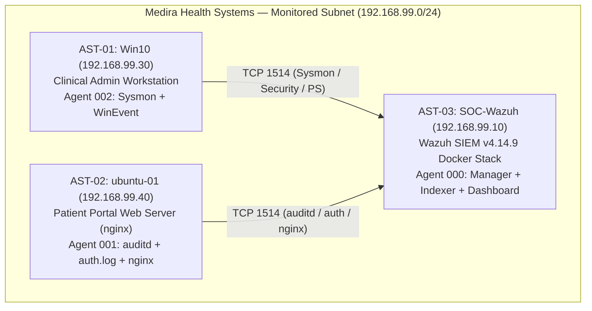

# Sub-task 2.1 — Organization Profile & Cyber Risk Register (4 pts)

## 1. Organization Profile: Medira Health Systems

| Attribute | Details |
| :--- | :--- |
| **Organization Name** | **Medira Health Systems** (Fictional Healthcare & Diagnostic Provider) |
| **Headquarters & Headcount** | Riyadh, Saudi Arabia — 220 employees (140 clinical/diagnostic staff, 55 administrative/billing staff, 15 IT/engineering, 10 executive/legal) |
| **Business Mission** | Operates three outpatient diagnostic imaging clinics and a 24/7 online patient results portal serving ~45,000 patients/year. |
| **Regulatory & Compliance Scope** | Saudi Personal Data Protection Law (**PDPL**), NCA Essential Cybersecurity Controls (**ECC-1:2018**), and **HIPAA** Security Rule for clinical partner integrations. |
| **SOC Operating Model** | Co-managed internal Tier-1/Tier-2 SOC monitoring endpoints and servers via **Wazuh SIEM v4.14.9** (`SOC-Wazuh`, `192.168.99.10`). |

---

## 2. Crown Jewels & Lab-Mapped Asset Inventory

Every critical asset in Medira Health Systems' production environment is represented directly in our live `192.168.99.0/24` (`VMnet1`) SOC lab:

| Asset ID | Lab Hostname & IP | Organizational Role | Data Sensitivity | Wazuh Agent & Telemetry |
| :--- | :--- | :--- | :--- | :--- |
| `AST-01` | **`Win10`** (`192.168.99.30`) | Clinical Administration & Billing Workstation (`WIN10\soc`) | **High** (PII/PHI access, domain/local admin credentials) | Agent `002` — Windows Security, System, PowerShell `4104`, Sysmon `v15.15` (Event IDs 1, 10, 11, 13) |
| `AST-02` | **`ubuntu-01`** (`192.168.99.40`) | Patient Portal Web Server (`nginx`) & Clinical Batch Scheduler (`cron`) | **Critical** (Patient portal web tier & backend SSH access) | Agent `001` — Linux `auditd` (`Neo23x0` + custom rules), `/var/log/auth.log`, `/var/log/nginx/access.log` & `error.log` |
| `AST-03` | **`SOC-Wazuh`** (`192.168.99.10`) | Central SIEM & Log Archive (`wazuh.manager`, `wazuh.indexer`, `wazuh.dashboard`) | **Critical** (Forensic audit trail & security visibility) | Agent `000` — Docker single-node stack (`HTTPS 443`, `TCP 1514/1515`) |
| `AST-04` | **Identity & Admin Accounts** (`WIN10\soc`, `ubuntu-01/kali`) | Privileged IT & Clinical Operations Accounts | **Critical** (Full administrative control over endpoints) | Monitored via Rules `100007`, `100200`, `100201`, `100202`, `100204` |

---

## 3. Twelve-Row Cyber Risk Register (RSK-01 to RSK-12) (Mapped to ATT&CK v19 & Capstone Rules)

*Scoring scale: Likelihood (1–5) × Impact (1–5) = Inherent Risk Score (1–25).*

| Risk ID | Threat Scenario & Asset at Risk | MITRE ATT&CK v19 Technique(s) | Likelihood (1–5) | Impact (1–5) | Score (L×I) | Mapped Wazuh Detection Rule(s) | Preventive / Compensating Control & Residual Risk |
| :--- | :--- | :--- | :---: | :---: | :---: | :--- | :--- |
| **`RSK-01`** | **Credential Dumping & Pre-Ransomware Staging on Clinical Workstations (`Win10`)**: Attacker executes encoded PowerShell, pulls tools via LOLBins, and dumps `lsass.exe` to harvest admin hashes. | `T1059.001`, `T1105`, `T1003.001`, `T1218.011` | 4 | 5 | **20 (Critical)** | **`100005`** (Lvl 10) **`100013`** (Lvl 10) **`100205`** (Lvl 9) **`100201`** (Lvl 14) | Windows 11 `RunAsPPL` on `lsass.exe`, Defender exclusions audit, WDAC LOLBin blocks, P1 host isolation (`PB-01`). **Residual: Medium (8)** |
| **`RSK-02`** | **Password Brute Force Followed by Compromised Admin Logon & RDP Lateral Movement (`Win10`)**: Credential stuffing or brute force against `WIN10\soc` leading to interactive RDP takeover. | `T1110`, `T1078`, `T1021.001` | 5 | 4 | **20 (Critical)** | **`100007`** (Lvl 10) **`100200`** (Lvl 13) **`100204`** (Lvl 8) | Account lockout policy (5 attempts / 15 min), NLA + MFA on RDP, host firewall jump-box restriction (`PB-02`). **Residual: Medium (6)** |
| **`RSK-03`** | **Linux Patient Portal Persistence via SSH Keys & Cron Jobs (`ubuntu-01`)**: Attacker modifies `~/.ssh/authorized_keys` or installs rogue `crontab` entries to maintain stealthy root/user access. | `T1098.004`, `T1053.003` | 3 | 5 | **15 (High)** | **`100202`** (Lvl 10) **`100203`** (Lvl 8) | `auditd` immutable watches on `.ssh/authorized_keys` and `/usr/bin/crontab`, `cron.allow` allowlisting (`PB-03`). **Residual: Low (5)** |
| **`RSK-04`** | **Anti-Forensics / Defense Impairment via Windows Event Log Clearing (`Win10`)**: Attacker clears `Security` (`1102`) or `System` (`104`) logs after privilege escalation to destroy local evidence. | `T1685.005` (`TA0112` Defense Impairment) | 4 | 4 | **16 (High)** | **`100207`** (Lvl 12) | Sub-second (`< 0.6s`) real-time log streaming to off-host `SOC-Wazuh` (`192.168.99.10`) + SHA-256 evidence hashing. **Residual: Low (4)** |
| **`RSK-05`** | **Workstation Autostart Persistence via Registry `Run`/`RunOnce` Keys (`Win10`)**: Malware registers autostart values under `CurrentVersion\Run` to survive reboots on clinical workstations. | `T1547.001` | 4 | 3 | **12 (Medium)** | **`100206`** (Lvl 9) | Sysmon Event ID 13 registry monitoring + GPO restriction on user-writable autostart paths (`PB-02`). **Residual: Low (4)** |

| **`RSK-06`** | **System Binary Proxy Execution (`rundll32.exe`) Bypassing Application Controls (`Win10`)**: Attacker uses `rundll32.exe` with `url.dll` / `comsvcs.dll` to proxy payload execution (`TA0005` Stealth). | `T1218.011` | 4 | 3 | **12 (Medium)** | **`100205`** (Lvl 9) | Owner: Windows Infra Lead. Action: WDAC signed-DLL policy + Sysmon EID 1 monitoring. **Residual: Low (4)** |
| **`RSK-07`** | **Linux Scheduled Task Persistence via User Crontab (`ubuntu-01`)**: Attacker registers recurring reverse shell or beacon via `/usr/bin/crontab`. | `T1053.003` | 3 | 4 | **12 (Medium)** | **`100203`** (Lvl 8) | Owner: Linux Platform Owner. Action: Restrict `/etc/cron.allow` to `root` only. **Residual: Low (3)** |
| **`RSK-08`** | **Web Application Reconnaissance & Exploit Scanning on Patient Portal (`ubuntu-01`)**: Automated scanners probing `/var/log/nginx/access.log` for vulnerable endpoints (`404`/`500` bursts). | `T1190`, `T1595.002` | 5 | 3 | **15 (High)** | Built-in **`31101` / `31104` / `31108`** (`nginx` decoder) | Owner: Linux Platform Owner. Action: Rate-limiting in `nginx` + WAF rules. **Residual: Low (5)** |
| **`RSK-09`** | **Active Directory Kerberoasting of Service Accounts (`T1558.003`)**: Attacker requests RC4 TGS tickets (`Event 4769` `0x17`) to crack service passwords offline. | `T1558.003` | 3 | 5 | **15 (High)** | **No Coverage in Part 1** *(Documented in `GAP_NOTE.md`)* | Owner: Windows Infra Lead. Action: Enforce AES-256 Kerberos encryption, 25+ char gMSA passwords, onboard `Event 4769` in 60-day roadmap. **Residual: Medium (9)** |
| **`RSK-10`** | **Ransomware Mass File Encryption on Clinical Workstations & Shares (`T1486`)**: Post-compromise encryption of diagnostic imaging files causing clinical downtime. | `T1486` | 3 | 5 | **15 (High)** | Pre-encryption stages caught by **`100005`, `100013`, `100201`, `100207`** (No direct file-rename rule) | Owner: CISO & Backup Lead. Action: Immutable offline backups (RPO 4h, RTO 2h) + pre-ransomware P1 isolation (`PB-01`). **Residual: Medium (6)** |
| **`RSK-11`** | **DNS Tunneling / C2 Exfiltration Over Port 53 (`T1071.004`)**: Patient PHI exfiltrated via high-entropy DNS TXT/A queries bypassing HTTP inspection. | `T1071.004`, `T1048` | 2 | 5 | **10 (Medium)** | **No Custom Rule** (Sysmon EID 22 logged) | Owner: Network Lead. Action: Restrict recursive DNS to internal forwarders with RPZ sinkholing. **Residual: Low (4)** |
| **`RSK-12`** | **SIEM Single-Node Outage or Tampering (`SOC-Wazuh` `192.168.99.10`)**: Loss of Docker host disk or container crash pausing real-time alert evaluation. | `T1562.001` | 2 | 4 | **8 (Medium)** | Internal Agent `000` health & disk monitors (`530`/`1002`) | Owner: SOC Manager. Action: Daily off-host snapshot of `wazuh-alerts-*` + LVM expansion (78 GB root verified). **Residual: Low (2)** |

---

## 4. Maximum Tolerable Downtime (MTD), RTO & RPO Thresholds

| Business Service / Asset | Maximum Tolerable Downtime (MTD) | Recovery Time Objective (RTO) | Recovery Point Objective (RPO) | Operational Impact if Exceeded |
| :--- | :---: | :---: | :---: | :--- |
| **Patient Portal Web Server (`ubuntu-01` `192.168.99.40`)** | **4 hours** | **1 hour** | **15 minutes** | Referring physicians and patients cannot retrieve diagnostic reports; SLA penalty after 4h. |
| **Clinical Admin Workstation (`Win10` `192.168.99.30`)** | **2 hours** | **30 minutes** | **4 hours** | Delays patient check-in and billing; fail over to secondary workstation if isolated for IR. |
| **Central SIEM (`SOC-Wazuh` `192.168.99.10`)** | **1 hour** | **15 minutes** | **0 minutes** (Agents buffer locally) | Temporary loss of real-time SOC visibility; Wazuh agents buffer events locally until reconnect. |

---

## 5. Deep-Dive Explanation of the Top 3 Risks (`RSK-01`, `RSK-02`, `RSK-04`)

1. **`RSK-01` (Score 20 — Credential Dumping & Pre-Ransomware Staging on `Win10`)**:
   - *Why It Ranks #1*: In healthcare environments, workstation compromise followed by `lsass.exe` credential harvesting (`T1003.001`) is the primary precursor to domain-wide ransomware. We mitigate this with four overlapping detections (`100005` PowerShell, `100013` LOLBin, `100205` `rundll32`, and `100201` LSASS access) plus Windows 11 `RunAsPPL`.
2. **`RSK-02` (Score 20 — Password Brute Force to Interactive RDP Compromise on `Win10`)**:
   - *Why It Ranks #2*: Administrative accounts exposed to SMB/RDP password guessing (`T1110`) allow attackers to log in interactively with valid credentials (`T1078`). Our correlation rule (`100007` -> `100200`) and RDP rule (`100204`) elevate this immediately to P1.
3. **`RSK-04` (Score 16 — Defense Impairment via Windows Event Log Clearing `Event 1102`)**:
   - *Why It Ranks #3*: Attackers routinely run `wevtutil cl Security` (`T1685.005`) after dumping credentials to blind local forensic investigators and fail PDPL/HIPAA audit requirements. Sub-second (`0.57s`) streaming to `SOC-Wazuh` plus Rule `100207` ensures pre-wipe logs are preserved off-host.
