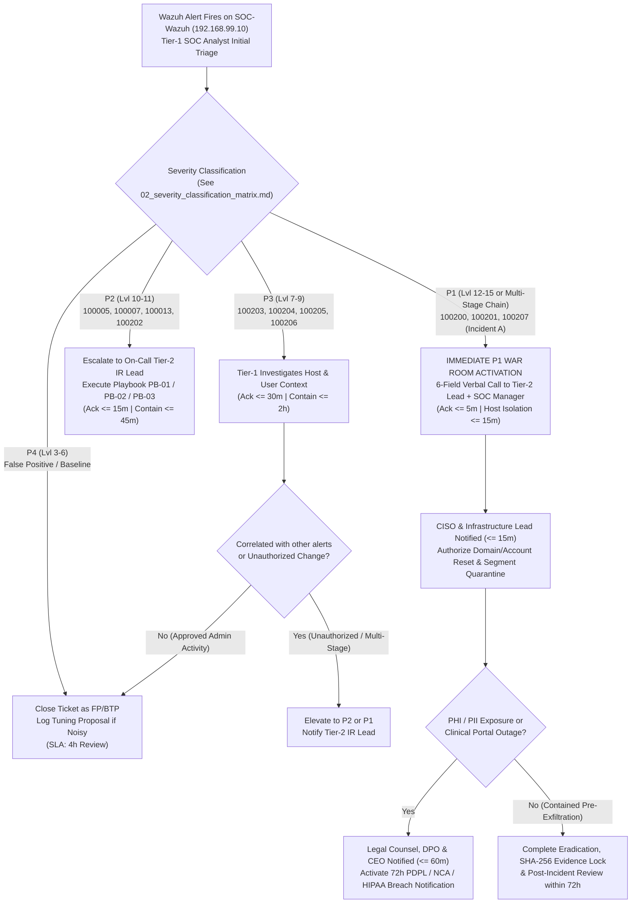

# Sub-task 2.3 — Escalation Tree & 24/7 Contact Roster (4 pts)

## 1. Visual Incident Escalation Tree (Mermaid Flowchart)

---

## 2. 24/7 Incident Response Contact Roster

| Role | Primary Contact | Backup Contact | Primary Channel | Out-of-Band (OOB) Channel *(if Corp IT/Email Compromised)* | Notification Trigger & SLA |
| :--- | :--- | :--- | :--- | :--- | :--- |
| **Tier-1 SOC Analyst (24/7 Shift)** | Shift Analyst Alpha (`soc-t1@medira.health`) | Shift Analyst Bravo (`soc-t1-backup@medira.health`) | Wazuh Dashboard + Jira SOC Queue | Signal Group: `Medira-IR-Ops` (`+966-50-555-0101`) | All alerts (`P1 <= 5m`, `P2 <= 15m`, `P3 <= 30m`) |
| **Tier-2 Incident Response Lead** | Tariq Al-Harbi (`t.alharbi@medira.health`) | Sara Al-Qahtani (`s.alqahtani@medira.health`) | Voice Call + Slack `#soc-ir-warroom` | Personal Mobile / Signal (`+966-50-555-0102` / `0103`) | All **P1** (`<= 5m` voice call) and **P2** (`<= 15m`) |
| **SOC Manager** | Majed Al-Otaibi (`m.alotaibi@medira.health`) | Tariq Al-Harbi (Acting) | Voice Call + PagerDuty | Signal (`+966-50-555-0104`) | All **P1** (`<= 10m`) or any **P2** exceeding 45m containment SLA |
| **Chief Information Security Officer (CISO)** | Dr. Layla Al-Mansoor (`ciso@medira.health`) | Majed Al-Otaibi (Deputy) | Voice Call | Signal (`+966-50-555-0105`) | All **P1** (`<= 15m`), regulatory events, or clinical downtime |
| **Windows / AD Infrastructure Lead (`Win10`)** | Fahad Al-Dossary (`f.aldossary@medira.health`) | Omar Al-Zahrani (`o.alzahrani@medira.health`) | Slack `#infra-oncall` + Voice | Signal (`+966-50-555-0106`) | Host isolation / GPO / account lockout on `Win10` (`192.168.99.30`) |
| **Linux & Cloud Platform Owner (`ubuntu-01`)** | Nadia Siddiqui (`n.siddiqui@medira.health`) | Kareem Hassan (`k.hassan@medira.health`) | Slack `#platform-oncall` + Voice | Signal (`+966-50-555-0107`) | SSH / `cron` / `nginx` compromise on `ubuntu-01` (`192.168.99.40`) |
| **General Counsel & Data Protection Officer (DPO)** | Advisor Khalid Al-Sudairi (`dpo@medira.health`) | External Privacy Counsel (`ir-legal@lexhealth.sa`) | Encrypted Email / Voice | Signal (`+966-50-555-0108`) | Any confirmed/suspected PHI/PII access within **60 minutes** (72h PDPL clock) |
| **CEO & Medical Director (Executive Crisis)** | Dr. Nasser Al-Ghamdi (`ceo@medira.health`) | COO Office (`coo@medira.health`) | Direct CISO Phone Briefing | Signal (`+966-50-555-0109`) | Confirmed **P1** affecting clinical operations or public reputation (`<= 60m`) |

---

## 3. Business-Hours vs. Out-of-Hours Call Order & No-Answer Fallback Policy

| Time Window | Step 1 (T+00m) | Step 2 — 10-Min No-Answer Fallback (T+10m) | Step 3 — 20-Min Escalation (T+20m) |
| :--- | :--- | :--- | :--- |
| **Business Hours** (`Sun–Thu, 08:00–17:00 AST`) | On-Shift Tier-1 Analyst places **6-Field Call** to Primary Tier-2 IR Lead (`Tariq Al-Harbi`, `+966-50-555-0102`) + posts in Slack `#soc-ir-warroom`. | If no answer within **10 minutes**, call Backup Tier-2 Lead (`Sara Al-Qahtani`, `+966-50-555-0103`) AND SOC Manager (`Majed Al-Otaibi`, `+966-50-555-0104`). | If unacknowledged at **20 minutes**, page CISO (`Dr. Layla Al-Mansoor`, `+966-50-555-0105`) via Signal OOB channel and initiate host quarantine autonomously. |
| **Out of Hours / Weekends / Holidays** (`17:00–08:00 AST, Fri–Sat`) | On-Shift Tier-1 Analyst triggers PagerDuty High-Urgency Push + direct mobile voice call to On-Call Tier-2 Duty Officer (`+966-50-555-0102`). | If no answer within **10 minutes** (2 voice attempts, 5 minutes apart), call Backup Tier-2 Duty Officer (`+966-50-555-0103`) and SOC Manager (`+966-50-555-0104`). | At **15 minutes** for P1 incidents, call CISO directly (`+966-50-555-0105`) and execute pre-authorized firewall isolation (`Playbook PB-01`/`PB-02`). |

---

## 4. External Parties, Vendors & National Regulatory Reporting Requirements

| External Entity | Contact / Portal | Trigger Condition | Mandatory Reporting Deadline & Requirement |
| :--- | :--- | :--- | :--- |
| **Saudi Data & AI Authority (SDAIA — PDPL Regulator)** | National Data Governance Platform (`dgp.sdaia.gov.sa`) — Submitted by DPO (`Khalid Al-Sudairi`) | Any breach involving unauthorized access, disclosure, or destruction of Personal Data / Patient PHI. | **≤ 72 hours** of detection (Saudi PDPL Article 20 & Implementing Regulations); Affected data subjects notified "without undue delay" if high risk. |
| **National Cybersecurity Authority (NCA — Saudi CERT)** | NCA National Operations Portal (`nca.gov.sa` / `cert.gov.sa`) — Submitted by CISO | Critical cybersecurity incident (P1) affecting healthcare sector operations or critical infrastructure controls (ECC-1:2018). | **≤ 24 hours** initial flash notification for critical sector incidents; follow-up technical report within 72 hours. |
| **Ministry of Health (MOH) Healthcare Cyber Center** | `moh-cert@moh.gov.sa` | Any incident threatening clinical diagnostic availability or hospital EHR interconnectivity. | **≤ 24 hours** if clinical operations or external lab integrations are degraded. |
| **Law Enforcement (Presidency of State Security / Cybercrime Unit)** | Official Legal Filing via General Counsel | Confirmed criminal extortion, ransomware demand, or nation-state intrusion. | Filed upon CEO + General Counsel authorization after forensic hash preservation (`SHA256SUMS.txt`). |
| **External IR Retainer & SIEM Vendor Support** | Wazuh / Cloud Managed IR Retainer (`ir-emergency@cyberdefense.sa`) | P1 incident exceeding internal Tier-2 capacity or requiring full memory/disk malware reverse engineering. | **4-hour** contractual SLA response upon SOC Manager / CISO activation. |
