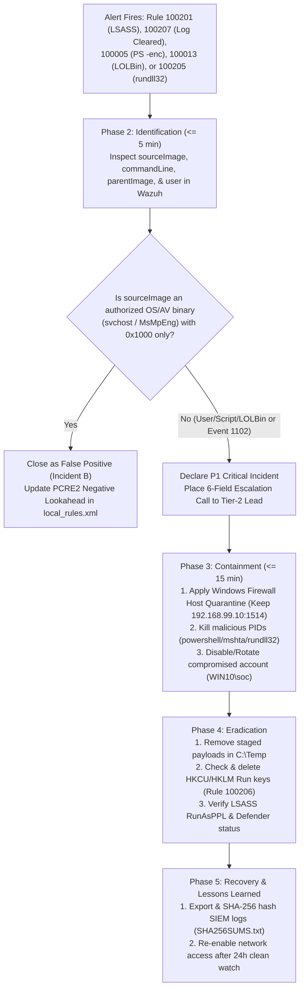
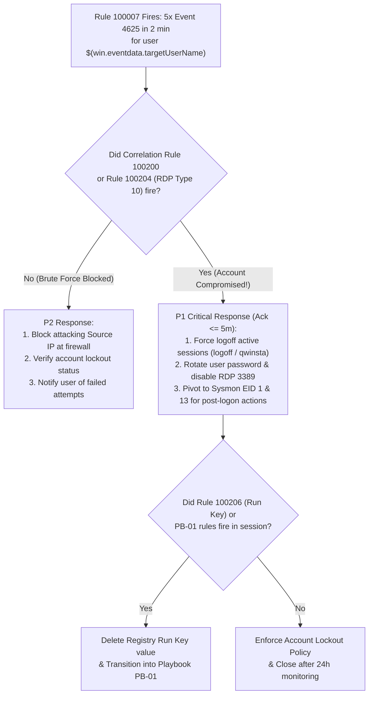
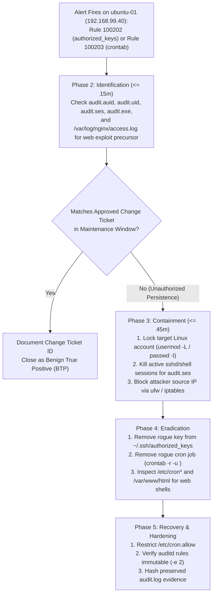

# Sub-task 2.4 — Incident Response Playbooks & Chain of Custody (10 pts)

This document contains **three production-tested Incident Response Playbooks** directly mapped to our live Wazuh Rule Pack (`100005`–`100207`) and lab endpoints (`Win10` `192.168.99.30` and `ubuntu-01` `192.168.99.40`), followed by a completed **Chain-of-Custody Form** for Incident A (`SOC-2026-INC-A01`).

---

## Playbook 1 (`PB-01`): Windows Credential Dumping, Malicious Scripting & Defense Impairment
- **Triggering Wazuh Rules**:
  - **`100201`** (Level 14, P1): `T1003.001` LSASS process memory access (`Sysmon Event 10`)
  - **`100207`** (Level 12, P1): `T1685.005` Security (`1102`) or System (`104`) event log cleared
  - **`100005`** (Level 10, P2): `T1059.001` PowerShell encoded command / download cradle (`Sysmon Event 1`)
  - **`100013`** (Level 10, P2): `T1105` LOLBin file download via `certutil` / `bitsadmin` / `mshta` / `regsvr32` (`Sysmon Event 1`)
  - **`100205`** (Level 9, P3): `T1218.011` `rundll32.exe` proxy execution (`Sysmon Event 1`)
- **Target Asset Scope**: `Win10` (`192.168.99.30`, Wazuh Agent `002`)
- **SLA**: Acknowledge **≤ 5 min** | Host Containment **≤ 15 min**

### PB-01 Decision Flowchart


### PB-01 Six-Phase Execution Procedure
1. **Phase 1 — Preparation**:
   - Ensure Sysmon v15.15 (`Microsoft-Windows-Sysmon/Operational`) and PowerShell ScriptBlock Logging (`4104`) are forwarded to `SOC-Wazuh` (`192.168.99.10:1514`).
   - Verify Windows 11 `RunAsPPL` (`HKLM\SYSTEM\CurrentControlSet\Control\Lsa\RunAsPPL = 1`) is enabled to block unprivileged `PROCESS_VM_READ` against `lsass.exe`.
2. **Phase 2 — Identification / Detection (≤ 5 min)**:
   - Query Wazuh Discover (`wazuh-alerts-*`):
     `agent.name:"Win10" AND rule.id:(100005 OR 100013 OR 100201 OR 100205 OR 100207)`
   - Decode any Base64 `-enc` payload (`[Text.Encoding]::Unicode.GetString([Convert]::FromBase64String("..."))`).
   - Check `win.eventdata.sourceImage` and `win.eventdata.grantedAccess` on Rule `100201`.
3. **Phase 3 — Containment (≤ 15 min)**:
   - Isolate `Win10` (`192.168.99.30`) from peer subnets while keeping SIEM telemetry (`192.168.99.10:1514`) and SOC SSH (`22`) open:
     ```powershell
     New-NetFirewallRule -DisplayName "SOC-Quarantine-Block-Lateral-Out" -Direction Outbound -RemoteAddress 192.168.99.40 -Action Block
     New-NetFirewallRule -DisplayName "SOC-Quarantine-Block-RDP-In" -Direction Inbound -LocalPort 3389 -Protocol TCP -Action Block
     Get-Process mshta,CalculatorApp,calc -ErrorAction SilentlyContinue | Stop-Process -Force
     ```
4. **Phase 4 — Eradication**:
   - Delete downloaded staging artifacts (`Remove-Item C:\Temp\*.txt, C:\Temp\*.dmp -Force`).
   - Audit and remove any Registry `Run`/`RunOnce` persistence entries (`reg query HKCU\Software\Microsoft\Windows\CurrentVersion\Run`).
   - Reset the password of `WIN10\soc` and revoke cached Kerberos/NTLM sessions (`klist purge`).
5. **Phase 5 — Recovery**:
   - Verify `Sysmon64` and `WazuhSvc` services are `Running` (`Get-Service Sysmon64, WazuhSvc`).
   - Remove quarantine firewall rules (`Remove-NetFirewallRule -DisplayName "SOC-Quarantine-*"`) after Tier-2 sign-off.
6. **Phase 6 — Lessons Learned**:
   - Document any false-positive exclusions (`svchost.exe`, `CompatTelRunner.exe`, `MsMpEng.exe`) in `TUNING_REPORT.md` and update `SHA256SUMS.txt`.

---

## Playbook 2 (`PB-02`): Brute-Force Attack, Account Takeover & Lateral Movement
- **Triggering Wazuh Rules**:
  - **`100007`** (Level 10, P2): `T1110` 5 failed Windows logons (`Event 4625`) for the same user within 2 minutes
  - **`100200`** (Level 13, P1 Correlation): `T1110` + `T1078` Successful logon (`Event 4624`) within 5 minutes of Rule `100007`
  - **`100204`** (Level 8, P3/P2): `T1021.001` Remote Desktop (`LogonType 10`) from non-local IP
  - **`100206`** (Level 9, P3/P2): `T1547.001` Registry `Run` / `RunOnce` persistence (`Sysmon Event 13`)
- **Target Asset Scope**: `Win10` (`192.168.99.30`, Wazuh Agent `002`)
- **SLA**: Acknowledge **≤ 15 min** (`100007`) / **≤ 5 min** (`100200`) | Containment **≤ 15 min** (`100200`)

### PB-02 Decision Flowchart


### PB-02 Six-Phase Execution Procedure
1. **Phase 1 — Preparation**:
   - Configure Windows Advanced Audit Policy (`Audit Logon` = Success and Failure) and ensure `0580-win-security_rules.xml` + `local_rules.xml` are active.
2. **Phase 2 — Identification / Detection**:
   - Check `data.win.eventdata.targetUserName`, `data.win.eventdata.ipAddress`, `data.win.eventdata.logonType`, and `data.win.eventdata.subStatus` (`0xc000006a` = bad password; `0xc0000064` = non-existent user).
   - Enumerate active interactive/RDP sessions on `Win10`: `qwinsta` / `quser`.
3. **Phase 3 — Containment**:
   - Force-terminate unauthorized interactive/RDP sessions and lock the compromised account:
     ```powershell
     qwinsta
     logoff 1
     logoff 2
     New-NetFirewallRule -DisplayName "SOC-Block-Attacker-IP" -Direction Inbound -RemoteAddress 192.168.99.40 -Action Block
     ```
4. **Phase 4 — Eradication**:
   - Remove any Registry persistence created during the session:
     ```powershell
     reg.exe delete "HKCU\Software\Microsoft\Windows\CurrentVersion\Run" /v T /f
     ```
   - Rotate the user's password (`net user soc <NewStrongPassword>`).
5. **Phase 5 — Recovery**:
   - Configure OS-level account lockout threshold (`net accounts /lockoutthreshold:5 /lockoutduration:15 /lockoutwindow:15`) so future brute-force bursts lock at the OS level before password exhaustion.
6. **Phase 6 — Lessons Learned**:
   - Note that reconnecting over RDP to an already-logged-in console session on Windows 11 logs NLA (`LogonType 3`) + `Event 4778` rather than a fresh `LogonType 10` (`4624`); include `Event 4778` in Tier-2 hunting queries.

---

## Playbook 3 (`PB-03`): Linux Web Server Compromise & Persistence (`authorized_keys` / `cron`)
- **Triggering Wazuh Rules**:
  - **`100202`** (Level 10, P2): `T1098.004` Write to SSH `authorized_keys` (`auditd` watch `ssh_authorized_keys`)
  - **`100203`** (Level 8, P3/P2 on `ubuntu-01`): `T1053.003` Execution of `/usr/bin/crontab` (`auditd` `SYSCALL=59`)
  - Correlated `nginx` access/error log alerts (`31101` / `31108`) on `/var/log/nginx/access.log`
- **Target Asset Scope**: `ubuntu-01` (`192.168.99.40`, Wazuh Agent `001`, Patient Portal Server)
- **SLA**: Acknowledge **≤ 15 min** | Containment **≤ 45 min**

### PB-03 Decision Flowchart


### PB-03 Six-Phase Execution Procedure
1. **Phase 1 — Preparation**:
   - Ensure `/etc/audit/rules.d/10-soc-capstone.rules` monitors `/home/kali/.ssh/authorized_keys`, `/root/.ssh/authorized_keys`, and `/usr/bin/crontab`, and `/var/log/nginx/access.log` is ingested by `wazuh-agent`.
2. **Phase 2 — Identification / Detection**:
   - Inspect `data.audit.auid` (original login UID across `sudo`), `data.audit.uid`, `data.audit.exe`, and `data.audit.file.name`.
   - Inspect `/home/kali/.ssh/authorized_keys` and `/var/spool/cron/crontabs/` on `ubuntu-01`:
     ```bash
     sudo cat /home/kali/.ssh/authorized_keys
     sudo ls -la /var/spool/cron/crontabs/
     sudo crontab -u soc -l
     ```
3. **Phase 3 — Containment**:
   - Lock the targeted account and terminate unauthorized sessions:
     ```bash
     sudo passwd -l kali
     sudo pkill -u kali
     ```
4. **Phase 4 — Eradication**:
   - Purge unauthorized SSH keys and remove rogue crontabs:
     ```bash
     sudo truncate -s 0 /home/kali/.ssh/authorized_keys
     sudo crontab -u soc -r
     ```
5. **Phase 5 — Recovery**:
   - Verify `nginx` web root integrity (`sha256sum /var/www/html/*`), unlock account after key rotation, and confirm `auditctl -l` rules are active.
6. **Phase 6 — Lessons Learned**:
   - Enforce `/etc/cron.allow` so only `root` can register scheduled tasks on `ubuntu-01`.

---

## 4. Completed Forensic Chain-of-Custody Form (Incident A — `SOC-2026-INC-A01`)

| Evidence Item # | File / Artifact Path | Source Host & IP | Collection Timestamp (UTC) | SHA-256 Cryptographic Hash (Verified in `evidence/SHA256SUMS.txt`) | Collected By | Storage Location |
| :---: | :--- | :--- | :--- | :--- | :--- | :--- |
| **EV-01** | `evidence/alerts_evidence.json` | `SOC-Wazuh` (`192.168.99.10`) | `2026-10-19T18:56:29Z` | `be4fa9fac0a32b969d5bfa4e0b4ad49b945a9f8c48a8c390f6996dff4712ebab` | Tier-1 SOC Analyst | Immutable Git Evidence Vault |
| **EV-02** | `evidence/PIPELINE_PROOF.md` | `SOC-Wazuh` (`192.168.99.10`) | `2026-10-19T18:57:31Z` | `70981b656a46824a12760bee6bfecd2146d9fafd9b8002e5c368595fb973ae35` | Tier-1 SOC Analyst | Immutable Git Evidence Vault |
| **EV-03** | `evidence/RULE_EVIDENCE_SUMMARY.md` | `SOC-Wazuh` (`192.168.99.10`) | `2026-10-19T18:57:31Z` | `b948927554b533399a3ab485c3b4ab25b5960f1fe3b531601ff1b1d0991de03e` | Tier-1 SOC Analyst | Immutable Git Evidence Vault |
| **EV-04** | `detections/wazuh/local_rules.xml` | `SOC-Wazuh` (`192.168.99.10`) | `2026-10-19T18:54:15Z` | `6cc6cde4f3f0c099836f23e510a0cfda6124ff75b73866e180bbf290c86299ff` | Tier-1 SOC Analyst | Immutable Git Evidence Vault |
| **EV-05** | `triage/INCIDENT_A_REPORT.md` | Analyst Workstation (`192.168.99.1`) | `2026-10-19T19:03:20Z` | `016ddbc409903f5696959487d572164ed3968fab798952a815e594e49f624878` | Tier-1 SOC Analyst | Immutable Git Evidence Vault |
